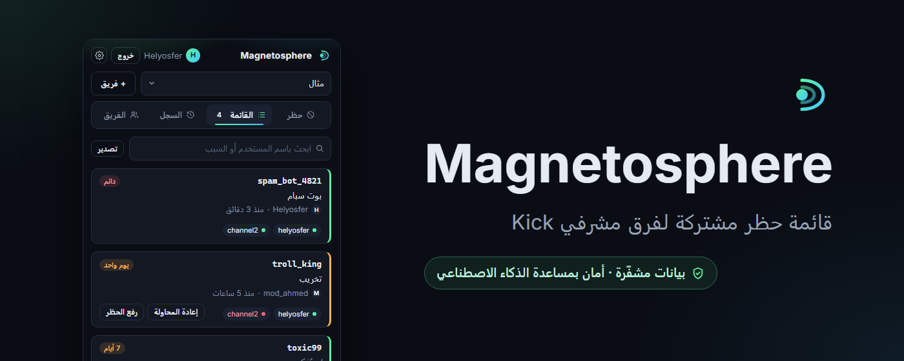
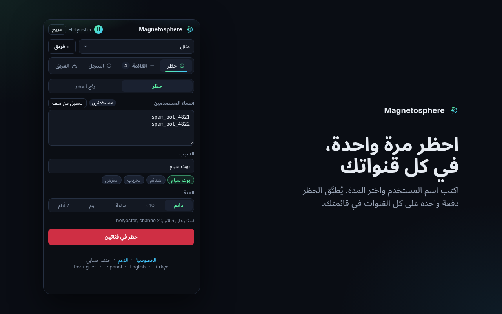
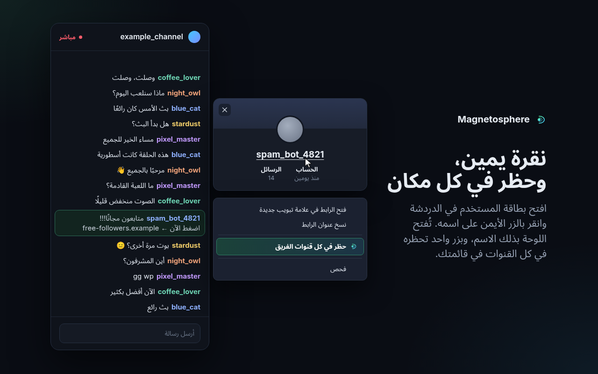
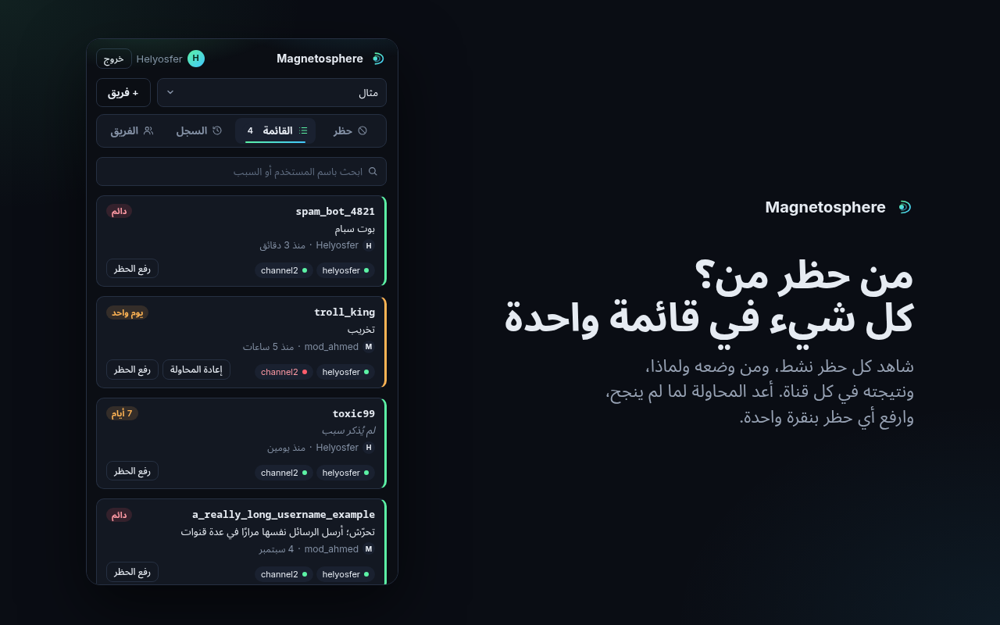
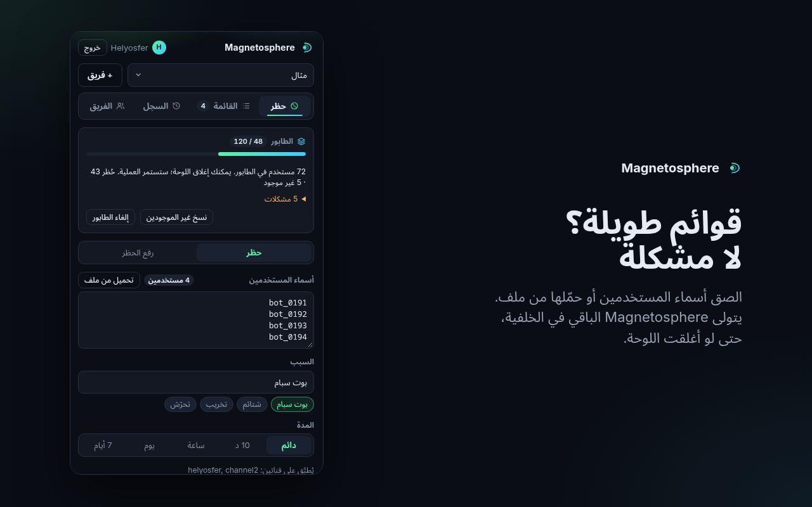
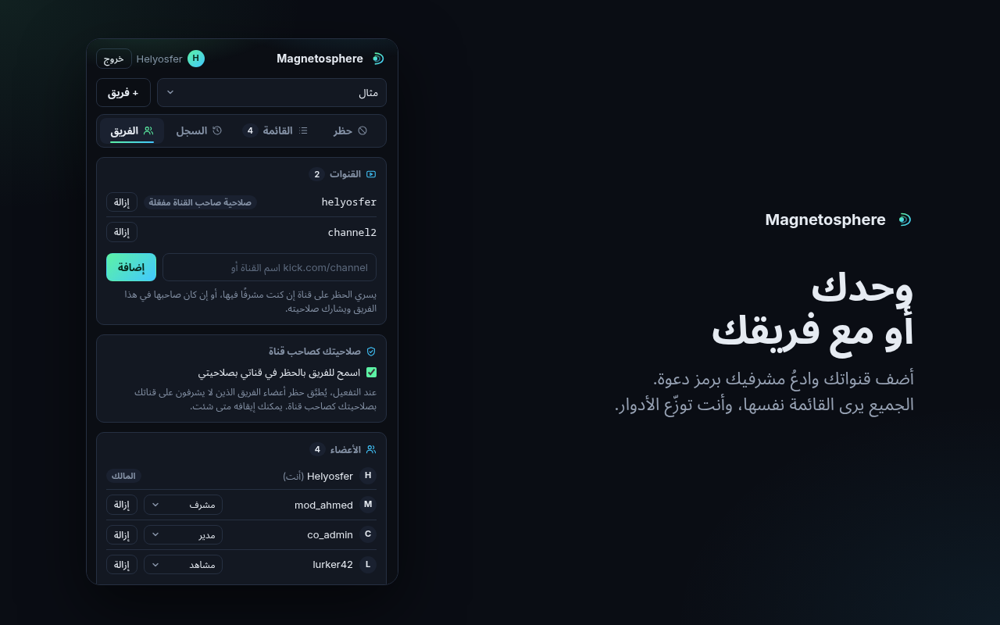
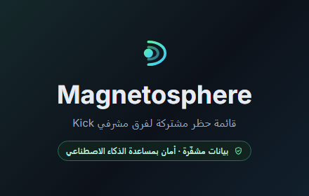

<div align="center">

<sub>[Türkçe](README.md) · [English](README.en.md) · [Español](README.es.md) · [Português (Brasil)](README.pt-BR.md) · [العربية](README.ar.md) · [Deutsch](README.de.md) · [Français](README.fr.md) · [Bahasa Indonesia](README.id.md) · [Русский](README.ru.md)</sub>



**قائمة حظر مشتركة لمشرفي Kick وفرق الإشراف.**<br>
احظر المستخدم في كل القنوات التي تشرف عليها بخطوة واحدة.

[](https://chromewebstore.google.com/detail/magnetosphere/kjbbjooackbcfeeoolkfpmdbkomjiflh)
[](LICENSE)


[لقطات الشاشة](#لقطات-الشاشة) ·
[الميزات](#الميزات) ·
[البدء](#البدء) ·
[الأدوار](#الأدوار-والصلاحيات) ·
[كيف يعمل](#كيف-يعمل) ·
[خادمك الخاص](#تشغيل-خادمك-الخاص) ·
[الأمان](#الأمان) ·
[التطوير](#التطوير)

</div>

<br>

<div dir="rtl">

إن كنت تشرف على أكثر من قناة، فعليك أن تحظر المتصيّد أو بوت السبام في كل قناة على حدة. يختصر Magnetosphere ذلك في
خطوة واحدة: تكتب اسم المستخدم مرة واحدة (أو تحمّل آلاف الأسماء من ملف)، فيُطبَّق الحظر على كل القنوات في قائمتك.
كما يُسجَّل من حظر من، ومتى، ولماذا.

يمكنك استخدامه **بمفردك**: تضيف القنوات التي تشرف عليها وتحظر من دون دعوة أحد.
أما إذا استخدمته **مع فريق** فستحصل على ما يلي أيضًا:

- يرى الجميع قائمة الحظر نفسها.
- الحظر الذي يضعه أحد الأعضاء يُطبَّق على كل قنوات الفريق.
- إذا شارك أحد أصحاب القنوات في الفريق صلاحيته، فإن حظر الأعضاء غير المشرفين على تلك القناة يسري فيها أيضًا.

اسمه مأخوذ من الدرع المغناطيسي (المجال المغناطيسي للأرض) الذي يحمي كوكبنا من الرياح الشمسية.

> Magnetosphere مشروع مستقل؛ وهو غير مرتبط بـ Kick ولم تعتمده Kick.

## لقطات الشاشة

| | |
|:-:|:-:|
|  |  |
| **حظر:** اكتب الأسماء واختر السبب والمدة؛ يُطبَّق الحظر على كل القنوات دفعة واحدة. | **النقر الأيمن:** افتح بطاقة المستخدم في الدردشة وانقر بزر الفأرة الأيمن على اسمه؛ تُفتح اللوحة بهذا الاسم. |
|  |  |
| **القائمة:** الحظر النشط؛ من حظر من ولماذا، وفي أي القنوات طُبِّق الحظر. | **الطابور:** تُعالَج آلاف الأسماء في الخلفية؛ وتستمر العملية حتى لو أُغلقت اللوحة. |
|  | |
| **الفريق:** القنوات، ومشاركة صلاحية صاحب القناة، والأعضاء وأدوارهم. | |

## الميزات

| | |
|---|---|
| **حظر في عدة قنوات دفعة واحدة** | حظر دائم أو إيقاف مؤقت لمدة 10 دقائق أو ساعة أو يوم أو 7 أيام؛ يُطبَّق على كل القنوات في الوقت نفسه. |
| **اختيار القنوات** | عندما يضم الفريق أكثر من قناة، تُختار القنوات في عمليتي **حظر** و**رفع الحظر**: **الكل**، أو **قناتي فقط**، أو القنوات التي تحددها عبر **اختيار…**. يسري الاختيار على تلك العملية وحدها، وبعد تنفيذها يعود إلى **الكل**. إذا رفعت الحظر من بعض القنوات فقط، يبقى السجل نشطًا في القنوات التي ما زال الحظر فيها قائمًا؛ وتظهر القناة التي رُفع عنها الحظر باللون الرمادي في البطاقة، ولن تعيد **إعادة المحاولة** حظره فيها. ولأن رفع الحظر في قناة لست مشرفًا فيها يُعطي خطأ، فإن اختيار القنوات التي تملك فيها الصلاحية فقط يمنحك نتيجة نظيفة. في القوائم الطويلة تُثبَّت القنوات لحظة دخول العملية إلى الطابور: القناة التي تُضاف إلى الفريق أثناء معالجة القائمة لا تُطبَّق على الأسماء المتبقية. |
| **حظر جماعي، واستيراد وتصدير** | الصق الأسماء أو حمّل ملف `.txt` أو `.csv` أو `.json` (حتى 6000 اسم في المرة الواحدة). في ملفات CSV يُقرأ العمود الأول فقط ويُتجاهل صف العناوين. يحمّل **القائمة > تصدير** كل الحظر الدائم في الفريق على شكل ملف `.txt` يحتوي على اسم مستخدم في كل سطر؛ ويمكن تحميل هذا الملف كما هو في فريق آخر. |
| **طابور في الخلفية** | تُوضع القوائم الطويلة في طابور على الخادم؛ ويستمر الحظر حتى لو أُغلقت اللوحة أو المتصفح. يُدار التقدم والأسماء غير الموجودة والإلغاء من اللوحة. |
| **الالتزام بحدّ الطلبات في Kick** | تُضبط سرعة الطلبات تلقائيًا. وإذا أبطأت Kick الطلبات فلا يضيع أي اسم، بل يعود إلى الطابور. |
| **قائمة مشتركة وسجل** | من وضع كل حظر ومتى ولماذا، وفي أي القنوات طُبِّق؛ مع بحث باسم المستخدم أو بالسبب. تعرض **القائمة** الحظر الدائم والإيقافات المؤقتة الجارية، ويعرض **السجل** الحظر المرفوع والإيقافات المنتهية؛ ويمكن للمالك والمديرين حذف السجل بعد التأكيد. |
| **إعادة المحاولة والتراجع** | يعيد محاولة الحظر في القنوات التي تعذّر تطبيقه فيها؛ ويرفع الحظر من كل القنوات بنقرة واحدة. |
| **رفع الحظر بالاسم** | اكتب اسم المستخدم في **حظر > رفع الحظر**، فيُرفع الحظر من كل قنوات الفريق. ويُرفع كذلك الحظر الذي وُضع يدويًا على Kick أو قبل Magnetosphere ولا يظهر في القائمة، ويُسجَّل رفعه في القائمة. القوائم التي تزيد على 10 أسماء (ويمكن تحميلها من ملف أيضًا) تدخل الطابور كما في الحظر الجماعي. |
| **اختصار النقر الأيمن** | على kick.com افتح بطاقة المستخدم في الدردشة، وانقر بزر الفأرة الأيمن على الاسم في البطاقة، واختر «حظر في كل قنوات الفريق». تُفتح اللوحة بهذا الاسم. |
| **بمفردك أو مع فريق** | كل من يسجّل الدخول يبني قائمة قنواته بنقرة واحدة؛ وإن شاء ضمّ آخرين إلى الفريق برابط دعوة أو برمزها. من يفتح الرابط يثبّت الإضافة وينضم بنقرة واحدة. |
| **الأدوار** | مالك، ومدير، ومشرف، ومشاهد. ويمكن اختيار الدور الذي يبدأ به المنضمّون بالدعوة. |
| **مشاركة صلاحية صاحب القناة** | إذا شاء صاحب قناة في الفريق، فتح صلاحية الحظر في قناته لاستخدام الفريق؛ وهذا القرار له وحده. |
| **الحماية من الحظر الخاطئ** | لا يمكن حظر أعضاء الفريق الذين يملكون صلاحية الحظر ولا أصحاب القنوات في الفريق. |
| **إدارة الحساب والفريق** | مغادرة الفريق، ونقل الملكية، وحذف الفريق والحساب؛ كل ذلك من اللوحة. |
| **9 لغات** | التركية والإنجليزية والألمانية والإسبانية والفرنسية والإندونيسية والبرتغالية والروسية والعربية. تُفتح اللوحة بلغة المتصفح، وإن لم تكن لغة المتصفح من هذه اللغات فبالإنجليزية. ويمكن تغييرها من **الإعدادات** التي تُفتح بعجلة الترس في الترويسة؛ وفي العربية تُرتَّب اللوحة من اليمين إلى اليسار. وتصل رسائل الخطأ من الخادم وصفحة الدعوة باللغة المختارة أيضًا. |

## البدء

<a href="https://chromewebstore.google.com/detail/magnetosphere/kjbbjooackbcfeeoolkfpmdbkomjiflh"></a>

1. **ثبّت.** أضف الإضافة من [Chrome Web Store](https://chromewebstore.google.com/detail/magnetosphere/kjbbjooackbcfeeoolkfpmdbkomjiflh).
   تعمل على المتصفحات المبنية على Chromium مثل Chrome وEdge وBrave؛ ولا يدعم Firefox.
2. **سجّل الدخول.** انقر على أيقونة Magnetosphere ثم اضغط **تسجيل الدخول عبر Kick**. يتم تسجيل الدخول
   في صفحة Kick نفسها؛ ولا ترى الإضافة كلمة مرورك.
3. **ابدأ.** اضغط **ابدأ بمفردي**؛ فتُضاف قناتك إلى القائمة تلقائيًا. وإن كنت مدعوًّا إلى فريق فالصق
   رمز الدعوة بدلًا من ذلك.
4. **أضف القنوات.** من تبويب **الفريق** أضف القنوات التي تشرف عليها بأسمائها أو برابط `kick.com/channel`.
5. **احظر.** اكتب أسماء المستخدمين في تبويب **حظر** أو اختر قائمة بزر **تحميل من ملف**. القوائم التي تزيد
   على 10 أسماء تدخل الطابور وتُعالَج في الخلفية.
6. **تابع.** يعرض تبويب **القائمة** نتيجة الحظر النشط قناةً قناة؛ أما الحظر المرفوع والإيقافات المنتهية
   فتنتقل إلى تبويب **السجل**. ومن هنا يمكنك رفع الحظر أو إعادة المحاولة في القنوات التي تعذّر فيها التطبيق.
7. **ارفع الحظر القديم.** للحظر غير الموجود في القائمة (الذي وُضع يدويًا على Kick أو قبل Magnetosphere)
   اختر **رفع الحظر** في تبويب **حظر** واكتب اسم المستخدم؛ فيُرفع الحظر من كل قنوات الفريق.
   والقوائم الطويلة تدخل الطابور هنا أيضًا.

إن أردت إنشاء فريق فاضغط **نسخ رابط الدعوة** في تبويب **الفريق** وأرسل الرابط إلى مشرفيك. من يفتحه يثبّت
الإضافة، ويضغط **الانضمام إلى الفريق** في الصفحة، ثم يرى في اللوحة اسم الفريق ومالكه ويوافق. وإذا فُتح الرابط
على الهاتف أو في متصفح غير Chrome، تطلب الصفحة فتحه في Chrome على الحاسوب. ويمكنك مشاركة الرمز بدلًا من
الرابط. ويستخدم المنضمّون قائمة القنوات وقائمة الحظر نفسها.

رمز الدعوة موجود في الجزء الذي يلي علامة `#` في الرابط؛ ولا يرسل المتصفح هذا الجزء إلى الخادم، فلا يصل
الرمز إلى سجلات الخادم أو Cloudflare. وتسلّم الصفحة الرمز إلى الإضافة عبر خاصية `externally_connectable`
في Chrome، وهذه الخاصية لا تطلب أي إذن جديد.

<br clear="left">

## الأدوار والصلاحيات

| | مشاهد | مشرف | مدير | المالك |
|---|:-:|:-:|:-:|:-:|
| رؤية القائمة المشتركة وتصديرها | ✓ | ✓ | ✓ | ✓ |
| الحظر وإعادة المحاولة وتحميل القوائم | | ✓ | ✓ | ✓ |
| رفع الحظر الذي وضعه بنفسه | | ✓ | ✓ | ✓ |
| رفع حظر غير موجود في القائمة (وُضع يدويًا على Kick) بالاسم | | ✓ | ✓ | ✓ |
| رفع حظر وضعه شخص آخر | | | ✓ | ✓ |
| إضافة القنوات وإزالتها | | | ✓ | ✓ |
| حذف السجل | | | ✓ | ✓ |
| رؤية رمز الدعوة وتجديده | | | ✓ | ✓ |
| إزالة عضو دوره أدنى من دورك | | | ✓ | ✓ |
| منح الأدوار، والدور الابتدائي للمنضمّين | | | | ✓ |
| نقل الملكية، وحذف الفريق | | | | ✓ |

يصبح المنضمّون بالدعوة مشرفين افتراضيًا؛ ويمكن للمالك جعل ذلك «يبدأ مشاهدًا».
وبإمكان أي عضو غير المالك مغادرة الفريق في أي وقت.

إذا كان للمستخدم الذي كتبت اسمه في **رفع الحظر** حظر نشط في القائمة وضعه عضو آخر، فتسري قاعدة القائمة:
لا يرفع هذا الحظر إلا المالك والمديرون.

**حذف السجل** يحذف نهائيًا الحظر المرفوع والإيقافات المنتهية عند كل أعضاء الفريق؛ ولا يمسّ الحظر على Kick.
أما سجل الحظر الذي تعذّر رفعه في إحدى القنوات فلا يُحذف، لأن الشخص قد يكون ما زال محظورًا في تلك القناة،
ونحتاج إلى السجل لإعادة محاولة رفع الحظر.

### مشاركة صلاحية صاحب القناة

يُجرَّب كل حظر في كل قناة أولًا **بصلاحية الإشراف الخاصة** بمن وضع الحظر. فإذا كان صاحب القناة في الفريق
وفعّل المشاركة ضمن **الفريق > صلاحيتك كصاحب قناة**، ثم لم تكفِ صلاحية المشرف، طُبِّق الحظر بصلاحية
صاحب القناة.

- تبدأ المشاركة مغلقة للجميع؛ ومن أسّس الفريق يفعّلها بنفسه لقناته. (في الفرق التي أُنشئت قبل 0.15.1
  تكون مشاركة المؤسس مفعّلة؛ أغلقها إن شئت.)
- لا يفعّلها ولا يعطّلها إلا صاحب القناة نفسه؛ والانضمام إلى فريق برمز دعوة لا يمنح هذه الصلاحية وحده.
- في قناة لست مشرفًا فيها ولا يشارك صاحبها صلاحيته، لا يُطبَّق الحظر؛ وتظهر تلك القناة باللون الأحمر في القائمة.
- لإضافة قناة إلى الفريق يجب أن تكون مشرفًا فيها على Kick، أو أن تكون القناة قناتك، أو أن يكون صاحبها في
  الفريق (0.15.1). إن أردت إضافة قناة صاحب قناة فلينضم هو إلى الفريق أولًا.

## كيف يعمل

```
   إضافة Chrome                  الخادم                    Kick
┌──────────────────┐      ┌──────────────────┐      ┌──────────────────┐
│ ‎اللوحة التي‎      │ ───▶ │ ‎الفرق والأدوار‎   │ ───▶ │ ‎API الرسمي‎       │
│ ‎يستخدمها‎         │      │ ‎القائمة المشتركة‎ │      │ ‎OAuth 2.1‎        │
│ ‎المشرف‎           │ ◀─── │ ‎الطابور والعمّال‎ │ ◀─── │ ‎والإشراف‎         │
└──────────────────┘      └──────────────────┘      └──────────────────┘
```

| الجزء | وظيفته |
|---|---|
| [`extension/`](extension) | إضافة Chrome (Manifest V3). الواجهة التي يراها المستخدم؛ لا ترسل أي طلب إلى Kick بنفسها، ولا ترى كلمة مرور Kick ولا التوكن الخاص بك. |
| [`server/`](server) | خادم Python (3.10+). يحفظ الفرق والأدوار والقائمة المشتركة والطابور وجلسات Kick؛ ويضع الحظر عبر [API الرسمي](https://docs.kick.com/apis/moderation) من Kick. |
| [`store/`](store) | نص Chrome Web Store وصوره. |
| [`tools/`](tools) | السكربت الذي يُنشئ حزمة المتجر. |
| [`docs/`](docs) | سياسة الخصوصية. |

الخادم ضروري لأن تدفق OAuth في Kick يتطلب Client Secret، ولا يمكن وضع هذا السر داخل الإضافة.
يستخدم الخادم مكتبة Python القياسية فقط؛ وتبعيته الوحيدة هي حزمة `cryptography` لتشفير التوكنات.
وتُحفظ البيانات في ملف SQLite واحد.

تستخدم الإضافة المنشورة في المتجر الخادم `magnetosphere.helyosfer.me` افتراضيًا؛ ويستطيع كل من يسجّل الدخول
إنشاء فريق عليه. وإن شئت، يمكنك بالخطوات أدناه تشغيل خادمك الخاص وربط الإضافة به.

## تشغيل خادمك الخاص

للتجربة على حاسوبك أولًا تكفي الخطوات 1–3؛ أما للتثبيت الدائم الذي يستخدمه الجميع فانتقل إلى قسم
[نشر الخادم على الإنترنت](#نشر-الخادم-على-الإنترنت).

### 1. تطبيق Kick

أنشئ تطبيقًا من [kick.com/settings/developer](https://kick.com/settings/developer)
(يجب أن يكون التحقق بخطوتين مفعّلًا في الحساب). لا يجوز استخدام المسافات في اسم التطبيق.

| الحقل | القيمة |
|---|---|
| Redirect URL | `http://localhost:8787/auth/callback` (للتجربة المحلية) أو `https://<your-domain>/auth/callback` |
| Scopes | Read user information, Read channel information, Execute moderation actions for moderators |

### 2. الخادم

```bash
cd server
pip install -r requirements.txt
cp .env.example .env
```

عبّئ ملف `.env`:

- `KICK_CLIENT_ID` و`KICK_CLIENT_SECRET`: القيمتان اللتان تعطيهما Kick.
- `TOKEN_ENCRYPTION_KEY`: المفتاح الذي يُولَّد بالأمر التالي.

```bash
python -c "from cryptography.fernet import Fernet; print(Fernet.generate_key().decode())"
```

ثم شغّل الخادم:

```bash
python app.py
```

يستمع الخادم على العنوان `http://localhost:8787`. وإن كان هناك إعداد أمني ناقص فسيكتب تحذيرًا عند التشغيل.
يمكنك التأكد من أنه يعمل من العنوان `http://localhost:8787/health`.

### 3. الإضافة

1. افتح الصفحة `chrome://extensions` في Chrome وفعّل **وضع المطوّر**.
2. اختر مجلد `extension` عبر **تحميل إضافة غير مضغوطة**.
3. انقر على أيقونة Magnetosphere، واكتب عنوان خادمك في حقل **متقدم: استخدم خادمك الخاص**
   (للتجربة المحلية `http://localhost:8787`) ثم اضغط **تسجيل الدخول عبر Kick**.

إن لم ترد أن يُدخل كل أعضاء فريقك العنوان يدويًا، فغيّر قيمة `DEFAULT_SERVER` في `extension/server-url.js`
إلى عنوانك ووزّع المجلد هكذا. ولكي تصل روابط الدعوة إلى الإضافة، أضف العنوان نفسه إلى قائمة
`externally_connectable.matches` في `manifest.json` وإلى قائمة `INVITE_ORIGINS` في `background.js`.
وإن لم تفعل فلن يظهر زر **نسخ رابط الدعوة** في اللوحة؛ ويمكن مع ذلك نسخ الرمز ومشاركته. يظهر الزر
إذا كان الخادم بالإصدار 0.12.0 أو أحدث.

يُثبَّت معرّف الإضافة المحمّلة يدويًا بالمفتاح الموجود في `manifest.json`
(`flmfmniipeobbaoahmbdkjnblbegalob`)؛ فيكون هو نفسه على كل حاسوب. ولا يقبل الخادم إلا المعرّفات الموجودة في
`ALLOWED_EXTENSION_IDS`. ومعرّف الإضافة المثبَّتة من المتجر مختلف
(`kjbbjooackbcfeeoolkfpmdbkomjiflh`)؛ ولقبول الاثنين اكتبهما معًا في القائمة.

### نشر الخادم على الإنترنت

في التثبيت الذي سيستخدمه فريقك، يجب أن يعمل الخادم باستمرار وخلف HTTPS.

1. **الإعدادات.** اجعل في `.env` القيمة `PUBLIC_URL=https://<your-domain>` وحدّث Redirect
   URL في تطبيق Kick إلى `https://<your-domain>/auth/callback`. أبقِ `HOST=127.0.0.1`؛ فلا يُفتح الخادم
   مباشرة للخارج. وحدّد `DB_PATH` لإبقاء قاعدة البيانات خارج مجلد الشيفرة.
2. **الوكيل العكسي.** يوفّر الوكيل العكسي HTTPS. مع [Caddy](https://caddyserver.com) تُجلب الشهادة
   تلقائيًا:

   ```
   <your-domain> {
   	reverse_proxy 127.0.0.1:8787
   }
   ```

   يقرأ حدّ تسجيل الدخول عنوان العميل الحقيقي من القيمة الأخيرة في ترويسة `X-Forwarded-For`. يكتب Caddy
   هذه الترويسة بشكل صحيح بإعداداته الافتراضية. أما nginx فلا يكتبها، ويمرّر الترويسة التي أرسلها العميل
   كما هي؛ فإن كنت تستخدم nginx فأضف السطر `proxy_set_header X-Forwarded-For $remote_addr;`. وإذا لم تصل
   الترويسة أصلًا فسيُعدّ كل العملاء عنوانًا واحدًا ويصبح حدّ تسجيل الدخول مشتركًا بين الجميع.

   إذا كان الخادم خلف Cloudflare فإن الوكيل العكسي يرى عنوان Cloudflare لا عنوان الزائر، ويصبح حدّ تسجيل
   الدخول مشتركًا بين كل من يأتي من خادم Cloudflare نفسه. العنوان الحقيقي موجود في ترويسة
   `CF-Connecting-IP`؛ ولا يجوز الوثوق بهذه الترويسة إلا في الطلبات الآتية من Cloudflare:

   ```
   @cloudflare remote_ip <ranges listed at https://www.cloudflare.com/ips/>
   handle @cloudflare {
   	reverse_proxy 127.0.0.1:8787 {
   		header_up X-Forwarded-For {http.request.header.CF-Connecting-IP}
   	}
   }
   handle {
   	reverse_proxy 127.0.0.1:8787
   }
   ```
3. **الخدمة.** شغّل الخادم بمستخدم نظام عديم الصلاحيات، كخدمة systemd:

   ```ini
   [Service]
   User=magnetosphere
   WorkingDirectory=/opt/magnetosphere/app/server
   ExecStart=/opt/magnetosphere/venv/bin/python app.py
   Environment=PYTHONUNBUFFERED=1
   Restart=on-failure
   NoNewPrivileges=true
   ProtectSystem=strict
   ReadWritePaths=/opt/magnetosphere/data
   ```

4. **من يستطيع إنشاء فريق.** افتراضيًا يستطيع كل من يسجّل الدخول إنشاء فريق. وإن كنت تفتح خادمك لفريقك
   وحده فقيّد ذلك بمعرّف مستخدم Kick الخاص بك عبر `ALLOWED_TEAM_CREATORS`؛
   وينضم الآخرون برمز الدعوة.
5. **النسخ الاحتياطي.** يمكن نسخ قاعدة البيانات احتياطيًا بأمان أثناء عملها:

   ```bash
   sqlite3 /opt/magnetosphere/data/crossban.db ".backup '/opt/backups/crossban-$(date +%F).db'"
   ```

   احتفظ بنسخة من النسخة الاحتياطية خارج الخادم (مثلًا في مجلد سحابي عبر [rclone](https://rclone.org)).
   لا تضع ملف `.env` بجانب هذه النسخة؛ يجب أن يبقى مفتاح التشفير منفصلًا عن قاعدة البيانات.

يرحّل الخادم قاعدة بيانات قديمة إلى المخطط الجديد تلقائيًا عند التشغيل؛ ويكفي أن تأخذ نسخة احتياطية
قبل التحديث.

### تحديث الخادم

في التثبيت أعلاه (الشيفرة في `/opt/magnetosphere/app`، وقاعدة البيانات في `/opt/magnetosphere/data`):

```bash
# 1. نسخة احتياطية
sqlite3 /opt/magnetosphere/data/crossban.db ".backup '/opt/backups/crossban-$(date +%F)-guncelleme.db'"
# 2. الشيفرة؛ تُسحب بصفتك مالك المجلد (git يرفض ذلك بمستخدم آخر ويقول "dubious ownership")
sudo -u "$(stat -c %U /opt/magnetosphere/app)" git -C /opt/magnetosphere/app pull
grep '^VERSION' /opt/magnetosphere/app/server/app.py   # لا تتابع قبل أن ترى الإصدار الجديد
/opt/magnetosphere/venv/bin/pip install -r /opt/magnetosphere/app/server/requirements.txt
# 3. أعد التشغيل وتحقق
sudo systemctl restart magnetosphere
curl -s https://<your-domain>/health          # {"ok": true, "version": "<new-version>"}
journalctl -u magnetosphere -n 30 --no-pager
```

إذا كان `/health` ما زال يعرض الإصدار القديم فإما أن `git pull` فشل، وإما أن الخدمة تعمل من مجلد آخر؛
انظر إلى قيمة `WorkingDirectory` عبر `systemctl cat magnetosphere`.

إذا كنت تقدّم صفحة الخصوصية من ملف ثابت على الوكيل العكسي (مثل `/var/www/magnetosphere/privacy.html`)
فإن `git pull` لا يحدّثه؛ بعد التحديث انسخ الملف `docs/privacy.html` إلى هناك، أو اضبط الوكيل العكسي
ليشير مباشرة إلى مجلد `docs/` في المستودع.

لا تتأثر الجلسات بالتحديث؛ ولا يحتاج أحد إلى تسجيل الدخول من جديد. وإذا كان الإصدار الجديد من الإضافة
يستخدم ميزة جديدة في الخادم فحدّث الخادم أولًا ثم الإضافة؛ وتواصل الإضافة القديمة العمل مع الخادم الجديد.
وللرجوع إلى إصدار سابق، اعثر على commit ذلك الإصدار عبر `git log`، ونفّذ `git checkout <commit>`
وأعد تشغيل الخدمة. لم يتغيّر مخطط قاعدة البيانات منذ 0.6.0؛ وتعمل الإصدارات 0.6.x و0.7.x بقاعدة البيانات نفسها.
لا تستعد النسخة الاحتياطية إلا إذا تلفت البيانات، وبعد إيقاف الخدمة.

### الإعدادات

تُقرأ من الملف `server/.env`.

| المتغيّر | الافتراضي | الوصف |
|---|---|---|
| `KICK_CLIENT_ID` | — | Client ID لتطبيق Kick |
| `KICK_CLIENT_SECRET` | — | Client Secret لتطبيق Kick |
| `TOKEN_ENCRYPTION_KEY` | فارغ | المفتاح الذي يشفّر توكنات Kick في قاعدة البيانات. إن كان فارغًا تبقى التوكنات نصًا عاديًا |
| `ALLOWED_EXTENSION_IDS` | فارغ (الكل) | معرّفات الإضافات المسموح لها بتسجيل الدخول واستدعاء API، مفصولة بفواصل |
| `ALLOWED_TEAM_CREATORS` | فارغ (الجميع) | معرّفات مستخدمي Kick الذين يحق لهم إنشاء فريق، مفصولة بفواصل. الانضمام بالدعوة مفتوح دائمًا |
| `PUBLIC_URL` | `http://localhost:8787` | عنوان الخادم كما يُوصَل إليه من الخارج. يجب أن يكون Redirect URL في Kick هو `{PUBLIC_URL}/auth/callback` |
| `HOST` | `127.0.0.1` | الواجهة التي يستمع عليها |
| `PORT` | `8787` | المنفذ الذي يستمع عليه |
| `DB_PATH` | `server/crossban.db` | مسار قاعدة بيانات SQLite |
| `QUEUE_WORKERS` | `4` | عدد العمّال الذين يعالجون الطابور في الوقت نفسه |
| `KICK_REQUESTS_PER_SECOND` | `1` | سرعة الطلبات الابتدائية إلى API الخاص بـ Kick؛ تنخفض تلقائيًا إذا أعادت Kick الرمز 429، وترتفع إن لم تكن هناك مشكلة |
| `KICK_REQUESTS_PER_SECOND_MAX` | `5` | الحد الأعلى لسرعة الطلبات |

## الأمان

### ما الذي يُحمى

- **توكنات Kick تُحفظ مشفّرة.** عند تعريف `TOKEN_ENCRYPTION_KEY` تكون access وrefresh
  tokens في قاعدة البيانات مشفّرة بـ Fernet (AES + HMAC)؛ فإذا تسرّب ملف قاعدة البيانات وحده فلا يمكن قراءة التوكنات.
- **الجلسات.** يُحفظ مفتاح الجلسة في قاعدة البيانات على شكل ملخّص (SHA-256) فقط، وتنتهي صلاحيته إذا لم
  يُستخدم لمدة 30 يومًا. ويغلق تسجيل الخروج كل جلسات المستخدم.
- **هذه الإضافة فقط.** عند تعريف `ALLOWED_EXTENSION_IDS` لا تستطيع إضافة أخرى لا بدء تدفق تسجيل الدخول
  ولا استدعاء API من المتصفح (يُفتح CORS للمعرّف المسموح فقط).
- **تدفق تسجيل الدخول.** يتم OAuth بـ PKCE و`state` يُستخدم مرة واحدة؛ ولا تُسلَّم الجلسة إلا إلى عنوان
  إعادة التوجيه الخاص بالإضافة في Chrome.
- **لا تُرسل الجلسة إلا عبر اتصال مشفّر.** لا ترسل الإضافة مفتاح الجلسة إلى عناوين `http://` غير
  `localhost` و`127.0.0.1` و`[::1]`: لا تبدأ تسجيل الدخول، ولا تستخدم الجلسة إن كان العنوان المحفوظ غير
  مشفّر، وتعرض تحذيرًا.
- **تُفحص الحقول النصية.** يُرفض الطلب إذا لم يكن اسم الفريق ورمز الدعوة وسبب الحظر نصًا؛ ولا تُحوَّل
  قيم مثل `null` أو القوائم إلى نص وتُحفظ.
- **الفرق معزولة بعضها عن بعض.** لا يرى قنوات الفريق وأعضاءه وقائمته إلا أعضاء ذلك الفريق.
- **تُفحص الأدوار على الخادم.** تمر كل عملية بفحص الدور على الخادم؛ ولا يُعتمد على إخفاء اللوحة للزر.
  تشديد الإيقاف المؤقت لا يغيّر صاحب الحظر ولا سببه؛ فلا يستطيع المشرف رفع حظر غيره بهذه الطريقة.
- **رمز الدعوة.** عشوائي بطول 72 بتًا؛ لا يراه ويجدّده إلا المالك والمديرون، ويبطل الرمز القديم فورًا.
  ولا يُحفظ في قاعدة البيانات إلا ملخّصه وصيغته المشفّرة (إن كان المفتاح معرَّفًا). والعضو الذي غادر
  الفريق لا يعود بالرمز نفسه بدور أعلى من آخر دور كان له؛ والعضو الذي أُزيل لا يستطيع الانضمام حتى يُجدَّد الرمز.
- **صلاحية صاحب القناة تُستخدم بالموافقة.** لا يُستخدم توكن صاحب القناة في حظر وضعه غيره إلا إذا فعّل
  صاحب القناة المشاركة بنفسه.
- **حذف الحساب.** عندما يحذف المستخدم حسابه تُحذف جلساته وعضوياته وتوكناته، ويُسحب الوصول على Kick.
  أما الحظر الذي وضعه في قوائم الفرق الأخرى فيبقى مجهول الاسم؛ ويُحذف معرّف Kick من السجلات أيضًا.
  وإذا فشل الإلغاء على Kick فإن الاستجابة تُبلغ بذلك (`kick_revoked: false`).
- **الحد الأدنى من الأذونات.** لا يُطلب من Kick إلا معلومات المستخدم ومعلومات القناة وصلاحية الحظر. وتستخدم
  الإضافة الأذونات `identity` و`storage` و`contextMenus` فقط؛ ولا تحقن أي content script في أي موقع.
- **الحدود.** يُقيَّد جسم الطلب بـ 1 MB، والقائمة المحمّلة في المرة الواحدة بـ 6000 اسم، والسجلات المنتظرة
  في الطابور لكل فريق بـ 20000. ويمكن من العنوان نفسه بدء 30 عملية تسجيل دخول كحد أقصى كل 10 دقائق.
  ويستطيع الحساب إرسال 300 طلب كحد أقصى في الدقيقة، وإنشاء 10 فرق كحد أقصى، والعضوية في 50 فريقًا؛
  وفي الفريق الواحد 50 قناة و200 عضو كحد أقصى. ولا يجوز أن يكون لحساب واحد أكثر من عمليتين متزامنتين
  إلى Kick؛ وبذلك لا يستطيع حساب واحد أن يستنفد حدّ Kick المشترك فيُبقي الآخرين في الانتظار.
- **معالجة متينة للطلبات.** لا تُبقي الطلبات التالفة أو المرسلة ناقصة الاتصال معلّقًا (مهلة 30 ثانية)؛
  وتعود الأخطاء غير المتوقعة إلى العميل بالرمز 500 من دون تسريب أي تفاصيل.
- **طابور عادل.** يُعالَج الطابور بالتناوب بين الفرق؛ فلا تُبقي القائمة الطويلة لفريق واحد الفرق الأخرى في الانتظار.

### التحقق من التشفير

يستطيع من يشغّل الخادم أن يُظهر أن التوكنات تُحفظ مشفّرة من دون إظهار المفتاح ولا أي توكن.
يفحص [`tools/sifreleme_dogrula.py`](tools/sifreleme_dogrula.py) قاعدة البيانات الحية والنسخ الاحتياطية
بالقراءة فقط، ويكتب تقريرًا من الأرقام وحدها:

- هل المفتاح معرَّف وهل هو مفتاح Fernet صالح،
- كم توكنًا مشفّرًا وكم توكنًا نصًا عاديًا، وكم من المشفّرة يمكن فكّها بالمفتاح،
- هل طبع الخادم عند آخر تشغيل تحذير «المفتاح غير معرَّف»،
- هل في كل نسخة احتياطية لقاعدة البيانات توكنات نصية، وهل في مجلدات النسخ الاحتياطية نسخة من المفتاح.

```bash
sudo /opt/magnetosphere/venv/bin/python /opt/magnetosphere/app/tools/sifreleme_dogrula.py \
    --sunucu /opt/magnetosphere/app/server --yedek /opt/backups
```

إذا وُجد توكن نصي أو كان المفتاح غير صالح يكون رمز الخروج 1. وملخّص SHA-256 في أول التقرير
للتحقق من أن السكربت الذي يعمل هو نفسه الإصدار الموجود في المستودع. التقرير إقرار من مشغّل الخادم؛
وليس دليلًا مستقلًا من الخارج، لكن ما يُقاس فيه معلن للجميع في هذا الملف.

### مسؤوليات من يشغّل الخادم

- الملفان `server/.env` (Client Secret ومفتاح التشفير) و`server/crossban.db` سريّان؛ ويُبقيهما `.gitignore`
  خارج المستودع. لا تضع مفتاح التشفير وقاعدة البيانات في النسخة الاحتياطية نفسها.
- افتح الخادم على الإنترنت خلف HTTPS فقط. ويستمع `HOST` افتراضيًا على الجهاز المحلي فقط.
- إذا ضاع مفتاح التشفير فلا تضيع بيانات؛ كل ما في الأمر أن على الجميع تسجيل الدخول عبر Kick من جديد.

### الحدود المعروفة

- يحمي التشفير من تسرّب ملف قاعدة البيانات؛ أما من استولى على الخادم بأكمله فيستطيع قراءة المفتاح أيضًا.
- من ينضم برمز الدعوة يصبح مشرفًا افتراضيًا ويستطيع الحظر في قنوات الفريق؛ فلا تشارك الرمز إلا مع من تثق
  بهم، أو اجعل المنضمّين يبدؤون مشاهدين.
- حدّ الطلبات لكل حساب ويُحفظ في الذاكرة؛ فضع حدًّا إضافيًا على الوكيل العكسي للطلبات من دون جلسة.
- إذا تزامن نقل الملكية تمامًا مع مغادرة العضو الذي سيتسلّمها، فقد يبقى الفريق بلا مالك.
  وإذا تزامن حذف الحساب مع انضمام عضو جديد إلى الفريق، فقد يُحذف الفريق من دون تحذير.
  كلاهما يتطلب نافذة زمنية ضيقة جدًا؛ ومن المخطط إصلاحهما.
- إذا كان `TOKEN_ENCRYPTION_KEY` فارغًا فإن الخادم يكتب تحذيرًا فقط ويحفظ التوكنات نصًا عاديًا. في خادم
  مفتوح للجميع عرّف المفتاح حتمًا.

### تدقيق مستقل (أكتوبر 2026)

دُقّق الخادم والإضافة بشكل مستقل في 15 أكتوبر 2026. وإلى جانب الاختبارات الموجودة في هذا المستودع استُخدمت
مجموعة اختبارات منفصلة:

- **اختبارات شاملة في المتصفح (Playwright).** فُتحت اللوحة مع الخادم الحقيقي المرتبط بـ Kick مزيّفة. اختُبر
  أن HTML في اسم الفريق واسم المستخدم وسبب الحظر لا يُنفَّذ (XSS)، وأن الجلسة تُغلق عندما يعيد الخادم 401،
  وأن عنوان الخادم غير المشفّر يُرفض، وإمكانية الوصول (axe).
- **اختبارات الخادم بعين المهاجم.**
  - جميع نقاط النهاية لفريق لست عضوًا فيه: كلها أعادت 404.
  - محاولة المساس بسجل حظر فريق آخر عبر مسار فريقك.
  - جلسات مزيّفة ومنتهية الصلاحية ومُسجَّل خروجها.
  - استخدام `state` للمرة الثانية ومحاولات إعادة التوجيه المفتوحة.
  - معرّف إضافة غير مسموح به، ورمز دعوة قديم جرى تجديده.
  - جعل المدير نفسه مالكًا.
  - تسرّب تفاصيل داخلية في استجابات الأخطاء.
- **فحص الطفرات.** عُطّلت الدفاعات التالية مؤقتًا واحدًا واحدًا؛ والتقط اختبار واحد على الأقل كل عطل:
  - فحص عضوية الفريق
  - استخدام `state` مرة واحدة
  - فحص عنوان إعادة التوجيه
  - مدة الجلسة
  - صلاحية المالك
  - عدم كتابة النص في اللوحة على أنه HTML
  - حذف الجلسة عند تلقي 401
- **التحليل الثابت.** روجعت تحذيرات Bandit الستة (f-string في SQL، و`urlopen`) سطرًا سطرًا. لا يصل في أي منها
  مدخل المستخدم إلى نص SQL ولا إلى مخطط عنوان الطلب أو خادمه؛ فالقيم تُمرَّر كمعاملات.
- **ما وُجد وأُصلح في 0.5.1.** إمكانية إرسال الإضافة مفتاح الجلسة إلى خادم غير مشفّر (`http://`)، وتحويل
  الحقول غير النصية إلى نص وحفظها.

النتيجة: لم تُكتشف ثغرات أخرى في المجالات المُختبَرة. والحدود المعروفة مذكورة أعلاه.

### الإبلاغ عن ثغرة أمنية

إن وجدت ثغرة أمنية فلا تفتح issue علنية من فضلك؛ بل راسل `destek@helyosfer.me`.
وللاطلاع على النطاق وأزمنة الرد وعملية الإفصاح، راجع [SECURITY.md](SECURITY.md).

سياسة الخصوصية: [magnetosphere.helyosfer.me/privacy](https://magnetosphere.helyosfer.me/privacy)
(مصدرها [`docs/privacy.html`](docs/privacy.html)).

## التطوير

### الاختبار

```bash
cd server
python -m unittest test_app
```

تعمل الاختبارات من البداية إلى النهاية على API مزيّف لـ Kick؛ ولا ترسل أي طلب إلى Kick الحقيقية. وهي تغطي
تسجيل الدخول، وفقدان الصلاحية، والطابور والعمّال المتزامنين، والطابور العادل بين الفرق، والأدوار، ومشاركة
الصلاحية، ورفع الحظر بالاسم، وحذف الحساب، والفصل بين القائمة والسجل، ورسائل الخطأ بخمس لغات،
وإعادة الحظر بعد انتهاء الإيقاف المؤقت، والترحيل من قاعدة بيانات قديمة، وقواعد الأمان.

وتُفحص اكتمال الترجمات (النصوص نفسها في كل لغة، وطول الوصف القصير للمتجر) على حدة:

```bash
node tools/ceviri_kontrol.js
```

وفي GitHub، مع كل push وPR، تعمل تلقائيًا اختبارات الخادم (Python 3.12 و3.14)، وفحص الترجمات، وفحص الثغرات
المعروفة في التبعيات (`pip-audit`) (`.github/workflows/test.yml`).

### Chrome Web Store

```bash
python tools/paketle.py
```

يُنتج الملف `dist/magnetosphere-<version>.zip`. ولأن المتجر لا يقبل حقل `key` في manifest، يزيله
السكربت من الحزمة؛ ويبقى في المستودع، فلا يتغيّر معرّف الإضافة المحمّلة يدويًا.

نص صفحة المتجر موجود في [`store/aciklama.md`](store/aciklama.md). الصور:

| المجال | الملف | الحجم |
|---|---|---|
| لقطات الشاشة | [`screenshot-1-ban.png`](store/ar/screenshot-1-ban.png)، [`screenshot-2-list.png`](store/ar/screenshot-2-list.png)، [`screenshot-3-queue.png`](store/ar/screenshot-3-queue.png)، [`screenshot-4-team.png`](store/ar/screenshot-4-team.png)، [`screenshot-5-right-click.png`](store/ar/screenshot-5-right-click.png) | 1280×800 |
| المربع الترويجي الصغير | [`promo-small-440x280.png`](store/ar/promo-small-440x280.png) | 440×280 |
| المربع الترويجي الكبير | [`promo-marquee-1400x560.png`](store/ar/promo-marquee-1400x560.png) | 1400×560 |
| الأيقونة | [`extension/icons/icon128.png`](extension/icons/icon128.png) | 128×128 |

## خارطة الطريق

نسخة عاملة. ما جرى التحقق منه على Kick الحقيقية: تسجيل الدخول، والحظر بصلاحية صاحب القناة وبصلاحية المشرف،
ورفع الحظر، والاستيراد الجماعي لآلاف الحسابات في قناتين.

- [x] تشفير التوكنات في قاعدة البيانات، ومدة صلاحية للجلسات
- [x] ربط الإضافة بمعرّف ثابت وأيقونتها
- [x] تشغيل الخادم على الإنترنت خلف HTTPS كخدمة، والنسخ الاحتياطي لقاعدة البيانات
- [x] حذف الفريق؛ وللخادم المفتوح: الطابور العادل بين الفرق وحدّ تسجيل الدخول
- [x] [النشر على Chrome Web Store](https://chromewebstore.google.com/detail/magnetosphere/kjbbjooackbcfeeoolkfpmdbkomjiflh)
- [x] الاستخدام بمفردك، وأدوار الفريق، وموافقة صريحة لصلاحية صاحب القناة، ومغادرة الفريق وحذف الحساب
- [x] حدود لكل حساب للاستخدام العام
- [x] رفع الحظر باسم المستخدم؛ بما فيه الحظر الذي وُضع يدويًا على Kick
- [x] الفصل بين القائمة والسجل: الإيقافات المنتهية والحظر المرفوع ينتقلان إلى السجل
- [x] الواجهة بالإنجليزية
- [x] الواجهة بالإسبانية والبرتغالية (البرازيل) والعربية (ترتيب من اليمين إلى اليسار في العربية)
- [x] الواجهة بالألمانية والفرنسية والروسية والإندونيسية؛ واللغة والخصوصية وحذف الحساب في الإعدادات بالترويسة
- [ ] التقاط تلقائي يراقب الدردشة ويضع بوتات السبام في قائمة المشتبه بهم

### قيود معروفة

- يُبحث عن اسم المستخدم وفق قاعدة عنوان القناة في Kick (أحرف صغيرة، و`-` بدل `_`، و25 حرفًا كحد أقصى).
- تُضاف القنوات غير قناتك يدويًا؛ فالـ API الرسمي لا يعطي قائمة «القنوات التي أشرف عليها».
- لا يعرض الـ API الرسمي الحظر الحالي في قناة؛ فلا يظهر في القائمة الحظر الذي وُضع قبل Magnetosphere.
  ويمكن رفع هذا الحظر بكتابة اسم المستخدم في **رفع الحظر**. وإذا لم يكن المستخدم محظورًا أصلًا في قناة
  فقد تظهر تلك القناة في النتيجة بحالة «تعذّر الرفع».
- تتحدد السرعة بحدّ الطلبات في Kick: نحو ثانية واحدة لكل حساب في فريق من قناتين.

## المساهمة

للإبلاغ عن الأخطاء وللاقتراحات [افتح issue](https://github.com/Helyosfer/magnetosphere/issues).
قبل إرسال أي تعديل تأكد من نجاح الاختبارات؛ وللسلوكيات الجديدة أضف اختبارًا إلى الملف `server/test_app.py`.

## الرخصة

Copyright (C) 2026 Helyosfer

Magnetosphere برنامج حر؛ يمكنك استخدامه وتعديله وتوزيعه بموجب شروط
[رخصة جنو العمومية الإصدار 3](LICENSE) (GPL-3.0). وإذا وزّعت نسخًا معدّلة فعليك أن تتيح شيفرتها المصدرية
بالرخصة نفسها. ويُقدَّم البرنامج دون أي ضمان.

خط [Inter](https://github.com/rsms/inter) المستخدم في اللوحة يأتي مع الإضافة، وهو مرخَّص
بموجب [SIL Open Font License 1.1](extension/fonts/LICENSE.txt).

</div>
