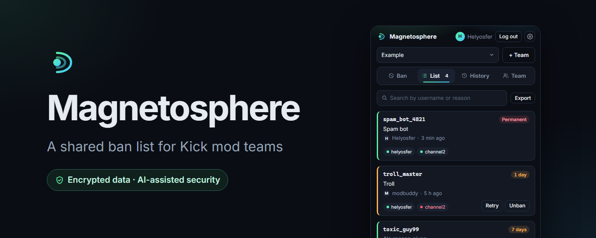
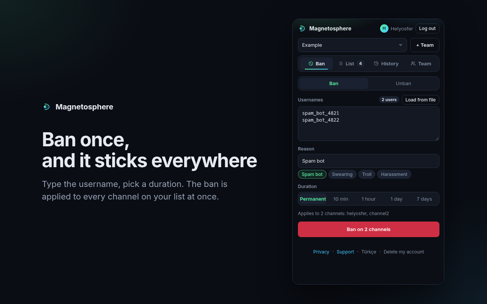
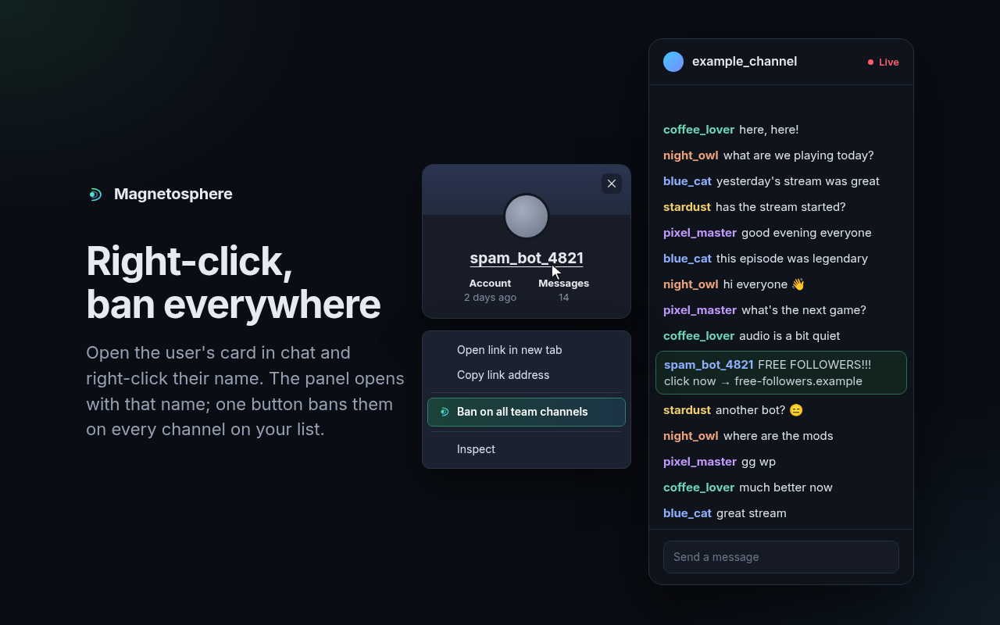
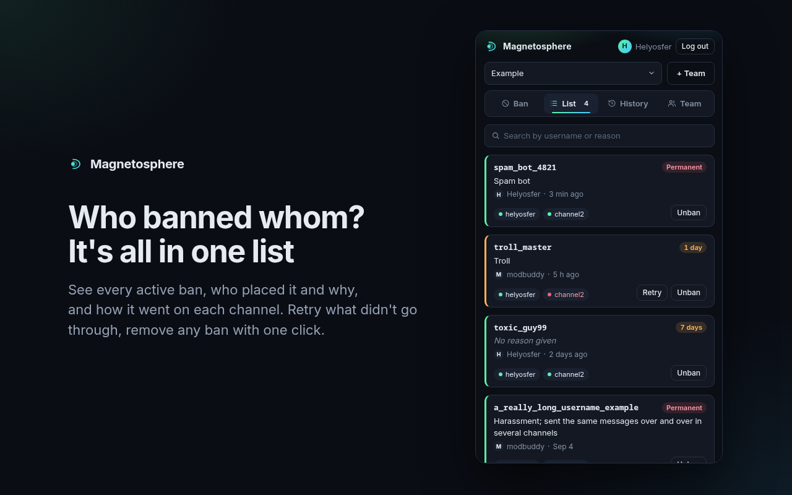
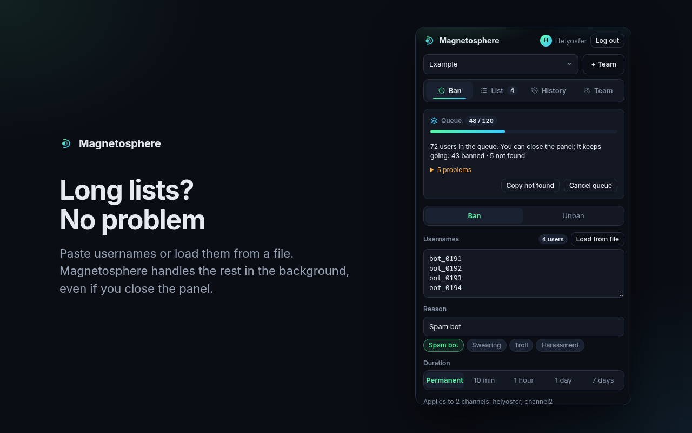
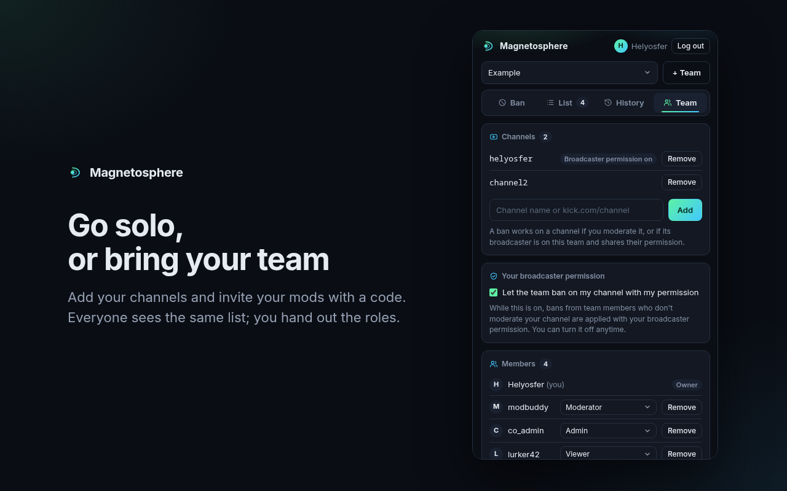
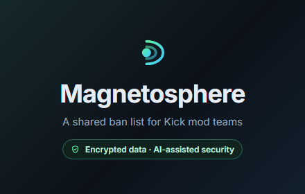

<div align="center">

<sub>[Türkçe](README.md) · [English](README.en.md) · [Español](README.es.md) · [Português (Brasil)](README.pt-BR.md) · [العربية](README.ar.md) · [Deutsch](README.de.md) · [Français](README.fr.md) · [Bahasa Indonesia](README.id.md) · [Русский](README.ru.md)</sub>



**Gemeinsame Bannliste für Kick-Moderatoren und Mod-Teams.**<br>
Banne einen Nutzer in einem Schritt in allen Kanälen, in denen du Moderator bist.

[](https://chromewebstore.google.com/detail/magnetosphere/kjbbjooackbcfeeoolkfpmdbkomjiflh)
[](LICENSE)


[Screenshots](#screenshots) ·
[Funktionen](#funktionen) ·
[Erste Schritte](#erste-schritte) ·
[Rollen](#rollen-und-rechte) ·
[Funktionsweise](#wie-es-funktioniert) ·
[Eigener Server](#eigenen-server-aufsetzen) ·
[Sicherheit](#sicherheit) ·
[Entwicklung](#entwicklung)

</div>

<br>

Wenn du in mehreren Kanälen Moderator bist, musst du einen Troll oder Spam-Bot in jedem Kanal einzeln
bannen. Magnetosphere macht daraus einen einzigen Schritt: Du gibst den Nutzernamen einmal ein (oder lädst
Tausende Namen aus einer Datei), und der Bann gilt in allen Kanälen deiner Bannliste. Wer wen wann und
warum gebannt hat, wird ebenfalls festgehalten.

Du kannst Magnetosphere **allein** nutzen: Du fügst die Kanäle hinzu, in denen du Moderator bist, und
bannst, ohne jemanden einzuladen. **Im Team** kommt Folgendes dazu:

- Alle sehen dieselbe Bannliste.
- Ein Bann, den eine Person setzt, gilt in allen Kanälen des Teams.
- Gibt ein Streamer im Team seine Rechte frei, gelten dort auch die Banns von Mitgliedern, die in diesem Kanal nicht Moderator sind.

Der Name stammt vom magnetischen Schutzschild (der Magnetosphäre), der die Erde vor dem Sonnenwind schützt.

> Magnetosphere ist ein unabhängiges Projekt; es ist weder mit Kick verbunden noch von Kick unterstützt oder genehmigt.

## Screenshots

| | |
|:-:|:-:|
|  |  |
| **Bannen:** Namen eingeben, Grund und Dauer wählen; der Bann geht an alle Kanäle gleichzeitig. | **Rechtsklick:** Öffne im Chat die Karte eines Nutzers und klicke den Namen rechts an; das Panel öffnet sich mit diesem Namen. |
|  |  |
| **Liste:** aktive Banns; wer wen warum gebannt hat und in welchen Kanälen der Bann gilt. | **Warteschlange:** Tausende Namen werden im Hintergrund verarbeitet, auch wenn das Panel geschlossen wird. |
|  | |
| **Team:** Kanäle, Freigabe der Streamer-Rechte, Mitglieder und ihre Rollen. | |

## Funktionen

| | |
|---|---|
| **Ein Bann in mehreren Kanälen** | Dauerhafter Bann oder Timeout von 10 Minuten, 1 Stunde, 1 Tag oder 7 Tagen; wird in allen Kanälen gleichzeitig angewendet. |
| **Kanalauswahl** | Hat das Team mehrere Kanäle, wählst du bei **Bannen** und **Entbannen** die Kanäle aus: **Alle**, **Nur meiner** oder die mit **Auswählen…** markierten Kanäle. Die Auswahl gilt nur für diese eine Aktion; nach der Aktion springt sie auf **Alle** zurück. Wenn du einen Bann nur in einigen Kanälen aufhebst, bleibt der Eintrag in den Kanälen aktiv, in denen der Bann weiter besteht; der aufgehobene Kanal erscheint auf der Karte grau, und **Erneut versuchen** bannt dort nicht erneut. Weil das Aufheben in einem Kanal, in dem du kein Moderator bist, einen Fehler liefert, ergibt es ein sauberes Ergebnis, nur die Kanäle zu wählen, in denen du Rechte hast. Bei langen Listen werden die Kanäle beim Einreihen festgeschrieben: Ein Kanal, der dem Team hinzugefügt wird, während die Liste abgearbeitet wird, gilt nicht für die übrigen Namen. |
| **Massen-Bann, Import und Export** | Namen einfügen oder eine `.txt`-, `.csv`- oder `.json`-Datei laden (bis zu 6.000 Namen auf einmal). Bei CSV-Dateien wird nur die erste Spalte gelesen, die Kopfzeile wird übersprungen. **Liste > Exportieren** lädt alle dauerhaften Banns des Teams als `.txt`-Datei mit einem Nutzernamen pro Zeile herunter; die Datei lässt sich unverändert in ein anderes Team laden. |
| **Warteschlange im Hintergrund** | Lange Listen werden auf dem Server in eine Warteschlange gestellt; die Banns werden weiter gesetzt, auch wenn Panel oder Browser geschlossen werden. Fortschritt, nicht gefundene Namen und Abbruch verwaltest du im Panel. |
| **Einhaltung der Kick-Ratenlimits** | Die Anfragerate passt sich automatisch an. Bremst Kick die Anfragen aus, geht kein Name verloren; er kommt zurück in die Warteschlange. |
| **Gemeinsame Liste und Verlauf** | Wer jeden Bann wann und warum gesetzt hat und in welchen Kanälen er gilt; Suche nach Nutzername oder Grund. **Liste** zeigt dauerhafte Banns und laufende Timeouts, **Verlauf** aufgehobene Banns und abgelaufene Timeouts; Besitzer und Admins können den Verlauf nach Bestätigung löschen. |
| **Erneut versuchen und rückgängig machen** | Wiederholt einen Bann in den Kanälen, in denen er nicht angewendet werden konnte; hebt einen Bann mit einem Klick in allen Kanälen auf. |
| **Entbannen per Name** | Gib bei **Bannen > Entbannen** den Nutzernamen ein; der Bann wird in allen Kanälen des Teams aufgehoben. Auch Banns, die nicht in der Liste stehen (manuell auf Kick oder vor Magnetosphere gesetzt), werden aufgehoben, und das Aufheben wird in der Liste festgehalten. Listen mit mehr als 10 Namen (auch aus Dateien ladbar) werden wie Massen-Banns in die Warteschlange gestellt. |
| **Rechtsklick-Shortcut** | Öffne auf kick.com im Chat die Karte eines Nutzers, klicke den Namen auf der Karte rechts an und wähle „In allen Teamkanälen bannen“. Das Panel öffnet sich mit diesem Namen. |
| **Allein oder im Team** | Jeder, der sich anmeldet, richtet mit einem Klick seine eigene Kanalliste ein; wer möchte, holt per Einladungslink oder -code weitere Leute ins Team. Wer den Link öffnet, installiert die Erweiterung und tritt mit einem Klick bei. |
| **Rollen** | Besitzer, Admin, Moderator und Zuschauer. Du kannst festlegen, mit welcher Rolle per Einladung Beitretende starten. |
| **Freigabe der Streamer-Rechte** | Ein Streamer im Team kann seine Bannrechte im eigenen Kanal für das Team freigeben; diese Entscheidung trifft nur er selbst. |
| **Schutz vor Fehl-Banns** | Teammitglieder mit Bannrechten und Streamer im Team können nicht gebannt werden. |
| **Konto- und Teamverwaltung** | Team verlassen, Besitz übertragen, Team und Konto löschen; alles im Panel. |
| **9 Sprachen** | Türkisch, Englisch, Deutsch, Spanisch, Französisch, Indonesisch, Portugiesisch, Russisch und Arabisch. Das Panel öffnet sich in der Sprache des Browsers; ist sie keine davon, auf Englisch. Über das Zahnrad in der Kopfzeile lässt es sich unter **Einstellungen** ändern; auf Arabisch wird das Panel von rechts nach links dargestellt. Auch die Fehlermeldungen des Servers und die Einladungsseite erscheinen in der gewählten Sprache. |

## Erste Schritte

<a href="https://chromewebstore.google.com/detail/magnetosphere/kjbbjooackbcfeeoolkfpmdbkomjiflh"></a>

1. **Installieren.** Füge die Erweiterung [aus dem Chrome Web Store](https://chromewebstore.google.com/detail/magnetosphere/kjbbjooackbcfeeoolkfpmdbkomjiflh)
   hinzu. Sie läuft in Chromium-basierten Browsern wie Chrome, Edge und Brave; Firefox wird nicht unterstützt.
2. **Anmelden.** Klicke auf das Magnetosphere-Symbol und dann auf **Mit Kick anmelden**. Die Anmeldung
   findet auf der Seite von Kick selbst statt; die Erweiterung sieht dein Passwort nicht.
3. **Loslegen.** Klicke auf **Allein starten**; dein eigener Kanal wird automatisch zur Liste hinzugefügt.
   Wurdest du in ein Team eingeladen, füge stattdessen den Einladungscode ein.
4. **Kanäle hinzufügen.** Füge im Tab **Team** die Kanäle, in denen du Moderator bist, per Name oder
   per `kick.com/kanal`-Link hinzu.
5. **Bannen.** Gib im Tab **Bannen** die Nutzernamen ein oder wähle mit **Aus Datei laden** eine Liste aus.
   Listen mit mehr als 10 Namen werden in die Warteschlange gestellt und im Hintergrund verarbeitet.
6. **Verfolgen.** Der Tab **Liste** zeigt das Ergebnis der aktiven Banns Kanal für Kanal; aufgehobene
   Banns und abgelaufene Timeouts wandern in den Tab **Verlauf**. Von hier aus kannst du einen Bann aufheben
   oder in den Kanälen, in denen er nicht angewendet werden konnte, erneut versuchen.
7. **Alte Banns aufheben.** Für einen Bann, der nicht in der Liste steht (manuell auf Kick oder vor
   Magnetosphere gesetzt), wähle im Tab **Bannen** den Modus **Entbannen** und gib den Nutzernamen ein; der Bann
   wird in allen Kanälen des Teams aufgehoben. Auch hier werden lange Listen in die Warteschlange gestellt.

Wenn du ein Team aufbauen möchtest, klicke im Tab **Team** auf **Einladungslink kopieren** und schicke den Link
an deine Mods. Wer ihn öffnet, installiert die Erweiterung, klickt auf der Seite auf **Team beitreten** und
bestätigt im Panel, nachdem er Namen und Besitzer des Teams gesehen hat. Wird der Link auf dem Handy oder in
einem anderen Browser als Chrome geöffnet, weist die Seite darauf hin, ihn in Chrome auf dem Computer zu öffnen.
Statt des Links kannst du auch den Code teilen. Wer beitritt, nutzt dieselbe Kanalliste und dieselbe Bannliste.

Der Einladungscode steht im Link hinter dem `#`-Zeichen; der Browser sendet diesen Teil nicht an den Server,
sodass der Code nicht in Server- oder Cloudflare-Logs landet. Die Seite übergibt den Code über Chromes
Funktion `externally_connectable` an die Erweiterung; diese Funktion verlangt keine neue Berechtigung.

<br clear="right">

## Rollen und Rechte

| | Zuschauer | Moderator | Admin | Besitzer |
|---|:-:|:-:|:-:|:-:|
| Gemeinsame Liste ansehen und exportieren | ✓ | ✓ | ✓ | ✓ |
| Banns setzen, erneut versuchen, Listen laden | | ✓ | ✓ | ✓ |
| Eigene Banns aufheben | | ✓ | ✓ | ✓ |
| Nicht gelistete (manuell auf Kick gesetzte) Banns per Name aufheben | | ✓ | ✓ | ✓ |
| Banns anderer aufheben | | | ✓ | ✓ |
| Kanäle hinzufügen und entfernen | | | ✓ | ✓ |
| Verlauf löschen | | | ✓ | ✓ |
| Einladungscode ansehen und erneuern | | | ✓ | ✓ |
| Mitglieder mit niedrigerer Rolle entfernen | | | ✓ | ✓ |
| Rollen vergeben, Startrolle der Beitretenden festlegen | | | | ✓ |
| Besitz übertragen, Team löschen | | | | ✓ |

Per Einladung Beitretende werden standardmäßig Moderator; der Besitzer kann das auf „Startet als Zuschauer“ umstellen.
Alle außer dem Besitzer können das Team jederzeit verlassen.

Gibt es für einen Nutzer, dessen Name du bei **Entbannen** eingibst, einen aktiven Bann eines anderen Mitglieds in der
Liste, gilt die Listenregel: Diesen Bann können nur Besitzer und Admins aufheben.

**Verlauf löschen** entfernt aufgehobene Banns und abgelaufene Timeouts dauerhaft für alle im Team; die Banns auf
Kick bleiben unberührt. Ein Banneintrag, der in einem Kanal nicht aufgehoben werden konnte, wird nicht gelöscht,
weil die Person in diesem Kanal womöglich noch gebannt ist und der Eintrag gebraucht wird, um das Aufheben erneut zu versuchen.

### Freigabe der Streamer-Rechte

Ein Bann wird in jedem Kanal zuerst mit den **eigenen Moderatorrechten** der Person versucht, die ihn setzt. Ist der Streamer des Kanals
im Team und hat unter **Team > Deine Streamer-Rechte** die Freigabe aktiviert, wird der Bann mit den Rechten des Streamers
angewendet, wenn die Rechte des Moderators nicht ausreichen.

- Die Freigabe ist für alle zunächst ausgeschaltet; auch wer das Team gründet, aktiviert sie für den eigenen Kanal selbst. (In vor
  0.15.1 gegründeten Teams ist die Freigabe des Gründers eingeschaltet; schalte sie aus, wenn du das möchtest.)
- Nur der Streamer selbst kann sie ein- und ausschalten; allein der Beitritt zu einem Team per Einladungscode gibt dieses Recht nicht.
- In einem Kanal, in dem du kein Moderator bist und dessen Streamer seine Rechte nicht freigibt, wird der Bann nicht angewendet; der Kanal erscheint in der Liste rot.
- Um dem Team einen Kanal hinzuzufügen, musst du in diesem Kanal Kick-Moderator sein, der Kanal muss dir gehören oder sein Streamer
  muss im Team sein (0.15.1). Möchtest du den Kanal eines Streamers hinzufügen, soll der Streamer zuerst dem Team beitreten.

## Wie es funktioniert

```
   Chrome-Erweiterung            Server                    Kick
┌──────────────────┐      ┌──────────────────┐      ┌──────────────────┐
│ Panel, das der   │ ───▶ │ Teams, Rollen    │ ───▶ │ Offizielle API   │
│ Moderator        │      │ Gemeinsame Liste │      │ (OAuth 2.1 und   │
│ benutzt          │ ◀─── │ Queue + Worker   │ ◀─── │  Moderation)     │
└──────────────────┘      └──────────────────┘      └──────────────────┘
```

| Teil | Was er macht |
|---|---|
| [`extension/`](extension) | Chrome-Erweiterung (Manifest V3). Die Oberfläche, die der Nutzer sieht; sie sendet von sich aus keine Kick-Anfragen und sieht weder dein Kick-Passwort noch dein Token. |
| [`server/`](server) | Python-Server (3.10+). Hält Teams, Rollen, die gemeinsame Liste, die Warteschlange und die Kick-Sitzungen; setzt Banns über die [offizielle API](https://docs.kick.com/apis/moderation) von Kick. |
| [`store/`](store) | Text und Bilder für den Chrome Web Store. |
| [`tools/`](tools) | Skript, das das Store-Paket erzeugt. |
| [`docs/`](docs) | Datenschutzerklärung. |

Der Server ist erforderlich, weil Kicks OAuth-Ablauf ein Client Secret verlangt; das Secret darf nicht in die Erweiterung.
Der Server nutzt nur die Python-Standardbibliothek; seine einzige Abhängigkeit ist das Paket
`cryptography` für die Token-Verschlüsselung. Die Daten liegen in einer einzigen SQLite-Datei.

Die Erweiterung aus dem Store nutzt standardmäßig den Server `magnetosphere.helyosfer.me`; jeder, der sich anmeldet,
kann dort ein Team gründen. Wenn du möchtest, kannst du mit den folgenden Schritten einen eigenen Server aufsetzen und die Erweiterung damit verbinden.

## Eigenen Server aufsetzen

Zum Ausprobieren auf dem eigenen Rechner reichen die Schritte 1–3; für eine dauerhafte Installation, die alle nutzen sollen,
geh weiter zum Abschnitt [Server im Internet erreichbar machen](#server-im-internet-erreichbar-machen).

### 1. Kick-App

Erstelle unter [kick.com/settings/developer](https://kick.com/settings/developer) eine App
(im Konto muss die Zwei-Faktor-Authentifizierung aktiviert sein). Im App-Namen sind keine Leerzeichen erlaubt.

| Feld | Wert |
|---|---|
| Redirect URL | `http://localhost:8787/auth/callback` (lokaler Test) oder `https://<deine-domain>/auth/callback` |
| Scopes | Read user information, Read channel information, Execute moderation actions for moderators |

### 2. Server

```bash
cd server
pip install -r requirements.txt
cp .env.example .env
```

Fülle die Datei `.env` aus:

- `KICK_CLIENT_ID` und `KICK_CLIENT_SECRET`: die Werte, die Kick dir gibt.
- `TOKEN_ENCRYPTION_KEY`: der Schlüssel, der mit dem folgenden Befehl erzeugt wird.

```bash
python -c "from cryptography.fernet import Fernet; print(Fernet.generate_key().decode())"
```

Starte dann den Server:

```bash
python app.py
```

Der Server lauscht auf `http://localhost:8787`. Fehlt eine Sicherheitseinstellung, gibt er beim Start eine Warnung aus.
Dass er läuft, siehst du unter `http://localhost:8787/health`.

### 3. Erweiterung

1. Öffne in Chrome die Seite `chrome://extensions` und aktiviere den **Entwicklermodus**.
2. Wähle mit **Entpackte Erweiterung laden** den Ordner `extension` aus.
3. Klicke auf das Magnetosphere-Symbol, gib im Feld **Erweitert: eigenen Server verwenden** die Adresse deines Servers ein
   (für lokale Tests `http://localhost:8787`) und klicke auf **Mit Kick anmelden**.

Wenn nicht jede Person in deinem Team die Adresse von Hand eingeben soll, ersetze den Wert `DEFAULT_SERVER` in
`extension/server-url.js` durch deine Adresse und verteile den Ordner so. Damit Einladungslinks die Erweiterung erreichen,
trage dieselbe Adresse auch in die Liste `externally_connectable.matches` in `manifest.json` und in die Liste
`INVITE_ORIGINS` in `background.js` ein. Tust du das nicht, erscheint im Panel die Schaltfläche **Einladungslink kopieren** nicht; der Code
lässt sich trotzdem kopieren und teilen. Die Schaltfläche erscheint ab Server 0.12.0.

Die ID einer von Hand geladenen Erweiterung ist durch den Schlüssel in `manifest.json` festgelegt
(`flmfmniipeobbaoahmbdkjnblbegalob`); auf jedem Rechner ist sie gleich. Der Server akzeptiert nur
IDs aus der Liste `ALLOWED_EXTENSION_IDS`. Die ID der Erweiterung aus dem Store ist eine andere
(`kjbbjooackbcfeeoolkfpmdbkomjiflh`); um beide zuzulassen, trage beide in die Liste ein.

### Server im Internet erreichbar machen

Bei einer Installation, die dein Team nutzen soll, muss der Server dauerhaft laufen und hinter HTTPS stehen.

1. **Einstellungen.** Setze in `.env` `PUBLIC_URL=https://<deine-domain>` und ändere die Redirect
   URL in der Kick-App auf `https://<deine-domain>/auth/callback`. Lass `HOST=127.0.0.1` stehen; der Server wird nicht
   direkt nach außen geöffnet. Um die Datenbank außerhalb des Codes zu halten, setze `DB_PATH`.
2. **Reverse Proxy.** HTTPS übernimmt ein Reverse Proxy. Mit [Caddy](https://caddyserver.com) wird das Zertifikat
   automatisch besorgt:

   ```
   <deine-domain> {
   	reverse_proxy 127.0.0.1:8787
   }
   ```

   Das Login-Limit liest die echte Client-Adresse aus dem letzten Wert des Headers `X-Forwarded-For`. Caddy schreibt
   diesen Header in der Standardkonfiguration korrekt. nginx tut das nicht und reicht den vom Client gesendeten
   Header unverändert weiter; wenn du nginx verwendest, füge die Zeile `proxy_set_header X-Forwarded-For $remote_addr;` hinzu. Kommt der Header
   gar nicht an, zählen alle Clients als eine einzige Adresse, und das Login-Limit gilt für alle gemeinsam.

   Steht der Server hinter Cloudflare, sieht der Reverse Proxy nicht den Besucher, sondern die Adresse von Cloudflare, und das Login-Limit
   gilt gemeinsam für alle, die über denselben Cloudflare-Server kommen. Die echte Adresse steht im Header `CF-Connecting-IP`;
   dem Header sollte nur bei Anfragen vertraut werden, die von Cloudflare kommen:

   ```
   @cloudflare remote_ip <die Bereiche unter https://www.cloudflare.com/ips/>
   handle @cloudflare {
   	reverse_proxy 127.0.0.1:8787 {
   		header_up X-Forwarded-For {http.request.header.CF-Connecting-IP}
   	}
   }
   handle {
   	reverse_proxy 127.0.0.1:8787
   }
   ```
3. **Dienst.** Betreibe den Server mit einem unprivilegierten Systembenutzer als systemd-Dienst:

   ```ini
   [Service]
   User=magnetosphere
   WorkingDirectory=/opt/magnetosphere/app/server
   ExecStart=/opt/magnetosphere/venv/bin/python app.py
   Environment=PYTHONUNBUFFERED=1
   Restart=on-failure
   NoNewPrivileges=true
   ProtectSystem=strict
   ReadWritePaths=/opt/magnetosphere/data
   ```

4. **Wer Teams anlegen darf.** Standardmäßig kann jeder, der sich anmeldet, ein Team gründen. Öffnest du deinen Server nur
   für dein eigenes Team, beschränke das mit `ALLOWED_TEAM_CREATORS` auf deine eigene Kick-Nutzer-ID;
   die anderen treten per Einladungscode bei.
5. **Backup.** Die Datenbank lässt sich im laufenden Betrieb sicher sichern:

   ```bash
   sqlite3 /opt/magnetosphere/data/crossban.db ".backup '/opt/backups/crossban-$(date +%F).db'"
   ```

   Bewahre eine Kopie des Backups außerhalb des Servers auf (z. B. mit [rclone](https://rclone.org) in einem Cloud-Ordner).
   Lege die Datei `.env` nicht neben dieses Backup; Verschlüsselungsschlüssel und Datenbank müssen getrennt liegen.

Beim Start migriert der Server eine alte Datenbank automatisch auf das neue Schema; vor einem Update genügt es,
ein Backup zu machen.

### Server aktualisieren

Bei der obigen Installation (Code in `/opt/magnetosphere/app`, Datenbank in `/opt/magnetosphere/data`):

```bash
# 1. Backup
sqlite3 /opt/magnetosphere/data/crossban.db ".backup '/opt/backups/crossban-$(date +%F)-update.db'"
# 2. Code; wird als Besitzer des Ordners gezogen (mit einem anderen Benutzer lehnt git mit „dubious ownership“ ab)
sudo -u "$(stat -c %U /opt/magnetosphere/app)" git -C /opt/magnetosphere/app pull
grep '^VERSION' /opt/magnetosphere/app/server/app.py   # nicht weitermachen, ohne die neue Version zu sehen
/opt/magnetosphere/venv/bin/pip install -r /opt/magnetosphere/app/server/requirements.txt
# 3. Neu starten und prüfen
sudo systemctl restart magnetosphere
curl -s https://<deine-domain>/health          # {"ok": true, "version": "<neue Version>"}
journalctl -u magnetosphere -n 30 --no-pager
```

Zeigt `/health` noch die alte Version, ist entweder `git pull` fehlgeschlagen, oder der Dienst
läuft aus einem anderen Ordner; sieh dir mit `systemctl cat magnetosphere` den Wert `WorkingDirectory` an.

Wenn du die Datenschutzseite im Reverse Proxy aus einer statischen Datei auslieferst (z. B. `/var/www/magnetosphere/privacy.html`),
aktualisiert `git pull` sie nicht; kopiere nach dem Update die Datei `docs/privacy.html` dorthin oder
stelle den Reverse Proxy so ein, dass er direkt auf den Ordner `docs/` im Repository zeigt.

Sitzungen sind vom Update nicht betroffen; niemand muss sich neu anmelden. Nutzt eine neue Version der Erweiterung eine neue
Serverfunktion, aktualisiere zuerst den Server und dann die Erweiterung; die alte Erweiterung läuft mit dem neuen Server
weiter. Um zu einer früheren Version zurückzukehren, finde mit `git log` den Commit dieser Version, führe
`git checkout <commit>` aus und starte den Dienst neu. Seit 0.6.0 hat sich das Datenbankschema nicht geändert; die Versionen 0.6.x und 0.7.x laufen mit derselben
Datenbank. Spiele das Backup nur ein, wenn Daten beschädigt wurden, und zwar bei gestopptem Dienst.

### Einstellungen

Werden aus der Datei `server/.env` gelesen.

| Variable | Standard | Beschreibung |
|---|---|---|
| `KICK_CLIENT_ID` | — | Client ID der Kick-App |
| `KICK_CLIENT_SECRET` | — | Client Secret der Kick-App |
| `TOKEN_ENCRYPTION_KEY` | leer | Schlüssel, der die Kick-Tokens in der Datenbank verschlüsselt. Ist er leer, bleiben die Tokens im Klartext |
| `ALLOWED_EXTENSION_IDS` | leer (alle) | Erweiterungs-IDs, die sich anmelden und die API aufrufen dürfen, durch Kommas getrennt |
| `ALLOWED_TEAM_CREATORS` | leer (alle) | Kick-Nutzer-IDs, die Teams anlegen dürfen, durch Kommas getrennt. Der Beitritt per Einladung ist in jedem Fall offen |
| `PUBLIC_URL` | `http://localhost:8787` | Von außen erreichbare Adresse des Servers. Die Redirect URL bei Kick muss `{PUBLIC_URL}/auth/callback` sein |
| `HOST` | `127.0.0.1` | Schnittstelle, auf der gelauscht wird |
| `PORT` | `8787` | Port, auf dem gelauscht wird |
| `DB_PATH` | `server/crossban.db` | Pfad der SQLite-Datenbank |
| `QUEUE_WORKERS` | `4` | Anzahl der Worker, die die Warteschlange gleichzeitig abarbeiten |
| `KICK_REQUESTS_PER_SECOND` | `1` | Anfangsrate der Anfragen an die Kick-API; sinkt automatisch, wenn Kick 429 zurückgibt, und steigt, wenn alles in Ordnung ist |
| `KICK_REQUESTS_PER_SECOND_MAX` | `5` | Obergrenze der Anfragerate |

## Sicherheit

### Was geschützt wird

- **Kick-Tokens werden verschlüsselt gespeichert.** Ist `TOKEN_ENCRYPTION_KEY` gesetzt, sind die Access- und
  Refresh-Tokens in der Datenbank mit Fernet (AES + HMAC) verschlüsselt; gelangt allein die Datenbankdatei an die Öffentlichkeit, sind die Tokens nicht lesbar.
- **Sitzungen.** Der Sitzungsschlüssel liegt in der Datenbank nur als Hash (SHA-256) vor und wird ungültig,
  wenn er 30 Tage nicht benutzt wird. Das Abmelden beendet alle Sitzungen des Nutzers.
- **Nur diese Erweiterung.** Ist `ALLOWED_EXTENSION_IDS` gesetzt, kann keine andere Erweiterung den Anmeldeablauf
  starten oder die API aus dem Browser aufrufen (CORS wird nur für die erlaubte ID geöffnet).
- **Anmeldeablauf.** OAuth läuft mit PKCE und einmal verwendbarem `state`; die Sitzung wird nur an die
  erweiterungsspezifische Weiterleitungsadresse von Chrome übergeben.
- **Die Sitzung geht nur über verschlüsselte Verbindungen.** Die Erweiterung sendet den Sitzungsschlüssel nicht an
  `http://`-Adressen außer `localhost`, `127.0.0.1` und `[::1]`: Sie startet die Anmeldung nicht, nutzt die Sitzung nicht,
  wenn die gespeicherte Adresse unverschlüsselt ist, und zeigt eine Warnung.
- **Textfelder werden geprüft.** Teamname, Einladungscode und Bann-Grund werden abgelehnt, wenn sie kein Text sind;
  Werte wie `null` oder Listen werden nicht in Text umgewandelt und gespeichert.
- **Teams sind voneinander isoliert.** Kanäle, Mitglieder und Liste eines Teams sehen nur die
  Mitglieder dieses Teams.
- **Rollen werden auf dem Server geprüft.** Jede Aktion durchläuft auf dem Server eine Rollenprüfung; darauf, dass das Panel
  eine Schaltfläche ausblendet, wird nicht vertraut. Das Verlängern eines Timeouts ändert weder Besitzer noch Grund des Banns;
  ein Moderator kann auf diesem Weg den Bann eines anderen nicht aufheben.
- **Einladungscode.** Er ist zufällig und 72 Bit lang; nur Besitzer und Admins sehen und erneuern ihn, der alte Code wird sofort
  ungültig. In der Datenbank liegen nur sein Hash und (ist ein Schlüssel gesetzt) seine verschlüsselte Form. Ein Mitglied, das das Team verlässt,
  kann mit demselben Code nicht mit einer höheren Rolle als zuletzt zurückkehren; ein entferntes Mitglied kann nicht beitreten, bis der Code erneuert wird.
- **Streamer-Rechte werden mit Zustimmung genutzt.** Das Token eines Streamers wird für den Bann eines anderen nur dann verwendet, wenn
  dieser Streamer die Freigabe selbst aktiviert hat.
- **Konto löschen.** Löscht ein Nutzer sein Konto, werden seine Sitzungen, Mitgliedschaften und Tokens gelöscht und der Zugriff
  bei Kick widerrufen. Banns, die er in den Listen anderer Teams gesetzt hat, bleiben anonym erhalten; auch die Kick-ID wird
  aus den Einträgen gelöscht. Schlägt der Widerruf bei Kick fehl, meldet die Antwort das (`kick_revoked: false`).
- **Minimale Berechtigungen.** Von Kick werden nur Nutzerinformationen, Kanalinformationen und Bannrechte angefordert. Die Erweiterung
  nutzt nur die Berechtigungen `identity`, `storage` und `contextMenus`; sie fügt auf keiner Website ein Content-Skript ein.
- **Limits.** Der Anfragekörper ist auf 1 MB begrenzt, eine auf einmal geladene Liste auf 6.000 Namen, die in der Warteschlange
  wartenden Einträge eines Teams auf 20.000. Von derselben Adresse können in 10 Minuten höchstens 30 Anmeldungen gestartet werden.
  Ein Konto kann höchstens 300 Anfragen pro Minute senden, höchstens 10 Teams gründen und Mitglied in 50 Teams sein;
  ein Team hat höchstens 50 Kanäle und 200 Mitglieder. Ein Konto kann gleichzeitig höchstens zwei Vorgänge an Kick senden;
  so kann ein einzelnes Konto das gemeinsame Kick-Ratenlimit nicht ausschöpfen und die anderen warten lassen.
- **Robuste Anfrageverarbeitung.** Fehlerhafte oder unvollständig gesendete Anfragen halten die Verbindung nicht offen (Timeout
  von 30 Sekunden); unerwartete Fehler kommen als 500 zurück, ohne dem Client Details preiszugeben.
- **Faire Warteschlange.** Die Warteschlange wird reihum zwischen den Teams abgearbeitet; die lange Liste eines Teams lässt die anderen nicht warten.

### Die Verschlüsselung prüfen

Wer den Server betreibt, kann zeigen, dass die Tokens verschlüsselt gespeichert sind, ohne den Schlüssel oder ein einziges Token zu zeigen.
[`tools/sifreleme_dogrula.py`](tools/sifreleme_dogrula.py) liest die Live-Datenbank und die Backups
nur lesend und schreibt einen Bericht, der ausschließlich aus Zahlen besteht:

- ob ein Schlüssel gesetzt und ein gültiger Fernet-Schlüssel ist,
- wie viele Tokens verschlüsselt und wie viele im Klartext sind und wie viele der verschlüsselten sich mit dem Schlüssel entschlüsseln lassen,
- ob der Server beim letzten Start die Warnung „Schlüssel nicht gesetzt“ ausgegeben hat,
- ob jedes Datenbank-Backup Klartext-Tokens enthält und ob in den Backup-Ordnern eine Kopie des Schlüssels liegt.

```bash
sudo /opt/magnetosphere/venv/bin/python /opt/magnetosphere/app/tools/sifreleme_dogrula.py \
    --sunucu /opt/magnetosphere/app/server --yedek /opt/backups
```

Werden Klartext-Tokens gefunden oder ist der Schlüssel ungültig, ist der Exit-Code 1. Der SHA-256-Hash am Anfang des Berichts
dient dazu zu prüfen, ob das ausgeführte Skript mit der Version im Repository identisch ist. Der Bericht ist eine Erklärung des Serverbetreibers;
er ist kein unabhängiger Beweis von außen, aber was gemessen wird, ist in dieser Datei für alle einsehbar.

### Pflichten des Serverbetreibers

- `server/.env` (Client Secret, Verschlüsselungsschlüssel) und `server/crossban.db` sind vertraulich; `.gitignore`
  hält beide aus dem Repository heraus. Lege Verschlüsselungsschlüssel und Datenbank nicht in dasselbe Backup.
- Öffne den Server nur hinter HTTPS zum Internet. `HOST` lauscht standardmäßig nur auf dem lokalen Rechner.
- Geht der Verschlüsselungsschlüssel verloren, gibt es keinen Datenverlust; nur alle müssen sich erneut mit Kick anmelden.

### Bekannte Grenzen

- Die Verschlüsselung schützt vor dem Abfluss der Datenbankdatei; wer den ganzen Server übernimmt, kann auch den Schlüssel lesen.
- Wer per Einladungscode beitritt, wird standardmäßig Moderator und kann in den Kanälen des Teams bannen; teile den Code
  nur mit Leuten, denen du vertraust, oder lass Beitretende als Zuschauer starten.
- Das Anfragelimit gilt pro Konto und liegt im Arbeitsspeicher; setze für Anfragen ohne Sitzung zusätzlich ein Limit im Reverse Proxy.
- Erfolgen eine Besitzübertragung und das Verlassen des Teams durch das übernehmende Mitglied genau gleichzeitig, kann das Team ohne Besitzer bleiben.
  Erfolgen das Löschen eines Kontos und der Beitritt eines neuen Mitglieds zum Team gleichzeitig, kann das Team ohne Warnung gelöscht werden.
  Beides erfordert ein sehr enges Zeitfenster; eine Behebung ist geplant.
- Ist `TOKEN_ENCRYPTION_KEY` leer, gibt der Server nur eine Warnung aus und speichert die Tokens im Klartext. Setze den Schlüssel auf einem öffentlich
  zugänglichen Server unbedingt.

### Unabhängiges Audit (Oktober 2026)

Server und Erweiterung wurden am 15. Oktober 2026 unabhängig geprüft. Zusätzlich zu den Tests in diesem Repository wurde eine separate Testsuite
eingesetzt:

- **End-to-End-Tests im Browser (Playwright).** Das Panel wurde mit einem echten Server geöffnet, der an ein gefälschtes Kick angebunden war. Geprüft wurde, dass HTML in
  Teamname, Nutzername und Bann-Grund nicht ausgeführt wird (XSS), dass die Sitzung endet, wenn der Server 401 zurückgibt, dass eine unverschlüsselte Serveradresse abgelehnt wird,
  sowie die Barrierefreiheit (axe).
- **Servertests aus Angreifersicht.**
  - Alle Endpunkte eines Teams, in dem man nicht Mitglied ist: alle lieferten 404.
  - Zugriff auf den Banneintrag eines anderen Teams über den Pfad des eigenen Teams.
  - Gefälschte, abgelaufene und abgemeldete Sitzungen.
  - Zweite Verwendung von `state` und Versuche mit offener Weiterleitung.
  - Nicht erlaubte Erweiterungs-ID und erneuerter alter Einladungscode.
  - Ein Admin, der sich selbst zum Besitzer macht.
  - Preisgabe interner Details in Fehlerantworten.
- **Mutationsprüfung.** Die folgenden Schutzmaßnahmen wurden nacheinander vorübergehend außer Kraft gesetzt; jede wurde von mindestens einem Test erkannt:
  - Prüfung der Teammitgliedschaft
  - Einmalverwendung von `state`
  - Prüfung der Weiterleitungsadresse
  - Sitzungsdauer
  - Besitzerrechte
  - Text im Panel nicht als HTML schreiben
  - Löschen der Sitzung bei 401
- **Statische Analyse.** Die 6 Warnungen von Bandit (f-String in SQL, `urlopen`) wurden Zeile für Zeile geprüft. In keiner
  gelangt Nutzereingabe in den SQL-Text oder in das Schema bzw. den Server der Anfrageadresse; die Werte werden
  als Parameter übergeben.
- **Gefunden und in 0.5.1 behoben.** Dass die Erweiterung den Sitzungsschlüssel an einen unverschlüsselten (`http://`) Server senden konnte
  und dass Felder, die kein Text sind, in Text umgewandelt und gespeichert wurden.

Ergebnis: In den getesteten Bereichen wurde keine weitere Schwachstelle gefunden. Die bekannten Grenzen stehen oben.

### Sicherheitslücke melden

Wenn du eine Sicherheitslücke findest, eröffne bitte kein öffentliches Issue; schreibe an `destek@helyosfer.me`.
Informationen zu Umfang, Antwortzeiten und Offenlegungsprozess findest du in [SECURITY.md](SECURITY.md).

Datenschutzerklärung: [magnetosphere.helyosfer.me/privacy](https://magnetosphere.helyosfer.me/privacy)
(Quelle: [`docs/privacy.html`](docs/privacy.html)).

## Entwicklung

### Tests

```bash
cd server
python -m unittest test_app
```

Die Tests laufen Ende-zu-Ende gegen eine gefälschte Kick-API; sie senden keine Anfragen an das echte Kick. Abgedeckt sind Anmeldung, Verlust
von Rechten, Warteschlange und parallele Worker, faire Warteschlange zwischen Teams, Rollen, Rechtefreigabe, Entbannen per Name,
Konto löschen, Trennung von Liste und Verlauf, Fehlermeldungen in fünf Sprachen, erneuter Bann nach einem abgelaufenen Timeout, Migration von einer alten Datenbank
und die Sicherheitsregeln.

Die Vollständigkeit der Übersetzungen (in jeder Sprache dieselben Texte, Länge der kurzen Store-Beschreibung) wird zusätzlich geprüft:

```bash
node tools/ceviri_kontrol.js
```

Bei jedem Push und PR auf GitHub laufen automatisch die Servertests (Python 3.12 und 3.14), die Übersetzungsprüfung und der Scan der Abhängigkeiten
auf bekannte Schwachstellen (`pip-audit`) (`.github/workflows/test.yml`).

### Chrome Web Store

```bash
python tools/paketle.py
```

Erzeugt die Datei `dist/magnetosphere-<version>.zip`. Da der Store das Feld `key` im Manifest nicht akzeptiert,
entfernt das Skript es im Paket; im Repository bleibt es erhalten, die ID der von Hand geladenen Erweiterung ändert sich nicht.

Der Text der Store-Seite steht in [`store/aciklama.md`](store/aciklama.md). Die Bilder:

| Bereich | Datei | Größe |
|---|---|---|
| Screenshots | [`ekran-1-banla.png`](store/ekran-1-banla.png), [`ekran-2-liste.png`](store/ekran-2-liste.png), [`ekran-3-sira.png`](store/ekran-3-sira.png), [`ekran-4-ekip.png`](store/ekran-4-ekip.png), [`ekran-5-sagtik.png`](store/ekran-5-sagtik.png) | 1280×800 |
| Kleine Werbekachel | [`tanitim-kucuk-440x280.png`](store/tanitim-kucuk-440x280.png) | 440×280 |
| Große Werbekachel | [`tanitim-buyuk-1400x560.png`](store/tanitim-buyuk-1400x560.png) | 1400×560 |
| Symbol | [`extension/icons/icon128.png`](extension/icons/icon128.png) | 128×128 |

## Roadmap

Lauffähige Version. Auf dem echten Kick bestätigt: Anmeldung, Bann sowohl mit Streamer- als auch mit Moderatorrechten,
Aufheben von Banns und ein Massenimport von Tausenden Konten in zwei Kanälen.

- [x] Verschlüsselung der Tokens in der Datenbank, Ablaufzeit für Sitzungen
- [x] Bindung der Erweiterung an eine feste ID und ihr Symbol
- [x] Server im Internet hinter HTTPS, als Dienst, mit Datenbank-Backup
- [x] Team löschen; faire Warteschlange zwischen Teams und Login-Limit für öffentliche Server
- [x] [Veröffentlichung im Chrome Web Store](https://chromewebstore.google.com/detail/magnetosphere/kjbbjooackbcfeeoolkfpmdbkomjiflh)
- [x] Nutzung allein, Rollen im Team, ausdrückliche Zustimmung für Streamer-Rechte, Team verlassen und Konto löschen
- [x] Limits pro Konto für die öffentliche Nutzung
- [x] Bann per Nutzername aufheben; einschließlich manuell auf Kick gesetzter Banns
- [x] Trennung von Liste und Verlauf: abgelaufene Timeouts und aufgehobene Banns wandern in den Verlauf
- [x] Englische Oberfläche
- [x] Spanische, portugiesische (Brasilien) und arabische Oberfläche (auf Arabisch Layout von rechts nach links)
- [x] Deutsche, französische, russische und indonesische Oberfläche; Sprache, Datenschutz und Konto löschen unter „Einstellungen“ in der Kopfzeile
- [ ] Automatische Erkennung, die den Chat mithört und Spam-Bots in eine Verdachts-Warteschlange stellt

### Bekannte Einschränkungen

- Der Nutzername wird nach der Kanaladressen-Regel von Kick gesucht (Kleinbuchstaben, `-` statt `_`, höchstens 25 Zeichen).
- Kanäle außer deinem eigenen werden von Hand hinzugefügt; die offizielle API liefert keine Liste „Kanäle, in denen ich Moderator bin“.
- Die offizielle API listet keine bestehenden Banns eines Kanals auf; vor Magnetosphere gesetzte Banns erscheinen nicht in der Liste.
  Diese Banns lassen sich mit **Entbannen** aufheben, indem du den Nutzernamen eingibst. Ist der Nutzer in einem Kanal ohnehin
  nicht gebannt, kann dieser Kanal im Ergebnis als „Entbannen fehlgeschlagen“ erscheinen.
- Das Tempo wird vom Kick-Ratenlimit bestimmt: bei einem Team mit zwei Kanälen etwa eine Sekunde pro Konto.

## Mitwirken

Für Fehlermeldungen und Vorschläge [eröffne ein Issue](https://github.com/Helyosfer/magnetosphere/issues).
Stelle vor dem Einreichen von Änderungen sicher, dass die Tests bestehen; füge für neues Verhalten einen Test in
`server/test_app.py` hinzu.

## Lizenz

Copyright (C) 2026 Helyosfer

Magnetosphere ist freie Software; du darfst sie unter den Bedingungen der [GNU General Public License Version 3](LICENSE) (GPL-3.0)
verwenden, verändern und weitergeben. Wenn du veränderte Versionen weitergibst, musst du den Quellcode ebenfalls unter derselben
Lizenz offenlegen. Die Software wird ohne jede Gewährleistung bereitgestellt.

Die im Panel verwendete Schriftart [Inter](https://github.com/rsms/inter) wird mit der Erweiterung ausgeliefert und ist unter der
[SIL Open Font License 1.1](extension/fonts/LICENSE.txt) lizenziert.
