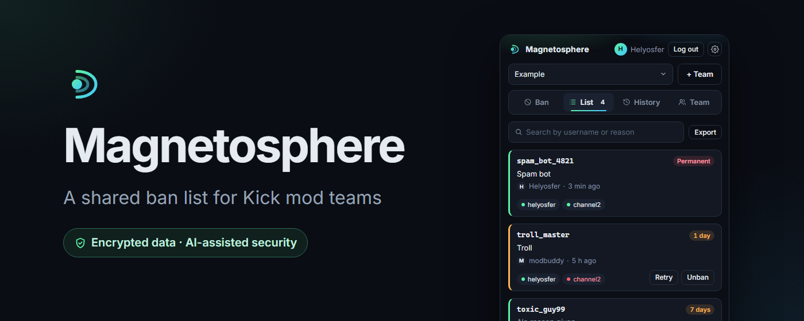
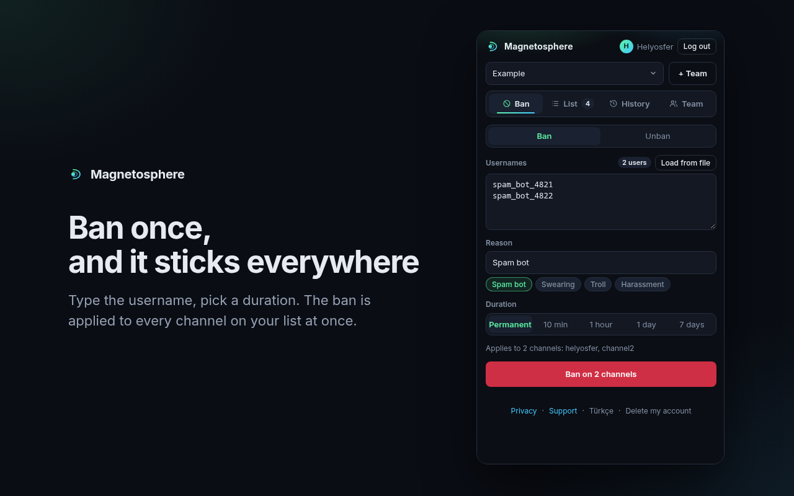
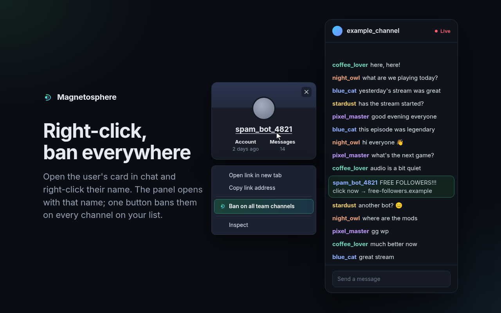
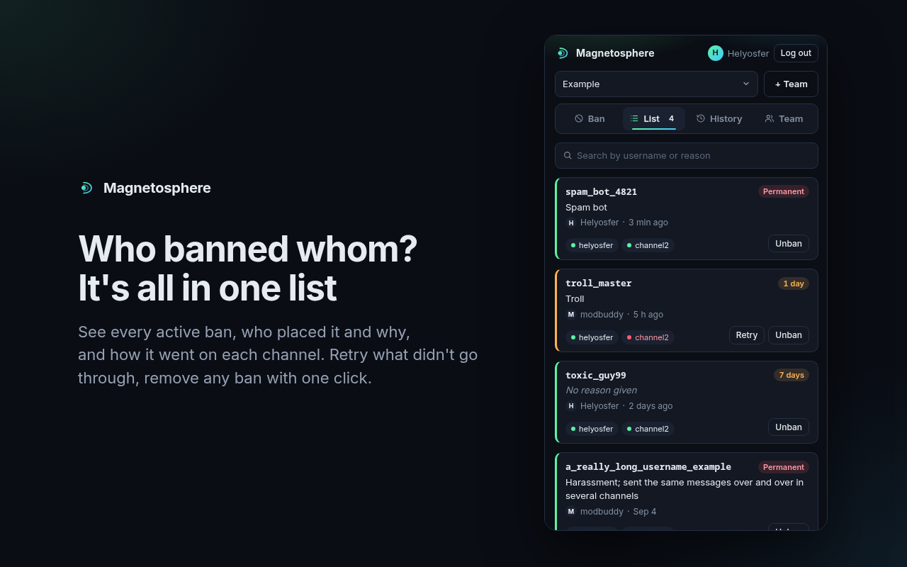
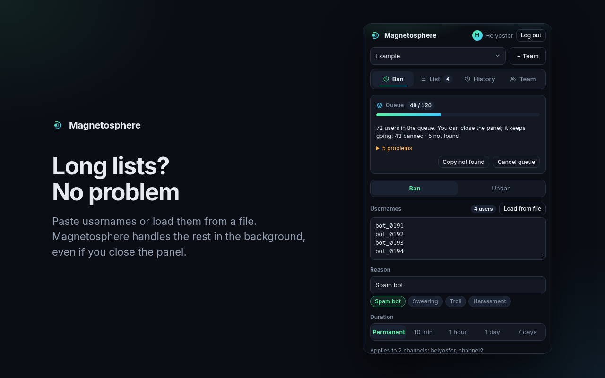
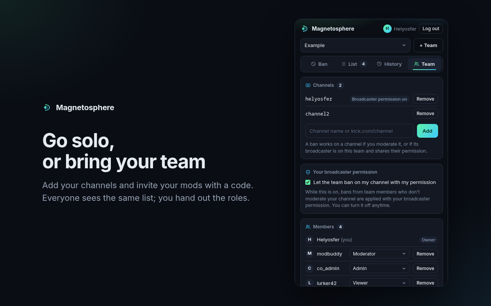
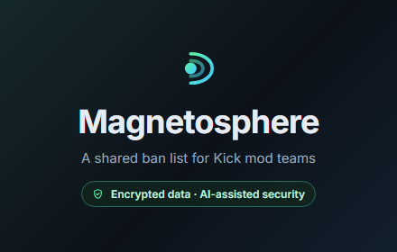

<div align="center">

<sub>[Türkçe](README.md) · [English](README.en.md) · [Español](README.es.md) · [Português (Brasil)](README.pt-BR.md) · [العربية](README.ar.md) · [Deutsch](README.de.md) · [Français](README.fr.md) · [Bahasa Indonesia](README.id.md) · [Русский](README.ru.md)</sub>



**A shared ban list for Kick moderators and mod teams.**<br>
Ban a user in every channel you moderate, in one go.

[](https://chromewebstore.google.com/detail/magnetosphere/kjbbjooackbcfeeoolkfpmdbkomjiflh)
[](LICENSE)


[Screenshots](#screenshots) ·
[Features](#features) ·
[Getting started](#getting-started) ·
[Roles](#roles-and-permissions) ·
[How it works](#how-it-works) ·
[Your own server](#setting-up-your-own-server) ·
[Security](#security) ·
[Development](#development)

</div>

<br>

If you moderate more than one channel, you have to ban every troll or spam bot separately in each of
them. Magnetosphere reduces that to a single step: type the username once (or load thousands of names
from a file) and the ban is applied to every channel on your ban list. Who banned whom, when and why is
recorded too.

You can use it **on your own**: without inviting anyone, you add the channels you moderate and issue bans.
**With a team**, you also get:

- Everyone sees the same ban list.
- A ban issued by one person is applied to all of the team's channels.
- If a broadcaster on the team shares their permission, bans from members who are not moderators on that channel also take effect there.

The name comes from the magnetic shield (the magnetosphere) that protects the Earth from the solar wind.

> Magnetosphere is an independent project; it is not affiliated with or endorsed by Kick.

## Screenshots

| | |
|:-:|:-:|
|  |  |
| **Ban:** type the names, pick a reason and a duration; the ban goes to all channels at once. | **Right-click:** open a user's card in chat and right-click the name; the panel opens with that name filled in. |
|  |  |
| **List:** active bans; who banned whom and why, and on which channels the ban was applied. | **Queue:** thousands of names are processed in the background; it keeps going even if the panel is closed. |
|  | |
| **Team:** channels, broadcaster permission sharing, members and their roles. | |

## Features

| | |
|---|---|
| **Ban in many channels at once** | A permanent ban or a timeout of 10 minutes, 1 hour, 1 day or 7 days; applied to all channels at the same time. |
| **Channel selection** | When the team has more than one channel, you choose the channels for **Ban** and **Unban**: **All**, **Only mine**, or the channels you tick with **Choose…**. The selection applies to that one action only and goes back to **All** afterwards. If you remove a ban from only some channels, the record stays active on the channels where the ban remains; the channel you removed it from appears greyed out on the card, and **Try again** does not ban there again. Unbanning on a channel where you are not a moderator fails, so selecting only the channels where you have permission gives a clean result. For long lists, the channels are fixed when the list is queued: a channel added to the team while the list is being processed is not applied to the remaining names. |
| **Bulk ban, import and export** | Paste names or upload a `.txt`, `.csv` or `.json` file (up to 6,000 names at a time). In CSV files only the first column is read and the header row is skipped. **List > Export** downloads all of the team's permanent bans as a `.txt` file with one username per line; the file can be loaded into another team as it is. |
| **Background queue** | Long lists are queued on the server; bans keep being issued even if you close the panel or the browser. Progress, names that were not found and cancellation are managed from the panel. |
| **Respects Kick's rate limit** | The request rate adjusts itself. If Kick slows requests down, no name is lost; it goes back into the queue. |
| **Shared list and history** | Who issued each ban, when and why, and on which channels the ban was applied; search by username or reason. **List** shows permanent bans and timeouts still in effect, **History** shows removed bans and expired timeouts; owners and admins can delete the history after confirming. |
| **Try again and undo** | Retries a ban on the channels where it could not be applied; removes a ban from all channels with one click. |
| **Unban by name** | Type the username in **Ban > Unban**; the ban is removed from all of the team's channels. Bans that were issued by hand on Kick or before Magnetosphere, and are not on the list, are removed too, and the removal is recorded on the list. Lists longer than 10 (which can also be loaded from a file) are queued like a bulk ban. |
| **Right-click shortcut** | On kick.com, open a user's card in chat, right-click the name on the card and choose "Ban on all team channels". The panel opens with that name. |
| **On your own or with a team** | Anyone who logs in builds their own channel list with one click; if they want, they bring others into the team with an invite link or code. The person who opens the link installs the extension and joins with one click. |
| **Roles** | Owner, admin, moderator and viewer. You can choose which role people who join by invite start with. |
| **Broadcaster permission sharing** | A broadcaster on the team can, if they choose, make the ban permission on their own channel available to the team; only they can make that decision. |
| **Protection against wrong bans** | Members with ban permission on the team and broadcasters on the team cannot be banned. |
| **Account and team management** | Leaving a team, transferring ownership, deleting the team and the account; all from the panel. |
| **9 languages** | Turkish, English, German, Spanish, French, Indonesian, Portuguese, Russian and Arabic. The panel opens in the browser's language; if the browser's language is not one of these, it uses English. You can change it in **Settings**, opened with the gear in the header; in Arabic the panel is laid out right to left. The server's error messages and the invite page also come in the selected language. |

## Getting started

<a href="https://chromewebstore.google.com/detail/magnetosphere/kjbbjooackbcfeeoolkfpmdbkomjiflh"></a>

1. **Install.** Add the extension [from the Chrome Web Store](https://chromewebstore.google.com/detail/magnetosphere/kjbbjooackbcfeeoolkfpmdbkomjiflh).
   It works in Chromium-based browsers such as Chrome, Edge and Brave; Firefox is not supported.
2. **Log in.** Click the Magnetosphere icon and press **Log in with Kick**. Login happens on Kick's own
   page; the extension never sees your password.
3. **Start.** Press **Start on my own**; your own channel is added to the list automatically. If you were
   invited to a team, paste the invite code instead.
4. **Add channels.** In the **Team** tab, add the channels you moderate by name or with a
   `kick.com/channel` link.
5. **Ban.** In the **Ban** tab, type usernames or pick a list with **Load from file**. Lists longer than 10
   names are queued and processed in the background.
6. **Follow up.** The **List** tab shows the result of active bans channel by channel; removed bans and
   expired timeouts move to the **History** tab. From here you can remove a ban or retry it on the
   channels where it could not be applied.
7. **Remove old bans.** For a ban that is not on the list (issued by hand on Kick or before Magnetosphere),
   choose **Unban** in the **Ban** tab and type the username; the ban is removed from all of the team's channels.
   Long lists are queued here too.

To build a team, press **Copy invite link** in the **Team** tab and send the link to your mods. The person
who opens it installs the extension, presses **Join team** on the page, and sees the team's name and owner in
the panel before confirming. If the link is opened on a phone or in a non-Chrome browser, the page tells them
to open it in Chrome on a computer. You can share the code instead of the link. People who join use the same
channel list and ban list.

The invite code is the part of the link after the `#` sign; the browser does not send that part to the
server, so the code never ends up in server or Cloudflare logs. The page hands the code to the extension
through Chrome's `externally_connectable` feature, which does not ask for any new permission.

<br clear="right">

## Roles and permissions

| | Viewer | Moderator | Admin | Owner |
|---|:-:|:-:|:-:|:-:|
| View and export the shared list | ✓ | ✓ | ✓ | ✓ |
| Issue bans, retry, load lists | | ✓ | ✓ | ✓ |
| Remove a ban you issued yourself | | ✓ | ✓ | ✓ |
| Remove a ban by name that is not on the list (issued by hand on Kick) | | ✓ | ✓ | ✓ |
| Remove a ban issued by someone else | | | ✓ | ✓ |
| Add and remove channels | | | ✓ | ✓ |
| Delete the history | | | ✓ | ✓ |
| See and renew the invite code | | | ✓ | ✓ |
| Remove a member with a lower role than yourself | | | ✓ | ✓ |
| Assign roles, set the starting role for people who join | | | | ✓ |
| Transfer ownership, delete the team | | | | ✓ |

People who join by invite become moderators by default; the owner can change this to "starts as viewer".
Everyone except the owner can leave the team at any time.

If the user whose name you type in **Unban** has an active ban on the list that another member issued, the
list rule applies: only owners and admins can remove that ban.

**Delete history** permanently deletes removed bans and expired timeouts for everyone on the team; it does
not touch the bans on Kick. A ban record that could not be removed on a channel is not deleted, because the
person may still be banned on that channel and the record is needed to retry the removal.

### Broadcaster permission sharing

On every channel, a ban is first tried with the **moderator permission of the person who issued it**. If the
channel's broadcaster is on the team and has turned on the sharing under **Team > Your broadcaster
permission**, the ban is applied with the broadcaster's permission when the moderator's permission is not enough.

- Sharing starts off for everyone; the person who created the team turns it on for their own channel
  themselves. (In teams created before 0.15.1, the creator's sharing is on; turn it off if you like.)
- Only the broadcaster themselves can turn it on and off; joining a team with an invite code does not grant
  this permission on its own.
- On a channel where you are not a moderator and whose broadcaster does not share their permission, the ban
  is not applied; that channel shows up in red on the list.
- To add a channel to the team, you need to be a Kick moderator on that channel, the channel must be yours,
  or its broadcaster must be on the team (0.15.1). If you want to add a broadcaster's channel, have the
  broadcaster join the team first.

## How it works

```
   Chrome extension              Server                    Kick
┌──────────────────┐      ┌──────────────────┐      ┌──────────────────┐
│ The panel the    │ ───▶ │ Teams, roles     │ ───▶ │ Official API     │
│ moderator        │      │ Shared list      │      │ (OAuth 2.1 and   │
│ uses             │ ◀─── │ Queue and workers│ ◀─── │  moderation)     │
└──────────────────┘      └──────────────────┘      └──────────────────┘
```

| Part | What it does |
|---|---|
| [`extension/`](extension) | The Chrome extension (Manifest V3). The interface the user sees; it makes no Kick requests on its own and never sees your Kick password or token. |
| [`server/`](server) | The Python server (3.10+). Holds teams, roles, the shared list, the queue and Kick sessions; issues bans through Kick's [official API](https://docs.kick.com/apis/moderation). |
| [`store/`](store) | The Chrome Web Store text and images. |
| [`tools/`](tools) | The script that builds the store package. |
| [`docs/`](docs) | The privacy policy. |

The server is required because Kick's OAuth flow needs a Client Secret, and the Secret cannot be placed
inside the extension. The server uses only the Python standard library; its one dependency is the
`cryptography` package, for token encryption. The data lives in a single SQLite file.

By default, the extension from the store uses the `magnetosphere.helyosfer.me` server; anyone who logs in
can build a team there. If you like, you can set up your own server with the steps below and point the
extension at it.

## Setting up your own server

To try it on your own computer first, steps 1–3 are enough; for a permanent setup that everyone will use,
go to [Putting the server on the internet](#putting-the-server-on-the-internet).

### 1. Kick application

Create an application at [kick.com/settings/developer](https://kick.com/settings/developer)
(two-step verification must be on for the account). The application name cannot contain spaces.

| Field | Value |
|---|---|
| Redirect URL | `http://localhost:8787/auth/callback` (local trial) or `https://<your-domain>/auth/callback` |
| Scopes | Read user information, Read channel information, Execute moderation actions for moderators |

### 2. Server

```bash
cd server
pip install -r requirements.txt
cp .env.example .env
```

Fill in the `.env` file:

- `KICK_CLIENT_ID` and `KICK_CLIENT_SECRET`: the values Kick gives you.
- `TOKEN_ENCRYPTION_KEY`: a key generated with the command below.

```bash
python -c "from cryptography.fernet import Fernet; print(Fernet.generate_key().decode())"
```

Then start the server:

```bash
python app.py
```

The server listens at `http://localhost:8787`. If a security setting is missing, it prints a warning at startup.
You can check that it is running at `http://localhost:8787/health`.

### 3. Extension

1. In Chrome, open the `chrome://extensions` page and turn on **Developer mode**.
2. Choose the `extension` folder with **Load unpacked**.
3. Click the Magnetosphere icon, type the server's address into the **Advanced: use your own server** field
   (`http://localhost:8787` for a local trial) and press **Log in with Kick**.

If you don't want everyone on your team to enter the address by hand, change the `DEFAULT_SERVER` value in
`extension/server-url.js` to your own address and distribute the folder that way. For invite links to reach
the extension, also add the same address to the `externally_connectable.matches` list in `manifest.json`
and to the `INVITE_ORIGINS` list in `background.js`. If you don't, the **Copy invite link** button does not
appear in the panel; the code can still be copied and shared. The button appears with server 0.12.0 or newer.

The ID of an extension loaded by hand is pinned by the key in `manifest.json`
(`flmfmniipeobbaoahmbdkjnblbegalob`); it comes out the same on every computer. The server accepts only the IDs
in the `ALLOWED_EXTENSION_IDS` list. The ID of the extension installed from the store is different
(`kjbbjooackbcfeeoolkfpmdbkomjiflh`); to accept both, put both in the list.

### Putting the server on the internet

For a setup your team will use, the server must run continuously and sit behind HTTPS.

1. **Settings.** In `.env`, set `PUBLIC_URL=https://<your-domain>` and update the Redirect URL in the Kick
   application to `https://<your-domain>/auth/callback`. Leave `HOST=127.0.0.1`; the server is not exposed
   directly to the outside. To keep the database outside the code folder, set `DB_PATH`.
2. **Reverse proxy.** A reverse proxy provides HTTPS. With [Caddy](https://caddyserver.com) the certificate
   is obtained automatically:

   ```
   <your-domain> {
   	reverse_proxy 127.0.0.1:8787
   }
   ```

   The login rate limit reads the real client address from the last value of the `X-Forwarded-For` header.
   Caddy writes this header correctly with its default settings. nginx does not; it passes along the header
   the client sent as it is, so if you use nginx, add the line `proxy_set_header X-Forwarded-For $remote_addr;`.
   If the header never arrives, all clients are counted as a single address and the login limit becomes
   shared by everyone.

   If the server is behind Cloudflare, the reverse proxy sees Cloudflare's address rather than the visitor's,
   and the login limit becomes shared by everyone coming through the same Cloudflare server. The real address
   is in the `CF-Connecting-IP` header; the header should be trusted only on requests that come from Cloudflare:

   ```
   @cloudflare remote_ip <the ranges at https://www.cloudflare.com/ips/>
   handle @cloudflare {
   	reverse_proxy 127.0.0.1:8787 {
   		header_up X-Forwarded-For {http.request.header.CF-Connecting-IP}
   	}
   }
   handle {
   	reverse_proxy 127.0.0.1:8787
   }
   ```
3. **Service.** Run the server as a systemd service under an unprivileged system user:

   ```ini
   [Service]
   User=magnetosphere
   WorkingDirectory=/opt/magnetosphere/app/server
   ExecStart=/opt/magnetosphere/venv/bin/python app.py
   Environment=PYTHONUNBUFFERED=1
   Restart=on-failure
   NoNewPrivileges=true
   ProtectSystem=strict
   ReadWritePaths=/opt/magnetosphere/data
   ```

4. **Who can create teams.** By default, anyone who logs in can create a team. If you are opening the
   server only for your own team, restrict this to your own Kick user ID with `ALLOWED_TEAM_CREATORS`;
   everyone else joins with an invite code.
5. **Backup.** The database can be backed up safely while it is running:

   ```bash
   sqlite3 /opt/magnetosphere/data/crossban.db ".backup '/opt/backups/crossban-$(date +%F).db'"
   ```

   Keep a copy of the backup off the server (for example in a cloud folder with [rclone](https://rclone.org)).
   Don't put the `.env` file next to this backup; the encryption key and the database should be kept apart.

At startup, the server automatically migrates an old database to the new schema; taking a backup before
updating is enough.

### Updating the server

For the setup above (code in `/opt/magnetosphere/app`, database in `/opt/magnetosphere/data`):

```bash
# 1. Backup
sqlite3 /opt/magnetosphere/data/crossban.db ".backup '/opt/backups/crossban-$(date +%F)-update.db'"
# 2. Code; pulled as the folder's owner (with another user, git refuses with "dubious ownership")
sudo -u "$(stat -c %U /opt/magnetosphere/app)" git -C /opt/magnetosphere/app pull
grep '^VERSION' /opt/magnetosphere/app/server/app.py   # don't continue until you see the new version
/opt/magnetosphere/venv/bin/pip install -r /opt/magnetosphere/app/server/requirements.txt
# 3. Restart and check
sudo systemctl restart magnetosphere
curl -s https://<your-domain>/health          # {"ok": true, "version": "<new version>"}
journalctl -u magnetosphere -n 30 --no-pager
```

If `/health` still shows the old version, either `git pull` failed or the service is running from a
different folder; check the `WorkingDirectory` value with `systemctl cat magnetosphere`.

If you serve the privacy page from a static file on the reverse proxy (for example
`/var/www/magnetosphere/privacy.html`), `git pull` does not update it; after updating, copy
`docs/privacy.html` there or configure the reverse proxy to serve the `docs/` folder in the repository directly.

Sessions are not affected by the update; nobody has to log in again. If the new version of the extension
uses a new server feature, update the server first and then the extension; an old extension keeps working
with a new server. To go back to a previous version, find that version's commit with `git log`, run
`git checkout <commit>` and restart the service. The database schema has not changed since 0.6.0; versions
0.6.x and 0.7.x work with the same database. Restore the backup only if the data is corrupted, and only
while the service is stopped.

### Settings

Read from the `server/.env` file.

| Variable | Default | Description |
|---|---|---|
| `KICK_CLIENT_ID` | — | The Kick application's Client ID |
| `KICK_CLIENT_SECRET` | — | The Kick application's Client Secret |
| `TOKEN_ENCRYPTION_KEY` | empty | The key that encrypts Kick tokens in the database. If empty, tokens stay in plain text |
| `ALLOWED_EXTENSION_IDS` | empty (all) | Extension IDs allowed to log in and call the API, comma-separated |
| `ALLOWED_TEAM_CREATORS` | empty (everyone) | Kick user IDs allowed to create teams, comma-separated. Joining by invite is always open |
| `PUBLIC_URL` | `http://localhost:8787` | The address the server is reached at from outside. The Redirect URL on Kick must be `{PUBLIC_URL}/auth/callback` |
| `HOST` | `127.0.0.1` | The interface to listen on |
| `PORT` | `8787` | The port to listen on |
| `DB_PATH` | `server/crossban.db` | Path of the SQLite database |
| `QUEUE_WORKERS` | `4` | Number of workers processing the queue at the same time |
| `KICK_REQUESTS_PER_SECOND` | `1` | Starting request rate to the Kick API; drops by itself if Kick returns 429, rises if there are no problems |
| `KICK_REQUESTS_PER_SECOND_MAX` | `5` | Upper limit of the request rate |

## Security

### What is protected

- **Kick tokens are stored encrypted.** While `TOKEN_ENCRYPTION_KEY` is set, the access and refresh tokens
  in the database are encrypted with Fernet (AES + HMAC); if the database file leaks on its own, the tokens
  cannot be read.
- **Sessions.** The session key is stored in the database only as a digest (SHA-256) and becomes invalid
  after 30 days of not being used. Logging out closes all of the user's sessions.
- **This extension only.** While `ALLOWED_EXTENSION_IDS` is set, no other extension can start the login flow
  or call the API from the browser (CORS is opened only to the allowed ID).
- **Login flow.** OAuth is done with PKCE and a single-use `state`; the session is delivered only to
  Chrome's extension-specific redirect address.
- **The session travels only over an encrypted connection.** The extension does not send the session key
  to `http://` addresses other than `localhost`, `127.0.0.1` and `[::1]`: it does not start the login, does
  not use the session if the saved address is unencrypted, and shows a warning.
- **Text fields are checked.** If the team name, invite code or ban reason is not text, the request is
  rejected; values such as `null` or a list are not converted to text and saved.
- **Teams are isolated from each other.** Only the members of a team can see its channels, members and list.
- **Roles are checked on the server.** Every action goes through a role check on the server; the panel
  hiding a button is not relied on. Escalating a timeout does not change the ban's owner or reason; a
  moderator cannot remove someone else's ban this way.
- **Invite code.** It is a random 72 bits; only owners and admins can see and renew it, and the old code
  becomes invalid immediately. The database holds only its digest and (if a key is set) its encrypted form.
  A member who leaves the team cannot return with the same code at a role higher than their last one; a
  removed member cannot join until the code is renewed.
- **Broadcaster permission is used with consent.** A broadcaster's token is used for a ban issued by someone
  else only if that broadcaster turned on the sharing themselves.
- **Account deletion.** When a user deletes their account, their sessions, memberships and tokens are
  deleted and the access on Kick is revoked. The bans they issued stay anonymous on other teams' lists; the
  Kick ID is also deleted from the records. If the revocation on Kick fails, the response says so
  (`kick_revoked: false`).
- **Minimal permissions.** Only user information, channel information and ban permission are requested from
  Kick. The extension uses only the `identity`, `storage` and `contextMenus` permissions; it injects no
  content script into any site.
- **Limits.** The request body is limited to 1 MB, a list loaded at one time to 6,000 names, and a team's
  pending records in the queue to 20,000. At most 30 logins can be started from the same address in 10
  minutes. An account can make at most 300 requests per minute, create at most 10 teams and be a member of
  50 teams; a team has at most 50 channels and 200 members. An account can have at most two operations going
  to Kick at the same time; this way a single account cannot fill the shared Kick rate limit and keep others
  waiting.
- **Robust request handling.** Malformed or half-sent requests do not hold a connection open (30-second
  timeout); unexpected errors return as a 500 without leaking details to the client.
- **Fair queue.** The queue is processed in turn across teams; one team's long list does not keep the others waiting.

### Verifying encryption

The person running the server can show that tokens are stored encrypted without revealing the key or any
token. [`tools/sifreleme_dogrula.py`](tools/sifreleme_dogrula.py) looks at the live database and backups
read-only and writes a report made up only of numbers:

- whether the key is set and is a valid Fernet key,
- how many tokens are encrypted, how many are plain text, and how many of the encrypted ones can be decrypted with the key,
- whether the server printed a "key not set" warning at its last startup,
- whether each database backup contains plain-text tokens, and whether a copy of the key sits in the backup folders.

```bash
sudo /opt/magnetosphere/venv/bin/python /opt/magnetosphere/app/tools/sifreleme_dogrula.py \
    --sunucu /opt/magnetosphere/app/server --yedek /opt/backups
```

If a plain-text token is found or the key is invalid, the exit code is 1. The SHA-256 digest at the top of
the report is there to check that the running script is the same as the version in the repository. The
report is the server operator's own statement; it is not independent external proof, but what is measured
is public to everyone in this file.

### Responsibilities of the person running the server

- `server/.env` (Client Secret, encryption key) and `server/crossban.db` are confidential; `.gitignore`
  keeps both out of the repository. Don't put the encryption key and the database in the same backup.
- Open the server to the internet only behind HTTPS. `HOST` by default listens only on the local machine.
- If the encryption key is lost, no data is lost; everyone just has to log in with Kick again.

### Known limits

- Encryption protects against the database file leaking; someone who takes over the whole server can read the key too.
- A person who joins with an invite code becomes a moderator by default and can issue bans on the team's
  channels; share the code only with people you trust, or start new members as viewers.
- The rate limit is per account and kept in memory; also set a limit on the reverse proxy against requests without a session.
- If an ownership transfer and the departure of the member taking over happen at exactly the same moment,
  the team can be left without an owner. If an account deletion and a new member joining the team happen at
  the same moment, the team can be deleted without a warning. Both require a very narrow window of time; a
  fix is planned.
- If `TOKEN_ENCRYPTION_KEY` is empty, the server only prints a warning and stores tokens in plain text. On a
  public server, always set the key.

### Independent audit (October 2026)

The server and extension were independently audited on 15 October 2026. Alongside the tests in this
repository, a separate test suite was used:

- **End-to-end tests in the browser (Playwright).** The panel was opened against the real server connected
  to a fake Kick. These checked that HTML in the team name, username and ban reason does not run (XSS), that
  the session is closed when the server returns 401, that an unencrypted server address is rejected, and
  accessibility (axe).
- **Server tests from an attacker's point of view.**
  - All endpoints of a team you are not a member of: all returned 404.
  - Touching another team's ban record through your own team's path.
  - Fake, expired and logged-out sessions.
  - Using `state` a second time and open-redirect attempts.
  - A non-allowed extension ID and a renewed old invite code.
  - An admin making themselves owner.
  - Internal details leaking in error responses.
- **Mutation check.** The following defenses were broken temporarily, one at a time; at least one test caught each of them:
  - team membership check
  - `state` being single-use
  - redirect address check
  - session expiry
  - owner permission
  - text not being written as HTML in the panel
  - the session being deleted on a 401
- **Static analysis.** Bandit's 6 warnings (f-string in SQL, `urlopen`) were reviewed line by line. In none
  of them does user input reach the SQL text or the scheme or host of the request address; values go as
  parameters.
- **Found and fixed in 0.5.1.** The extension being able to send the session key to an unencrypted
  (`http://`) server, and non-text fields being converted to text and saved.

Result: no other vulnerability was found in the areas tested. The known limits are above.

### Reporting a vulnerability

If you find a security vulnerability, please don't open a public issue; write to `destek@helyosfer.me`.
For the scope, response times and disclosure process, see [SECURITY.md](SECURITY.md).

Privacy policy: [magnetosphere.helyosfer.me/privacy](https://magnetosphere.helyosfer.me/privacy)
(source: [`docs/privacy.html`](docs/privacy.html)).

## Development

### Tests

```bash
cd server
python -m unittest test_app
```

The tests run end to end against a fake Kick API; they make no requests to the real Kick. They cover login,
loss of permission, the queue and concurrent workers, fair queueing across teams, roles, permission sharing,
unban by name, account deletion, the List and History split, error messages in five languages, re-banning
after a timeout expires, migration from an old database, and the security rules.

The completeness of the translations (the same texts in every language, the length of the store's short
description) is checked separately:

```bash
node tools/ceviri_kontrol.js
```

On GitHub, on every push and PR, the server tests (Python 3.12 and 3.14), the translation check and a scan
of dependencies for known vulnerabilities (`pip-audit`) run automatically (`.github/workflows/test.yml`).

### Chrome Web Store

```bash
python tools/paketle.py
```

Produces the `dist/magnetosphere-<version>.zip` file. Because the store does not accept the `key` field in
the manifest, the script removes it from the package; it stays in the repository, so the ID of the extension
loaded by hand does not change.

The text of the store page is in [`store/aciklama.md`](store/aciklama.md). The images:

| Field | File | Size |
|---|---|---|
| Screenshots | [`screenshot-1-ban.png`](store/en/screenshot-1-ban.png), [`screenshot-2-list.png`](store/en/screenshot-2-list.png), [`screenshot-3-queue.png`](store/en/screenshot-3-queue.png), [`screenshot-4-team.png`](store/en/screenshot-4-team.png), [`screenshot-5-right-click.png`](store/en/screenshot-5-right-click.png) | 1280×800 |
| Small promo tile | [`promo-small-440x280.png`](store/en/promo-small-440x280.png) | 440×280 |
| Marquee promo tile | [`promo-marquee-1400x560.png`](store/en/promo-marquee-1400x560.png) | 1400×560 |
| Icon | [`extension/icons/icon128.png`](extension/icons/icon128.png) | 128×128 |

## Roadmap

A working release. Verified on the real Kick: login, bans with both broadcaster and moderator permission,
unbanning, and a bulk import of thousands of accounts across two channels.

- [x] Encrypting tokens in the database, session expiry
- [x] Pinning the extension to a fixed ID and its icon
- [x] The server running on the internet behind HTTPS, as a service, with database backups
- [x] Deleting teams; fair queueing across teams and a login limit for a public server
- [x] [Chrome Web Store release](https://chromewebstore.google.com/detail/magnetosphere/kjbbjooackbcfeeoolkfpmdbkomjiflh)
- [x] Use on your own, roles within a team, explicit consent for broadcaster permission, leaving a team and account deletion
- [x] Per-account limits for public use
- [x] Unban by username, including bans issued by hand on Kick
- [x] List and History split: expired timeouts and removed bans move to History
- [x] English interface
- [x] Spanish, Portuguese (Brazil) and Arabic interfaces (right-to-left layout in Arabic)
- [x] German, French, Russian and Indonesian interfaces; language, privacy and account deletion in Settings in the header
- [ ] Automatic detection that listens to chat and puts spam bots into a suspicious queue

### Known limitations

- A username is looked up using Kick's channel address rule (lowercase, `-` in place of `_`, at most 25 characters).
- Channels other than your own are added by hand; the official API does not provide a "channels I moderate" list.
- The official API does not list the existing bans on a channel; bans issued before Magnetosphere do not
  appear on the list. These bans can be removed by typing the username in **Unban**. If the user is not
  already banned on a channel, that channel may show up in the result as "could not be removed".
- Speed is set by Kick's rate limit: about one second per account for a team with two channels.

## Contributing

To report bugs and make suggestions, [open an issue](https://github.com/Helyosfer/magnetosphere/issues).
Before sending a change, make sure the tests pass; for new behavior, add a test to `server/test_app.py`.

## License

Copyright (C) 2026 Helyosfer

Magnetosphere is free software; you can use, modify and distribute it under the terms of the
[GNU General Public License version 3](LICENSE) (GPL-3.0). If you distribute modified versions, you must
also release the source code under the same license. The software is provided without any warranty.

The [Inter](https://github.com/rsms/inter) typeface used in the panel ships with the extension and is
licensed under the [SIL Open Font License 1.1](extension/fonts/LICENSE.txt).
