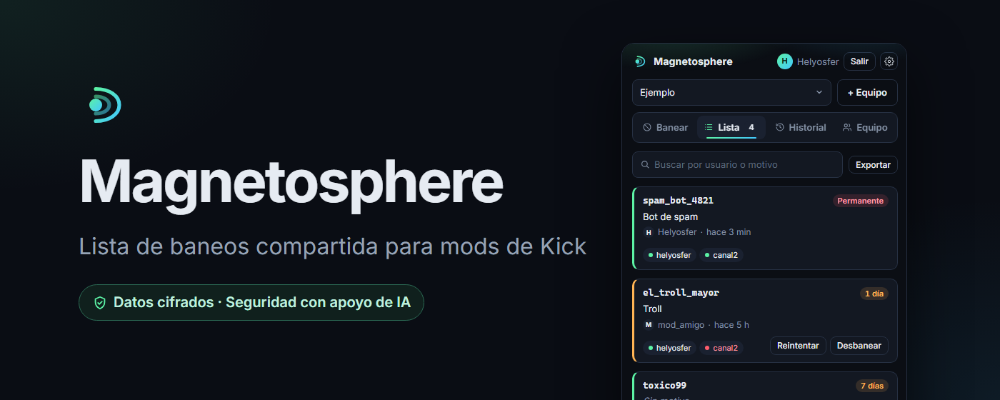
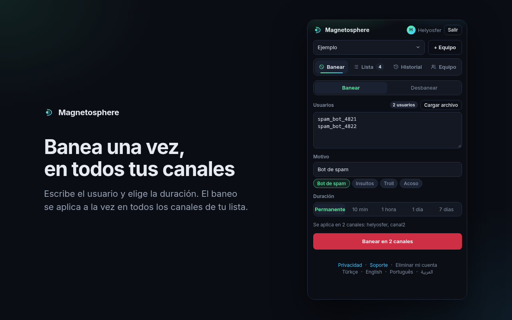
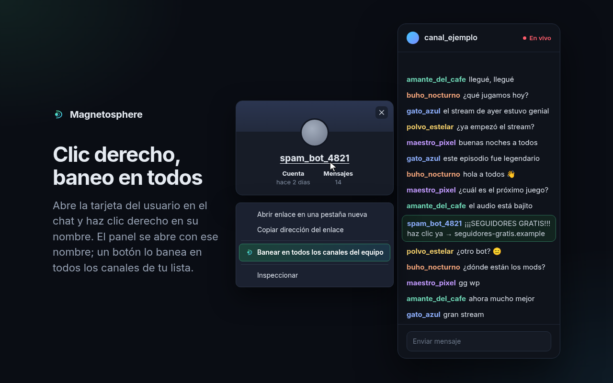
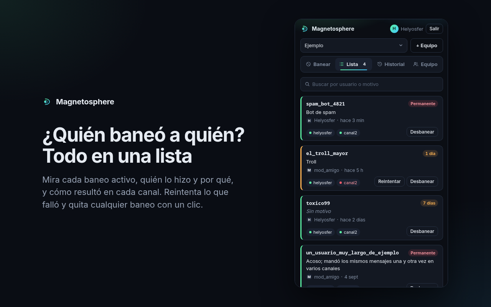
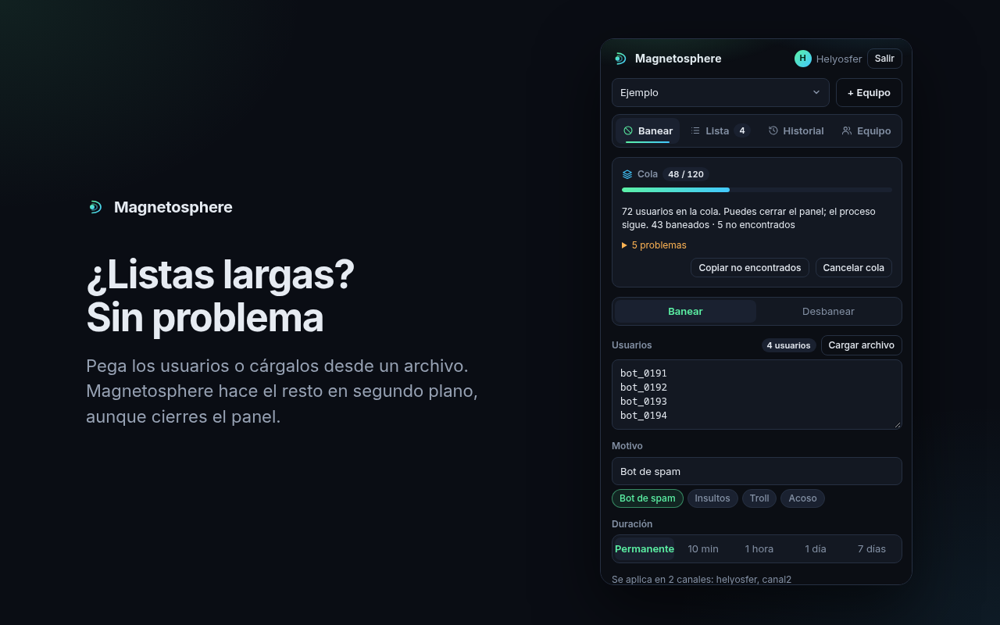
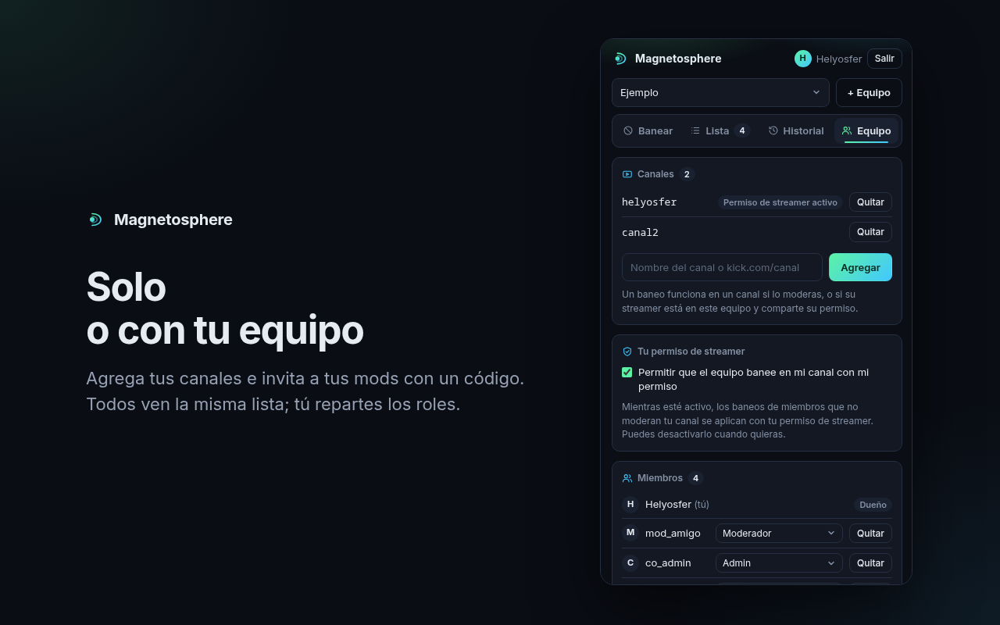
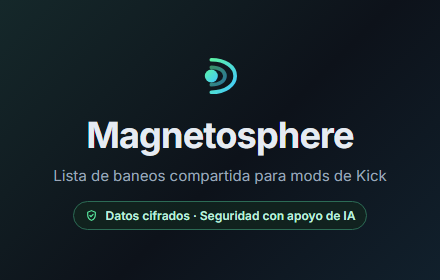

<div align="center">

<sub>[Türkçe](README.md) · [English](README.en.md) · [Español](README.es.md) · [Português (Brasil)](README.pt-BR.md) · [العربية](README.ar.md) · [Deutsch](README.de.md) · [Français](README.fr.md) · [Bahasa Indonesia](README.id.md) · [Русский](README.ru.md)</sub>



**Lista de baneos compartida para moderadores de Kick y sus equipos.**<br>
Banea a un usuario de una sola vez en todos los canales que moderas.

[](https://chromewebstore.google.com/detail/magnetosphere/kjbbjooackbcfeeoolkfpmdbkomjiflh)
[](LICENSE)


[Capturas de pantalla](#capturas-de-pantalla) ·
[Funciones](#funciones) ·
[Primeros pasos](#primeros-pasos) ·
[Roles](#roles-y-permisos) ·
[Cómo funciona](#cómo-funciona) ·
[Tu propio servidor](#monta-tu-propio-servidor) ·
[Seguridad](#seguridad) ·
[Desarrollo](#desarrollo)

</div>

<br>

Si moderas en varios canales, tienes que banear a un troll o a un bot de spam en cada canal por separado.
Magnetosphere lo reduce a un solo paso: escribes el nombre de usuario una vez (o cargas miles de nombres
desde un archivo) y el baneo se aplica en todos los canales de tu lista. También queda registrado quién
baneó a quién, cuándo y por qué.

Puedes usarlo **por tu cuenta**: sin invitar a nadie, agregas los canales que moderas y baneas. **En equipo**
obtienes además lo siguiente:

- Todos ven la misma lista de baneos.
- El baneo que pone una persona se aplica en todos los canales del equipo.
- Si un streamer del equipo comparte su permiso, los baneos de los miembros que no son moderadores de ese canal también valen allí.

Su nombre viene del escudo magnético que protege la Tierra del viento solar (la magnetosfera).

> Magnetosphere es un proyecto independiente; no está afiliado a Kick ni cuenta con su respaldo.

## Capturas de pantalla

| | |
|:-:|:-:|
|  |  |
| **Banear:** escribe los nombres, elige el motivo y la duración; el baneo va a todos los canales a la vez. | **Clic derecho:** abre la tarjeta del usuario en el chat y haz clic derecho sobre su nombre; el panel se abre con ese nombre. |
|  |  |
| **Lista:** baneos activos; quién baneó a quién y por qué, y en qué canales se aplicó el baneo. | **Cola:** miles de nombres se procesan en segundo plano; sigue aunque cierres el panel. |
|  | |
| **Equipo:** canales, permiso de streamer compartido, miembros y sus roles. | |

## Funciones

| | |
|---|---|
| **Baneo en varios canales a la vez** | Baneo permanente o suspensión de 10 minutos, 1 hora, 1 día o 7 días; se aplica en todos los canales al mismo tiempo. |
| **Selección de canales** | Cuando el equipo tiene varios canales, en **Banear** y **Desbanear** se eligen los canales: **Todos**, **Solo el mío** o los que marques con **Elegir…**. La selección vale solo para esa operación; al terminar vuelve a **Todos**. Si quitas un baneo solo de algunos canales, el registro sigue activo en los canales donde el baneo continúa; el canal del que se quitó aparece en gris en la tarjeta y **Reintentar** no vuelve a banear allí. Como quitar un baneo en un canal donde no eres moderador da error, elegir solo los canales donde tienes permiso da un resultado limpio. En listas largas los canales se fijan al entrar en la cola: un canal agregado al equipo mientras se procesa la lista no se aplica a los nombres restantes. |
| **Baneo masivo, importar y exportar** | Pega los nombres o carga un archivo `.txt`, `.csv` o `.json` (hasta 6.000 nombres de una vez). En los CSV solo se lee la primera columna y se omite la fila de encabezado. **Lista > Exportar** descarga todos los baneos permanentes del equipo como un `.txt` con un nombre de usuario por línea; el archivo se puede cargar tal cual en otro equipo. |
| **Cola en segundo plano** | Las listas largas se ponen en cola en el servidor; los baneos se siguen aplicando aunque cierres el panel o el navegador. El progreso, los nombres no encontrados y la cancelación se gestionan desde el panel. |
| **Respeta el límite de solicitudes de Kick** | La velocidad de las solicitudes se ajusta sola. Si Kick las ralentiza, no se pierde ningún nombre: vuelve a la cola. |
| **Lista compartida e historial** | Quién puso cada baneo, cuándo y por qué, y en qué canales se aplicó; búsqueda por nombre de usuario o por motivo. **Lista** muestra los baneos permanentes y las suspensiones vigentes; **Historial**, los baneos quitados y las suspensiones terminadas. El dueño y los admins pueden borrar el historial con confirmación. |
| **Reintentar y deshacer** | Reintenta el baneo en los canales donde no se pudo aplicar; quita un baneo de todos los canales con un clic. |
| **Quitar baneos por nombre** | En **Banear > Desbanear** escribe el nombre de usuario; el baneo se quita de todos los canales del equipo. También se quitan los baneos que no están en la lista (puestos a mano en Kick o antes de Magnetosphere), y la operación queda registrada en la lista. Las listas de más de 10 nombres (también se pueden cargar desde un archivo) se ponen en cola como un baneo masivo. |
| **Atajo de clic derecho** | En kick.com, abre la tarjeta del usuario en el chat, haz clic derecho sobre el nombre y elige «Banear en todos los canales del equipo». El panel se abre con ese nombre. |
| **Por tu cuenta o en equipo** | Quien inicia sesión arma su propia lista de canales con un clic; si quiere, suma a otras personas al equipo con un enlace o código de invitación. Quien abre el enlace instala la extensión y se une con un clic. |
| **Roles** | Dueño, admin, moderador y espectador. Se puede elegir con qué rol empiezan quienes se unen por invitación. |
| **Permiso de streamer compartido** | Si un streamer del equipo quiere, abre su permiso de baneo en su propio canal para que el equipo lo use; esa decisión solo la toma él. |
| **Protección contra baneos por error** | No se puede banear a los miembros con permiso de baneo en el equipo ni a los streamers del equipo. |
| **Gestión de cuenta y equipo** | Salir del equipo, transferir la propiedad, eliminar el equipo y la cuenta; todo desde el panel. |
| **9 idiomas** | Turco, inglés, alemán, español, francés, indonesio, portugués, ruso y árabe. El panel se abre en el idioma del navegador; si el idioma del navegador no es uno de estos, en inglés. Se puede cambiar en **Ajustes**, que se abre con el engranaje del encabezado; en árabe el panel se dispone de derecha a izquierda. Los mensajes de error del servidor y la página de invitación también llegan en el idioma elegido. |

## Primeros pasos

<a href="https://chromewebstore.google.com/detail/magnetosphere/kjbbjooackbcfeeoolkfpmdbkomjiflh"></a>

1. **Instala.** Agrega la extensión desde [Chrome Web Store](https://chromewebstore.google.com/detail/magnetosphere/kjbbjooackbcfeeoolkfpmdbkomjiflh).
   Funciona en navegadores basados en Chromium como Chrome, Edge y Brave; Firefox no es compatible.
2. **Inicia sesión.** Haz clic en el icono de Magnetosphere y pulsa **Iniciar sesión con Kick**. El inicio de
   sesión se hace en la propia página de Kick; la extensión no ve tu contraseña.
3. **Empieza.** Pulsa **Empezar por mi cuenta**; tu propio canal se agrega solo a la lista. Si te invitaron
   a un equipo, pega en su lugar el código de invitación.
4. **Agrega canales.** En la pestaña **Equipo**, agrega los canales que moderas por su nombre o con el enlace
   `kick.com/canal`.
5. **Banea.** En la pestaña **Banear** escribe los nombres de usuario o elige una lista con **Cargar archivo**.
   Las listas de más de 10 nombres se ponen en cola y se procesan en segundo plano.
6. **Haz seguimiento.** La pestaña **Lista** muestra el resultado de los baneos activos canal por canal; los
   baneos quitados y las suspensiones terminadas pasan a la pestaña **Historial**. Desde ahí puedes quitar un
   baneo o reintentarlo en los canales donde no se pudo aplicar.
7. **Quita baneos antiguos.** Para un baneo que no está en la lista (puesto a mano en Kick o antes de
   Magnetosphere), elige **Desbanear** en la pestaña **Banear** y escribe el nombre de usuario; el baneo se
   quita de todos los canales del equipo. Aquí también las listas largas se ponen en cola.

Si quieres armar un equipo, pulsa **Copiar enlace de invitación** en la pestaña **Equipo** y envía el enlace a
tus mods. Quien lo abre instala la extensión, pulsa **Unirse al equipo** en la página, ve en el panel el
nombre y el dueño del equipo y da su confirmación. Si el enlace se abre en el teléfono o en un navegador que no
es Chrome, la página indica que hay que abrirlo en Chrome en el ordenador. En lugar del enlace también puedes
compartir el código. Quienes se unen usan la misma lista de canales y la misma lista de baneos.

El código de invitación está en la parte del enlace después del `#`; el navegador no envía esa parte al
servidor, así que el código no llega a los registros del servidor ni de Cloudflare. La página entrega el código
a la extensión mediante `externally_connectable` de Chrome; esta función no pide ningún permiso nuevo.

<br clear="right">

## Roles y permisos

| | Espectador | Moderador | Admin | Dueño |
|---|:-:|:-:|:-:|:-:|
| Ver y exportar la lista compartida | ✓ | ✓ | ✓ | ✓ |
| Banear, reintentar, cargar listas | | ✓ | ✓ | ✓ |
| Quitar un baneo propio | | ✓ | ✓ | ✓ |
| Quitar por nombre un baneo que no está en la lista (puesto a mano en Kick) | | ✓ | ✓ | ✓ |
| Quitar un baneo puesto por otra persona | | | ✓ | ✓ |
| Agregar y quitar canales | | | ✓ | ✓ |
| Borrar el historial | | | ✓ | ✓ |
| Ver y renovar el código de invitación | | | ✓ | ✓ |
| Expulsar a un miembro de menor rango | | | ✓ | ✓ |
| Asignar roles, rol inicial de quienes se unen | | | | ✓ |
| Transferir la propiedad, eliminar el equipo | | | | ✓ |

Quienes se unen por invitación son moderadores por defecto; el dueño puede cambiarlo a «empiezan como espectadores».
Todos, salvo el dueño, pueden salir del equipo cuando quieran.

Si el usuario cuyo nombre escribes en **Desbanear** tiene en la lista un baneo activo puesto por otro miembro,
rige la regla de la lista: ese baneo solo lo pueden quitar el dueño y los admins.

**Borrar historial** elimina de forma permanente, para todos los del equipo, los baneos quitados y las
suspensiones terminadas; no toca los baneos en Kick. El registro de un baneo que no se pudo quitar en algún
canal no se borra, porque la persona puede seguir baneada en ese canal y hace falta el registro para volver a
intentar quitarlo.

### Permiso de streamer compartido

Un baneo se intenta primero en cada canal con **el propio permiso de moderador** de quien lo pone. Si el
streamer del canal está en el equipo y activó el uso compartido en **Equipo > Tu permiso de streamer**, cuando
el permiso del moderador no alcanza el baneo se aplica con el permiso del streamer.

- El uso compartido empieza desactivado para todos; quien creó el equipo también lo activa él mismo para su
  canal. (En los equipos creados antes de la 0.15.1 el uso compartido del creador está activado; desactívalo si
  quieres.)
- Solo el propio streamer puede activarlo o desactivarlo; unirse a un equipo con un código de invitación no
  otorga este permiso por sí solo.
- En un canal donde no eres moderador y cuyo streamer no comparte su permiso, el baneo no se aplica; en la
  lista ese canal aparece en rojo.
- Para agregar un canal al equipo tienes que ser moderador de Kick en ese canal, que el canal sea tuyo o que su
  streamer esté en el equipo (0.15.1). Si quieres agregar el canal de un streamer, primero tiene que unirse él
  al equipo.

## Cómo funciona

```
   Extensión de Chrome           Servidor                  Kick
┌──────────────────┐      ┌──────────────────┐      ┌──────────────────┐
│ El panel que     │ ───▶ │ Equipos, roles   │ ───▶ │ API oficial      │
│ usa el           │      │ Lista compartida │      │ (OAuth 2.1 y     │
│ moderador        │ ◀─── │ Cola y workers   │ ◀─── │  moderación)     │
└──────────────────┘      └──────────────────┘      └──────────────────┘
```

| Componente | Qué hace |
|---|---|
| [`extension/`](extension) | Extensión de Chrome (Manifest V3). La interfaz que ve el usuario; no hace ninguna solicitud a Kick por sí sola y no ve tu contraseña de Kick ni tu token. |
| [`server/`](server) | Servidor en Python (3.10+). Guarda los equipos, los roles, la lista compartida, la cola y las sesiones de Kick; pone los baneos mediante la [API oficial](https://docs.kick.com/apis/moderation) de Kick. |
| [`store/`](store) | Texto e imágenes de Chrome Web Store. |
| [`tools/`](tools) | Script que genera el paquete para la tienda. |
| [`docs/`](docs) | Política de privacidad. |

El servidor es imprescindible porque el flujo OAuth de Kick exige un Client Secret, y el Secret no puede ir
dentro de la extensión. El servidor usa solo la biblioteca estándar de Python; su única dependencia es el
paquete `cryptography`, para cifrar los tokens. Los datos se guardan en un único archivo SQLite.

La extensión de la tienda usa por defecto el servidor `magnetosphere.helyosfer.me`; cualquiera que inicie
sesión puede crear un equipo allí. Si quieres, con los pasos de abajo puedes montar tu propio servidor y
conectar la extensión a él.

## Monta tu propio servidor

Para probar primero en tu ordenador bastan los pasos 1 a 3; para una instalación permanente que use todo el
mundo, pasa a la sección [Publicar el servidor en internet](#publicar-el-servidor-en-internet).

### 1. Aplicación de Kick

Crea una aplicación en [kick.com/settings/developer](https://kick.com/settings/developer)
(la cuenta debe tener activada la verificación en dos pasos). El nombre de la aplicación no puede llevar espacios.

| Campo | Valor |
|---|---|
| Redirect URL | `http://localhost:8787/auth/callback` (prueba local) o `https://<tu-dominio>/auth/callback` |
| Scopes | Read user information, Read channel information, Execute moderation actions for moderators |

### 2. Servidor

```bash
cd server
pip install -r requirements.txt
cp .env.example .env
```

Completa el archivo `.env`:

- `KICK_CLIENT_ID` y `KICK_CLIENT_SECRET`: los valores que te da Kick.
- `TOKEN_ENCRYPTION_KEY`: la clave que genera el siguiente comando.

```bash
python -c "from cryptography.fernet import Fernet; print(Fernet.generate_key().decode())"
```

Luego inicia el servidor:

```bash
python app.py
```

El servidor escucha en `http://localhost:8787`. Si falta algún ajuste de seguridad, al arrancar escribe una
advertencia. Puedes comprobar que funciona en `http://localhost:8787/health`.

### 3. Extensión

1. En Chrome abre la página `chrome://extensions` y activa el **Modo desarrollador**.
2. Con **Cargar descomprimida** elige la carpeta `extension`.
3. Haz clic en el icono de Magnetosphere, escribe la dirección de tu servidor en el campo **Avanzado: usar tu
   propio servidor** (para la prueba local, `http://localhost:8787`) y pulsa **Iniciar sesión con Kick**.

Si no quieres que todos los de tu equipo tengan que escribir la dirección a mano, cambia el valor
`DEFAULT_SERVER` de `extension/server-url.js` por tu dirección y distribuye la carpeta así. Para que los
enlaces de invitación lleguen a la extensión, agrega esa misma dirección también a la lista
`externally_connectable.matches` de `manifest.json` y a la lista `INVITE_ORIGINS` de `background.js`. Si no lo
haces, el botón **Copiar enlace de invitación** no aparece en el panel; el código se puede copiar y compartir
igualmente. El botón aparece si el servidor es 0.12.0 o más reciente.

El ID de la extensión cargada a mano queda fijado por la clave de `manifest.json`
(`flmfmniipeobbaoahmbdkjnblbegalob`); sale igual en todos los ordenadores. El servidor solo acepta los ID de
la lista `ALLOWED_EXTENSION_IDS`. El ID de la extensión instalada desde la tienda es distinto
(`kjbbjooackbcfeeoolkfpmdbkomjiflh`); para aceptar ambos, escribe los dos en la lista.

### Publicar el servidor en internet

En una instalación para tu equipo, el servidor debe estar siempre encendido y detrás de HTTPS.

1. **Configuración.** En `.env` pon `PUBLIC_URL=https://<tu-dominio>` y actualiza la Redirect URL de la
   aplicación de Kick a `https://<tu-dominio>/auth/callback`. Deja `HOST=127.0.0.1`; el servidor no se
   expone directamente al exterior. Para mantener la base de datos fuera del código, define `DB_PATH`.
2. **Proxy inverso.** HTTPS lo ofrece un proxy inverso. Con [Caddy](https://caddyserver.com) el certificado
   se obtiene automáticamente:

   ```
   <tu-dominio> {
   	reverse_proxy 127.0.0.1:8787
   }
   ```

   El límite de inicios de sesión lee la dirección real del cliente en el último valor de la cabecera
   `X-Forwarded-For`. Caddy escribe esa cabecera correctamente con la configuración por defecto. nginx no la
   escribe y reenvía tal cual la cabecera que manda el cliente; si usas nginx, agrega la línea
   `proxy_set_header X-Forwarded-For $remote_addr;`. Si la cabecera no llega, todos los clientes cuentan como
   una sola dirección y el límite de inicios de sesión se vuelve común para todos.

   Si el servidor está detrás de Cloudflare, el proxy inverso no ve al visitante sino la dirección de
   Cloudflare, y el límite de inicios de sesión pasa a ser común para todos los que vengan del mismo servidor
   de Cloudflare. La dirección real está en la cabecera `CF-Connecting-IP`; en esa cabecera solo se debe
   confiar cuando la solicitud viene de Cloudflare:

   ```
   @cloudflare remote_ip <rangos de https://www.cloudflare.com/ips/>
   handle @cloudflare {
   	reverse_proxy 127.0.0.1:8787 {
   		header_up X-Forwarded-For {http.request.header.CF-Connecting-IP}
   	}
   }
   handle {
   	reverse_proxy 127.0.0.1:8787
   }
   ```
3. **Servicio.** Ejecuta el servidor con un usuario de sistema sin privilegios, como servicio de systemd:

   ```ini
   [Service]
   User=magnetosphere
   WorkingDirectory=/opt/magnetosphere/app/server
   ExecStart=/opt/magnetosphere/venv/bin/python app.py
   Environment=PYTHONUNBUFFERED=1
   Restart=on-failure
   NoNewPrivileges=true
   ProtectSystem=strict
   ReadWritePaths=/opt/magnetosphere/data
   ```

4. **Quién puede crear equipos.** Por defecto, cualquiera que inicie sesión puede crear un equipo. Si abres
   tu servidor solo para tu propio equipo, limita esto con `ALLOWED_TEAM_CREATORS` a tu propio ID de usuario
   de Kick; los demás se unen con el código de invitación.
5. **Copia de seguridad.** La base de datos se puede respaldar sin problema mientras está en uso:

   ```bash
   sqlite3 /opt/magnetosphere/data/crossban.db ".backup '/opt/backups/crossban-$(date +%F).db'"
   ```

   Guarda una copia del respaldo fuera del servidor (p. ej. en una carpeta en la nube con [rclone](https://rclone.org)).
   No pongas el archivo `.env` junto a este respaldo; la clave de cifrado y la base de datos deben guardarse por separado.

Al arrancar, el servidor migra solo una base de datos antigua al esquema nuevo; basta con hacer un respaldo
antes de actualizar.

### Actualizar el servidor

En la instalación de arriba (código en `/opt/magnetosphere/app`, base de datos en `/opt/magnetosphere/data`):

```bash
# 1. Copia de seguridad
sqlite3 /opt/magnetosphere/data/crossban.db ".backup '/opt/backups/crossban-$(date +%F)-guncelleme.db'"
# 2. Código; se descarga como propietario de la carpeta (con otro usuario git dice "dubious ownership" y lo rechaza)
sudo -u "$(stat -c %U /opt/magnetosphere/app)" git -C /opt/magnetosphere/app pull
grep '^VERSION' /opt/magnetosphere/app/server/app.py   # no sigas sin ver la versión nueva
/opt/magnetosphere/venv/bin/pip install -r /opt/magnetosphere/app/server/requirements.txt
# 3. Reinicia y comprueba
sudo systemctl restart magnetosphere
curl -s https://<tu-dominio>/health          # {"ok": true, "version": "<nueva versión>"}
journalctl -u magnetosphere -n 30 --no-pager
```

Si `/health` sigue mostrando la versión anterior, o bien `git pull` dio error, o bien el servicio se ejecuta
desde otra carpeta; mira el valor de `WorkingDirectory` con `systemctl cat magnetosphere`.

Si sirves la página de privacidad desde un archivo estático en el proxy inverso (p. ej.
`/var/www/magnetosphere/privacy.html`), `git pull` no la actualiza; tras actualizar, copia allí el archivo
`docs/privacy.html` o configura el proxy inverso para que apunte directamente a la carpeta `docs/` del repositorio.

Las sesiones no se ven afectadas por la actualización; nadie tiene que volver a iniciar sesión. Si la nueva
versión de la extensión usa una función nueva del servidor, actualiza primero el servidor y después la
extensión; la extensión antigua sigue funcionando con el servidor nuevo. Para volver a una versión anterior,
busca el commit de esa versión con `git log`, haz `git checkout <commit>` y reinicia el servicio. Desde la
0.6.0 el esquema de la base de datos no ha cambiado; las versiones 0.6.x y 0.7.x funcionan con la misma base
de datos. Restaura el respaldo solo si los datos se corrompieron, con el servicio detenido.

### Configuración

Se lee del archivo `server/.env`.

| Variable | Por defecto | Descripción |
|---|---|---|
| `KICK_CLIENT_ID` | — | Client ID de la aplicación de Kick |
| `KICK_CLIENT_SECRET` | — | Client Secret de la aplicación de Kick |
| `TOKEN_ENCRYPTION_KEY` | vacío | Clave que cifra los tokens de Kick en la base de datos. Si está vacía, los tokens quedan en texto plano |
| `ALLOWED_EXTENSION_IDS` | vacío (todos) | ID de extensión a los que se permite iniciar sesión y llamar a la API, separados por comas |
| `ALLOWED_TEAM_CREATORS` | vacío (todos) | ID de usuario de Kick que pueden crear equipos, separados por comas. Unirse por invitación está siempre permitido |
| `PUBLIC_URL` | `http://localhost:8787` | Dirección con la que se accede al servidor desde fuera. La Redirect URL en Kick debe ser `{PUBLIC_URL}/auth/callback` |
| `HOST` | `127.0.0.1` | Interfaz en la que escucha |
| `PORT` | `8787` | Puerto en el que escucha |
| `DB_PATH` | `server/crossban.db` | Ruta de la base de datos SQLite |
| `QUEUE_WORKERS` | `4` | Número de workers que procesan la cola al mismo tiempo |
| `KICK_REQUESTS_PER_SECOND` | `1` | Velocidad inicial de solicitudes a la API de Kick; si Kick responde 429 baja sola y, si no hay problemas, sube |
| `KICK_REQUESTS_PER_SECOND_MAX` | `5` | Límite superior de la velocidad de solicitudes |

## Seguridad

### Qué está protegido

- **Los tokens de Kick se guardan cifrados.** Con `TOKEN_ENCRYPTION_KEY` definida, los tokens de acceso y de
  actualización de la base de datos están cifrados con Fernet (AES + HMAC); si el archivo de la base de datos
  se filtra por sí solo, los tokens no se pueden leer.
- **Sesiones.** La clave de sesión se guarda en la base de datos solo como un resumen (SHA-256) y deja de ser
  válida si no se usa durante 30 días. Cerrar sesión cierra todas las sesiones del usuario.
- **Solo esta extensión.** Con `ALLOWED_EXTENSION_IDS` definida, ninguna otra extensión puede iniciar el flujo
  de inicio de sesión ni llamar a la API desde el navegador (CORS solo se abre para el ID permitido).
- **Flujo de inicio de sesión.** OAuth se hace con PKCE y un `state` de un solo uso; la sesión solo se entrega
  a la dirección de redirección propia de la extensión en Chrome.
- **La sesión solo viaja por conexiones cifradas.** La extensión no envía la clave de sesión a direcciones
  `http://` que no sean `localhost`, `127.0.0.1` o `[::1]`: no inicia el inicio de sesión, no usa la sesión si
  la dirección guardada no está cifrada y muestra una advertencia.
- **Se validan los campos de texto.** Si el nombre del equipo, el código de invitación o el motivo del baneo
  no son texto, la solicitud se rechaza; valores como `null` o una lista no se convierten en texto ni se guardan.
- **Los equipos están aislados entre sí.** Los canales, los miembros y la lista de un equipo solo los ven los
  miembros de ese equipo.
- **Los roles se verifican en el servidor.** Cada operación pasa por la comprobación de rol en el servidor; no
  se confía en que el panel oculte un botón. Endurecer una suspensión no cambia el autor ni el motivo del
  baneo; un moderador no puede quitar por esta vía el baneo de otra persona.
- **Código de invitación.** Es aleatorio, de 72 bits; solo lo ven y lo renuevan el dueño y los admins, y el
  código anterior deja de valer al instante. En la base de datos solo se guarda su resumen y (si hay clave
  definida) su versión cifrada. Un miembro que sale del equipo no puede volver con el mismo código con un rol
  superior al último que tenía; un miembro expulsado no puede unirse hasta que se renueve el código.
- **El permiso de streamer se usa con consentimiento.** El token de un streamer solo se usa para un baneo
  puesto por otra persona si ese streamer activó el uso compartido por sí mismo.
- **Eliminar la cuenta.** Cuando un usuario elimina su cuenta, se borran sus sesiones, membresías y tokens, y se
  revoca el acceso en Kick. Los baneos que puso en las listas de otros equipos quedan sin nombre; su ID de Kick
  también se borra de los registros. Si la revocación en Kick falla, la respuesta lo indica (`kick_revoked: false`).
- **Permisos mínimos.** A Kick solo se le piden información de usuario, información de canal y permiso de
  baneo. La extensión solo usa los permisos `identity`, `storage` y `contextMenus`; no inyecta scripts de
  contenido en ningún sitio.
- **Límites.** El cuerpo de la solicitud está limitado a 1 MB, la lista cargada de una vez a 6.000 nombres y
  los registros en espera en la cola de un equipo a 20.000. Desde la misma dirección se pueden iniciar como
  máximo 30 inicios de sesión cada 10 minutos. Una cuenta puede hacer como máximo 300 solicitudes por minuto,
  crear como máximo 10 equipos y ser miembro de 50; un equipo tiene como máximo 50 canales y 200 miembros. Una
  cuenta puede tener como máximo dos operaciones hacia Kick al mismo tiempo; así una sola cuenta no puede
  agotar el límite de velocidad compartido de Kick y hacer esperar a las demás.
- **Procesamiento robusto de solicitudes.** Las solicitudes dañadas o enviadas a medias no dejan la conexión
  colgada (tiempo de espera de 30 segundos); los errores inesperados vuelven al cliente como 500 sin filtrar
  detalles.
- **Cola justa.** La cola se procesa por turnos entre los equipos; la lista larga de un equipo no hace esperar
  a los demás.

### Verificar el cifrado

Quien opera el servidor puede demostrar que los tokens se guardan cifrados sin mostrar la clave ni ningún
token. [`tools/sifreleme_dogrula.py`](tools/sifreleme_dogrula.py) examina en modo de solo lectura la base de
datos en uso y los respaldos, y escribe un informe compuesto solo de números:

- si la clave está definida y es una clave Fernet válida,
- cuántos tokens están cifrados, cuántos están en texto plano y cuántos de los cifrados se pueden descifrar con la clave,
- si en el último arranque el servidor escribió la advertencia «clave no definida»,
- si cada respaldo de la base de datos contiene tokens en texto plano y si en las carpetas de respaldo hay una copia de la clave.

```bash
sudo /opt/magnetosphere/venv/bin/python /opt/magnetosphere/app/tools/sifreleme_dogrula.py \
    --sunucu /opt/magnetosphere/app/server --yedek /opt/backups
```

Si se encuentran tokens en texto plano o la clave no es válida, el código de salida es 1. El resumen SHA-256 al
inicio del informe sirve para comprobar que el script en ejecución es igual a la versión del repositorio. El
informe es una declaración de quien opera el servidor; no es una prueba independiente desde fuera, pero lo que
se mide es público para todos en este archivo.

### Responsabilidades de quien opera el servidor

- `server/.env` (Client Secret, clave de cifrado) y `server/crossban.db` son confidenciales; `.gitignore`
  mantiene ambos fuera del repositorio. No pongas la clave de cifrado y la base de datos en el mismo respaldo.
- Expón el servidor a internet solo detrás de HTTPS. `HOST` por defecto escucha solo en la máquina local.
- Si se pierde la clave de cifrado no se pierden datos; solo hace falta que todos vuelvan a iniciar sesión con Kick.

### Limitaciones conocidas

- El cifrado protege frente a la filtración del archivo de la base de datos; quien tome el control de todo el
  servidor también puede leer la clave.
- Quien se une con el código de invitación es moderador por defecto y puede banear en los canales del equipo;
  comparte el código solo con personas de confianza o haz que los nuevos empiecen como espectadores.
- El límite de solicitudes es por cuenta y se mantiene en memoria; contra las solicitudes sin sesión, pon además
  un límite en el proxy inverso.
- Si la transferencia de propiedad y la salida del equipo del miembro que la recibiría ocurren exactamente al
  mismo tiempo, el equipo puede quedarse sin dueño. Si la eliminación de una cuenta y la llegada de un nuevo
  miembro al equipo ocurren al mismo tiempo, el equipo puede eliminarse sin aviso. Ambos casos requieren un
  intervalo de tiempo muy estrecho; está previsto corregirlos.
- Si `TOKEN_ENCRYPTION_KEY` está vacía, el servidor solo escribe una advertencia y guarda los tokens en texto
  plano. En un servidor público, define siempre la clave.

### Auditoría independiente (octubre de 2026)

El servidor y la extensión se auditaron de forma independiente el 15 de octubre de 2026. Además de las pruebas
de este repositorio, se usó un conjunto de pruebas aparte:

- **Pruebas de extremo a extremo en el navegador (Playwright).** El panel se abrió con el servidor real
  conectado a un Kick simulado. Se probó que el HTML en el nombre del equipo, el nombre de usuario y el motivo
  del baneo no se ejecuta (XSS), que la sesión se cierra cuando el servidor responde 401, que se rechaza una
  dirección de servidor sin cifrado y la accesibilidad (axe).
- **Pruebas del servidor con ojos de atacante.**
  - Todos los endpoints de un equipo del que no se es miembro: todos devolvieron 404.
  - Tocar el registro de baneo de otro equipo por la ruta del propio equipo.
  - Sesiones falsas, caducadas y cerradas.
  - Segundo uso del `state` e intentos de redirección abierta.
  - ID de extensión no permitido y código de invitación antiguo ya renovado.
  - Un admin que se hace dueño a sí mismo.
  - Filtración de detalles internos en las respuestas de error.
- **Control por mutación.** Estas defensas se rompieron temporalmente una por una; al menos una prueba detectó
  cada una:
  - la comprobación de membresía del equipo
  - el uso único del `state`
  - la comprobación de la dirección de redirección
  - la duración de la sesión
  - el permiso de dueño
  - que el panel no escriba el texto como HTML
  - la eliminación de la sesión al recibir 401
- **Análisis estático.** Las 6 advertencias de Bandit (f-string en SQL, `urlopen`) se revisaron línea por
  línea. En ninguna, la entrada del usuario llega al texto SQL ni al esquema o al servidor de la dirección de
  la solicitud; los valores van como parámetros.
- **Hallazgos corregidos en la 0.5.1.** Que la extensión pudiera enviar la clave de sesión a un servidor sin
  cifrado (`http://`) y que los campos que no eran texto se convirtieran en texto y se guardaran.

Resultado: no se encontraron otras vulnerabilidades en las áreas probadas. Las limitaciones conocidas están arriba.

### Informar de una vulnerabilidad

Si encuentras una vulnerabilidad, por favor no abras un issue público; escribe a `destek@helyosfer.me`.
Para el alcance, los plazos de respuesta y el proceso de divulgación, consulta [SECURITY.md](SECURITY.md).

Política de privacidad: [magnetosphere.helyosfer.me/privacy](https://magnetosphere.helyosfer.me/privacy)
(su fuente es [`docs/privacy.html`](docs/privacy.html)).

## Desarrollo

### Pruebas

```bash
cd server
python -m unittest test_app
```

Las pruebas se ejecutan de extremo a extremo contra una API de Kick simulada; no hacen solicitudes al Kick
real. Cubren el inicio de sesión, la pérdida de permisos, la cola y los workers concurrentes, la cola justa
entre equipos, los roles, el uso compartido de permisos, el desbaneo por nombre, la eliminación de cuenta, la
separación entre Lista e Historial, los mensajes de error en cinco idiomas, el nuevo baneo tras una suspensión
terminada, la migración desde una base de datos antigua y las reglas de seguridad.

La integridad de las traducciones (los mismos textos en todos los idiomas, la longitud de la descripción corta
de la tienda) también se verifica por separado:

```bash
node tools/ceviri_kontrol.js
```

En GitHub, en cada push y PR se ejecutan automáticamente las pruebas del servidor (Python 3.12 y 3.14), la
verificación de traducciones y el análisis de vulnerabilidades conocidas en las dependencias (`pip-audit`)
(`.github/workflows/test.yml`).

### Chrome Web Store

```bash
python tools/paketle.py
```

Genera el archivo `dist/magnetosphere-<versión>.zip`. Como la tienda no acepta el campo `key` del manifest, el
script lo quita del paquete; sigue en el repositorio, así que el ID de la extensión cargada a mano no cambia.

El texto de la página de la tienda está en [`store/aciklama.md`](store/aciklama.md). Las imágenes:

| Campo | Archivo | Tamaño |
|---|---|---|
| Capturas de pantalla | [`screenshot-1-ban.png`](store/es/screenshot-1-ban.png), [`screenshot-2-list.png`](store/es/screenshot-2-list.png), [`screenshot-3-queue.png`](store/es/screenshot-3-queue.png), [`screenshot-4-team.png`](store/es/screenshot-4-team.png), [`screenshot-5-right-click.png`](store/es/screenshot-5-right-click.png) | 1280×800 |
| Mosaico promocional pequeño | [`promo-small-440x280.png`](store/es/promo-small-440x280.png) | 440×280 |
| Mosaico promocional grande | [`promo-marquee-1400x560.png`](store/es/promo-marquee-1400x560.png) | 1400×560 |
| Icono | [`extension/icons/icon128.png`](extension/icons/icon128.png) | 128×128 |

## Hoja de ruta

Versión en funcionamiento. Verificado en Kick real: inicio de sesión, baneo con permiso tanto de streamer como
de moderador, desbaneo e importación masiva de miles de cuentas en dos canales.

- [x] Cifrado de los tokens en la base de datos, duración limitada de las sesiones
- [x] Extensión con ID fijo e icono
- [x] Servidor en internet detrás de HTTPS, como servicio, y respaldo de la base de datos
- [x] Eliminación de equipos; cola justa entre equipos y límite de inicios de sesión para el servidor abierto
- [x] [Publicación en Chrome Web Store](https://chromewebstore.google.com/detail/magnetosphere/kjbbjooackbcfeeoolkfpmdbkomjiflh)
- [x] Uso por cuenta propia, roles dentro del equipo, consentimiento explícito para el permiso de streamer, salida del equipo y eliminación de la cuenta
- [x] Límites por cuenta para el uso público
- [x] Desbaneo por nombre de usuario; incluidos los baneos puestos a mano en Kick
- [x] Separación entre Lista e Historial: las suspensiones terminadas y los baneos quitados pasan al Historial
- [x] Interfaz en inglés
- [x] Interfaz en español, portugués (Brasil) y árabe (en árabe, disposición de derecha a izquierda)
- [x] Interfaz en alemán, francés, ruso e indonesio; idioma, privacidad y eliminación de cuenta en Ajustes, en el encabezado
- [ ] Captura automática que escuche el chat y ponga los bots de spam en una cola de sospechosos

### Limitaciones conocidas

- El nombre de usuario se busca con la regla de dirección de canal de Kick (minúsculas, `-` en lugar de `_`, como máximo 25 caracteres).
- Los canales distintos del tuyo se agregan a mano; la API oficial no entrega la lista de «canales donde soy moderador».
- La API oficial no lista los baneos existentes de un canal; los baneos puestos antes de Magnetosphere no aparecen
  en la lista. Esos baneos se pueden quitar con **Desbanear** escribiendo el nombre de usuario. Si el usuario
  no está baneado en un canal, ese canal puede aparecer en el resultado como «no se pudo quitar».
- La velocidad la determina el límite de solicitudes de Kick: en un equipo de dos canales, aproximadamente un segundo por cuenta.

## Contribuir

Para informar de errores y hacer sugerencias, [abre un issue](https://github.com/Helyosfer/magnetosphere/issues).
Antes de enviar un cambio, asegúrate de que las pruebas pasen; para los comportamientos nuevos, agrega una prueba
en `server/test_app.py`.

## Licencia

Copyright (C) 2026 Helyosfer

Magnetosphere es software libre; puedes usarlo, modificarlo y distribuirlo bajo los términos de la
[Licencia Pública General de GNU versión 3](LICENSE) (GPL-3.0). Si distribuyes versiones modificadas, debes
abrir también el código fuente con la misma licencia. El software se ofrece sin ninguna garantía.

La fuente tipográfica [Inter](https://github.com/rsms/inter) usada en el panel viene incluida con la extensión y
está licenciada bajo la [SIL Open Font License 1.1](extension/fonts/LICENSE.txt).
