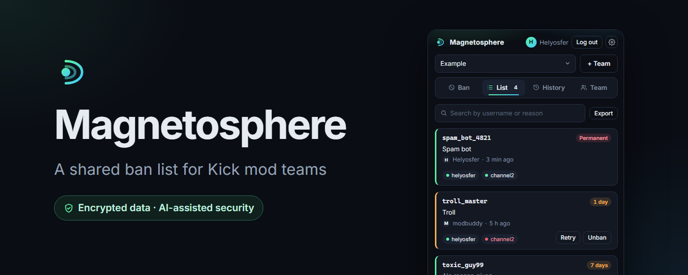
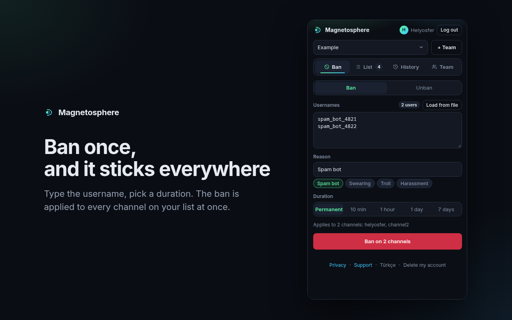
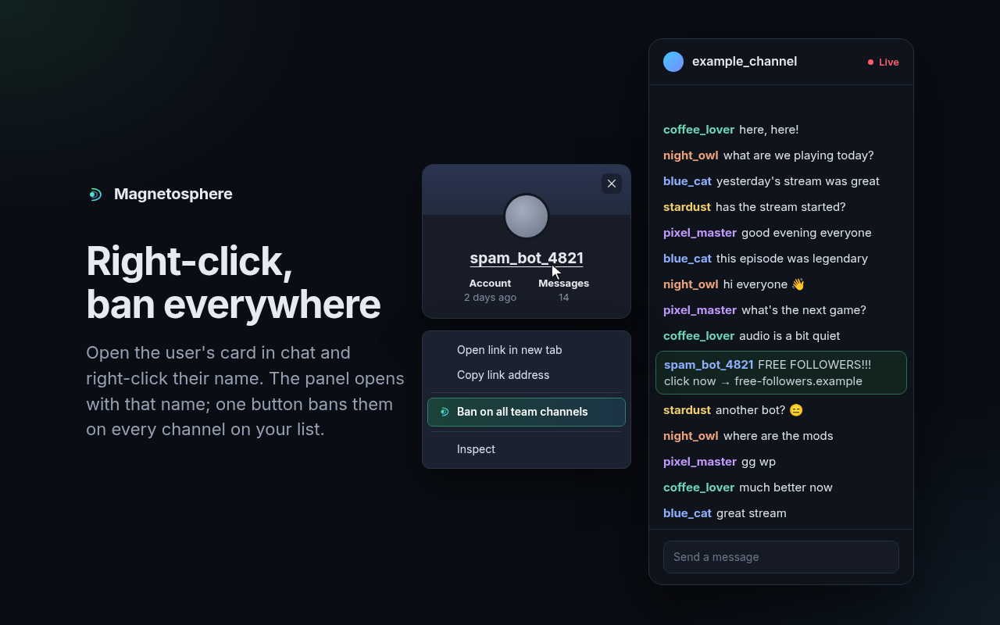
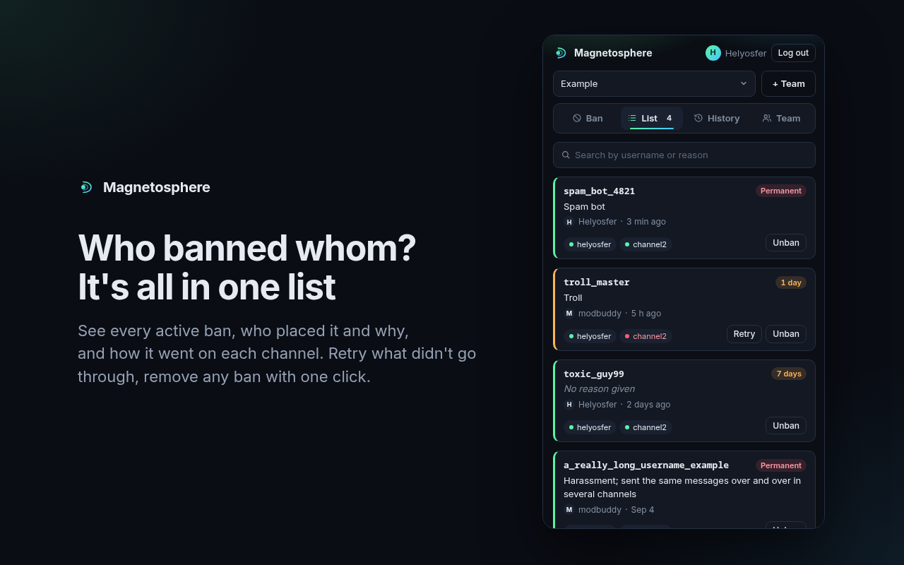
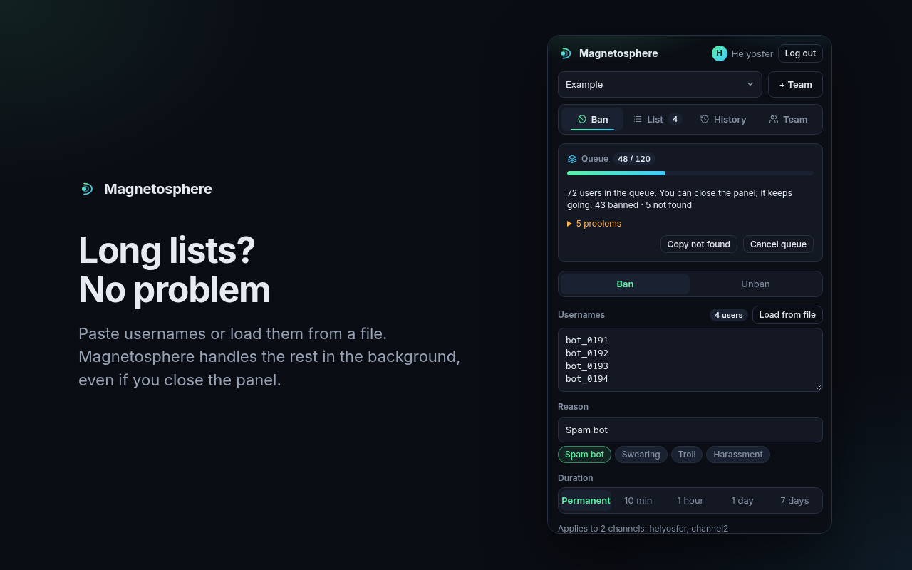
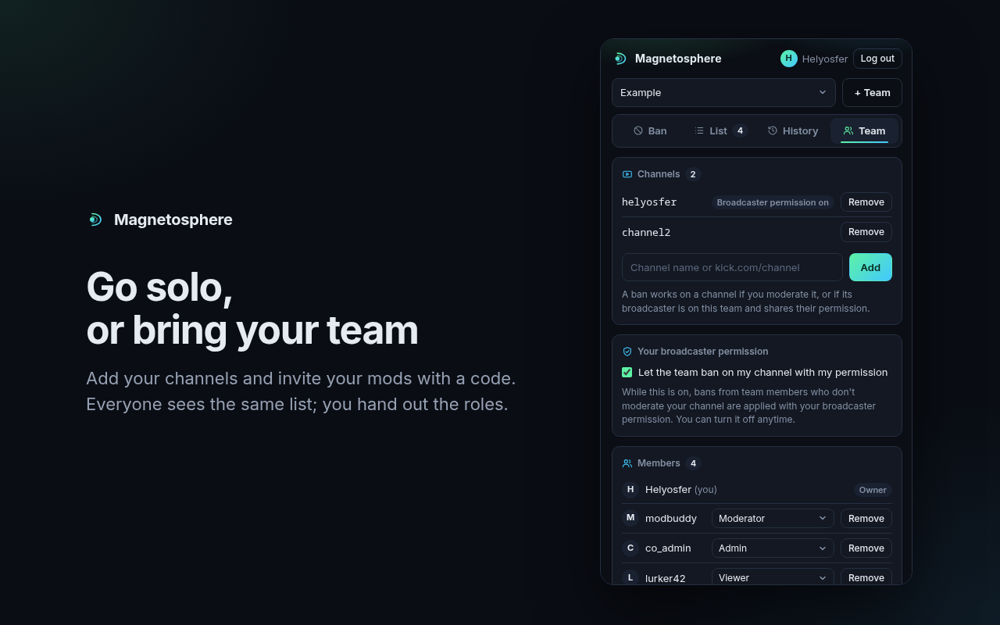
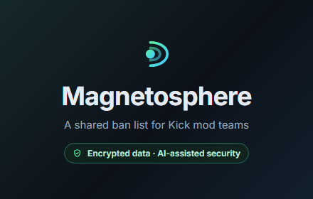

<div align="center">

<sub>[Türkçe](README.md) · [English](README.en.md) · [Español](README.es.md) · [Português (Brasil)](README.pt-BR.md) · [العربية](README.ar.md) · [Deutsch](README.de.md) · [Français](README.fr.md) · [Bahasa Indonesia](README.id.md) · [Русский](README.ru.md)</sub>



**Une liste de bans partagée pour les modérateurs Kick et leurs équipes.**<br>
Bannis un utilisateur d'un seul coup sur toutes les chaînes que tu modères.

[](https://chromewebstore.google.com/detail/magnetosphere/kjbbjooackbcfeeoolkfpmdbkomjiflh)
[](LICENSE)


[Captures d'écran](#captures-décran) ·
[Fonctionnalités](#fonctionnalités) ·
[Pour commencer](#pour-commencer) ·
[Rôles](#rôles-et-permissions) ·
[Fonctionnement](#fonctionnement) ·
[Ton propre serveur](#installer-ton-propre-serveur) ·
[Sécurité](#sécurité) ·
[Développement](#développement)

</div>

<br>

Si tu modères plusieurs chaînes, il faut bannir un troll ou un bot de spam sur chaque chaîne, une par une.
Magnetosphere réduit ça à une seule étape : tu écris le pseudo une fois (ou tu charges des milliers de pseudos
depuis un fichier) et le ban s'applique à toutes les chaînes de ta liste. Qui a banni qui, quand et pourquoi
est également enregistré.

Tu peux l'utiliser **seul** : sans inviter personne, tu ajoutes les chaînes que tu modères et tu bannis.
**En équipe**, tu obtiens en plus :

- Tout le monde voit la même liste de bans.
- Le ban posé par une personne s'applique à toutes les chaînes de l'équipe.
- Si un streamer de l'équipe partage ses droits, les bans des membres qui ne modèrent pas sa chaîne y sont aussi valables.

Son nom vient du bouclier magnétique (la magnétosphère) qui protège la Terre du vent solaire.

> Magnetosphere est un projet indépendant ; il n'est ni affilié à Kick ni approuvé par Kick.

## Captures d'écran

| | |
|:-:|:-:|
|  |  |
| **Bannir :** écris les pseudos, choisis un motif et une durée ; le ban part sur toutes les chaînes à la fois. | **Clic droit :** ouvre la carte de l'utilisateur dans le chat et fais un clic droit sur son pseudo ; le panneau s'ouvre avec ce pseudo. |
|  |  |
| **Liste :** les bans actifs ; qui a banni qui et pourquoi, et sur quelles chaînes le ban a été appliqué. | **File d'attente :** des milliers de pseudos sont traités en arrière-plan ; le traitement continue même si tu fermes le panneau. |
|  | |
| **Équipe :** les chaînes, le partage des droits du streamer, les membres et leurs rôles. | |

## Fonctionnalités

| | |
|---|---|
| **Un ban sur plusieurs chaînes d'un coup** | Ban permanent ou exclusion temporaire de 10 minutes, 1 heure, 1 jour ou 7 jours ; appliqué à toutes les chaînes en même temps. |
| **Choix des chaînes** | Quand l'équipe a plusieurs chaînes, tu choisis les chaînes lors d'un **Bannir** ou d'un **Débannir** : **Toutes**, **La mienne** ou celles cochées avec **Choisir…**. Le choix ne vaut que pour l'action en cours ; une fois l'action faite, il revient sur **Toutes**. Si tu lèves un ban seulement sur certaines chaînes, l'entrée reste active sur les chaînes où le ban persiste ; la chaîne levée apparaît en gris sur la carte et **Réessayer** n'y repose pas le ban. Comme la levée d'un ban échoue sur une chaîne que tu ne modères pas, il vaut mieux ne sélectionner que les chaînes où tu as les droits pour obtenir un résultat propre. Pour les longues listes, les chaînes sont figées au moment de la mise en file : une chaîne ajoutée à l'équipe pendant le traitement ne s'applique pas aux pseudos restants. |
| **Bans en masse, import et export** | Colle des pseudos ou charge un fichier `.txt`, `.csv` ou `.json` (jusqu'à 6 000 pseudos d'un coup). Dans les fichiers CSV, seule la première colonne est lue et la ligne d'en-tête est ignorée. **Liste > Exporter** télécharge tous les bans permanents de l'équipe dans un fichier `.txt` avec un pseudo par ligne ; ce fichier peut être chargé tel quel dans une autre équipe. |
| **File d'attente en arrière-plan** | Les longues listes sont mises en file sur le serveur ; les bans continuent d'être posés même si tu fermes le panneau ou le navigateur. La progression, les pseudos introuvables et l'annulation se gèrent depuis le panneau. |
| **Respect des limites de Kick** | Le débit des requêtes s'ajuste tout seul. Si Kick ralentit les requêtes, aucun pseudo n'est perdu : il retourne dans la file. |
| **Liste partagée et historique** | Qui a posé chaque ban, quand et pourquoi, et sur quelles chaînes il est appliqué ; recherche par pseudo ou par motif. **Liste** montre les bans permanents et les exclusions en cours, **Historique** montre les bans levés et les exclusions terminées ; le propriétaire et les admins peuvent supprimer l'historique après confirmation. |
| **Réessayer et annuler** | Réessaie le ban sur les chaînes où il n'a pas pu être appliqué ; lève un ban sur toutes les chaînes en un clic. |
| **Lever un ban par pseudo** | Avec **Bannir > Débannir**, écris le pseudo ; le ban est levé sur toutes les chaînes de l'équipe. Les bans posés à la main sur Kick ou avant Magnetosphere, absents de la liste, sont aussi levés et l'opération est enregistrée dans la liste. Les listes de plus de 10 pseudos (également chargeables depuis un fichier) sont mises en file comme les bans en masse. |
| **Raccourci clic droit** | Sur kick.com, ouvre la carte d'un utilisateur dans le chat, fais un clic droit sur son pseudo et choisis « Bannir sur toutes les chaînes de l'équipe ». Le panneau s'ouvre avec ce pseudo. |
| **Seul ou en équipe** | Toute personne connectée monte sa propre liste de chaînes en un clic ; elle peut ensuite faire entrer d'autres personnes dans l'équipe avec un lien d'invitation ou un code. La personne qui ouvre le lien installe l'extension et rejoint l'équipe en un clic. |
| **Rôles** | Propriétaire, admin, modérateur et spectateur. Tu peux choisir le rôle avec lequel commencent les personnes qui rejoignent par invitation. |
| **Partage des droits du streamer** | Un streamer de l'équipe peut, s'il le souhaite, ouvrir à l'équipe son droit de bannir sur sa propre chaîne ; lui seul prend cette décision. |
| **Protection contre les bans par erreur** | Les membres de l'équipe qui ont le droit de bannir et les streamers de l'équipe ne peuvent pas être bannis. |
| **Gestion du compte et de l'équipe** | Quitter l'équipe, transférer la propriété, supprimer l'équipe et le compte ; tout se fait depuis le panneau. |
| **9 langues** | Turc, anglais, allemand, espagnol, français, indonésien, portugais, russe et arabe. Le panneau s'ouvre dans la langue du navigateur ; si la langue du navigateur n'en fait pas partie, il s'ouvre en anglais. Tu peux la changer dans **Paramètres**, qui s'ouvre avec la roue dentée de l'en-tête ; en arabe, le panneau s'affiche de droite à gauche. Les messages d'erreur du serveur et la page d'invitation sont aussi dans la langue choisie. |

## Pour commencer

<a href="https://chromewebstore.google.com/detail/magnetosphere/kjbbjooackbcfeeoolkfpmdbkomjiflh"></a>

1. **Installe.** Ajoute l'extension depuis le [Chrome Web Store](https://chromewebstore.google.com/detail/magnetosphere/kjbbjooackbcfeeoolkfpmdbkomjiflh).
   Elle fonctionne dans les navigateurs basés sur Chromium comme Chrome, Edge et Brave ; Firefox n'est pas pris en charge.
2. **Connecte-toi.** Clique sur l'icône Magnetosphere puis sur **Se connecter avec Kick**. La connexion se fait
   sur la page de Kick ; l'extension ne voit pas ton mot de passe.
3. **Commence.** Clique sur **Commencer seul** ; ta propre chaîne est ajoutée automatiquement à la liste. Si on t'a
   invité dans une équipe, colle plutôt le code d'invitation.
4. **Ajoute les chaînes.** Dans l'onglet **Équipe**, ajoute les chaînes que tu modères avec leur nom ou avec un
   lien `kick.com/chaîne`.
5. **Bannis.** Dans l'onglet **Bannir**, écris les pseudos ou choisis une liste avec **Charger un fichier**. Les listes de plus de
   10 pseudos sont mises en file et traitées en arrière-plan.
6. **Suis.** L'onglet **Liste** montre le résultat des bans actifs chaîne par chaîne ; les bans levés et les exclusions
   terminées passent dans l'onglet **Historique**. Tu peux lever un ban depuis ici ou
   réessayer sur les chaînes où il n'a pas pu être appliqué.
7. **Lève les anciens bans.** Pour un ban absent de la liste (posé à la main sur Kick ou avant Magnetosphere),
   choisis **Débannir** dans l'onglet **Bannir** et écris le pseudo ; le ban est levé sur toutes les chaînes de l'équipe.
   Les longues listes sont aussi mises en file ici.

Pour monter une équipe, clique sur **Copier le lien d'invitation** dans l'onglet **Équipe** et envoie le lien à tes
modos. La personne qui l'ouvre installe l'extension, clique sur **Rejoindre l'équipe** sur la page, puis voit le nom de l'équipe et
son propriétaire dans le panneau et confirme. Si le lien s'ouvre sur un téléphone ou dans un navigateur autre que Chrome, la page
demande de l'ouvrir dans Chrome sur un ordinateur. Tu peux aussi partager le code au lieu du lien. Les personnes qui rejoignent utilisent la même liste de chaînes et la même liste de bans.

Le code d'invitation se trouve dans la partie du lien après le `#` ; le navigateur n'envoie pas cette partie au serveur, donc le code
n'apparaît pas dans les journaux du serveur ni de Cloudflare. La page transmet le code à l'extension grâce à la
fonctionnalité `externally_connectable` de Chrome ; elle ne demande aucune nouvelle permission.

<br clear="right">

## Rôles et permissions

| | Spectateur | Modérateur | Admin | Propriétaire |
|---|:-:|:-:|:-:|:-:|
| Voir et exporter la liste partagée | ✓ | ✓ | ✓ | ✓ |
| Poser des bans, réessayer, charger une liste | | ✓ | ✓ | ✓ |
| Lever ses propres bans | | ✓ | ✓ | ✓ |
| Lever par pseudo un ban absent de la liste (posé à la main sur Kick) | | ✓ | ✓ | ✓ |
| Lever un ban posé par quelqu'un d'autre | | | ✓ | ✓ |
| Ajouter et retirer des chaînes | | | ✓ | ✓ |
| Supprimer l'historique | | | ✓ | ✓ |
| Voir et renouveler le code d'invitation | | | ✓ | ✓ |
| Retirer un membre de rang inférieur | | | ✓ | ✓ |
| Attribuer des rôles, définir le rôle initial des nouveaux arrivants | | | | ✓ |
| Transférer la propriété, supprimer l'équipe | | | | ✓ |

Les personnes qui rejoignent par invitation sont modérateurs par défaut ; le propriétaire peut changer cela en « commencent comme spectateurs ».
Tout le monde sauf le propriétaire peut quitter l'équipe à tout moment.

Si, avec **Débannir**, le pseudo saisi a dans la liste un ban actif posé par un autre membre, la règle de la liste
s'applique : seuls le propriétaire et les admins peuvent lever ce ban.

**Supprimer l'historique** supprime définitivement, pour tous les membres de l'équipe, les bans levés et les exclusions terminées ;
il ne touche pas aux bans sur Kick. Une entrée de ban qui n'a pas pu être levée sur une chaîne n'est pas supprimée, car la personne peut
encore y être bannie et l'entrée est nécessaire pour réessayer la levée.

### Partage des droits du streamer

Sur chaque chaîne, un ban est d'abord tenté avec **les propres droits de modérateur** de la personne qui le pose. Si le streamer de la chaîne
est dans l'équipe et a activé le partage sous **Équipe > Tes droits de streamer**, le ban est appliqué avec
les droits du streamer quand ceux du modérateur ne suffisent pas.

- Le partage est désactivé par défaut pour tout le monde ; la personne qui crée l'équipe l'active elle-même pour sa propre chaîne. (Dans les équipes
  créées avant la 0.15.1, le partage du créateur est activé ; désactive-le si tu veux.)
- Seul le streamer lui-même peut l'activer et le désactiver ; rejoindre une équipe avec un code d'invitation ne donne pas ce droit à lui seul.
- Sur une chaîne que tu ne modères pas et dont le streamer ne partage pas ses droits, le ban n'est pas appliqué ; cette chaîne apparaît en rouge dans la liste.
- Pour ajouter une chaîne à l'équipe, il faut que tu sois modérateur Kick de cette chaîne, que la chaîne soit la tienne ou que son
  streamer soit dans l'équipe (0.15.1). Si tu veux ajouter la chaîne d'un streamer, il doit d'abord rejoindre l'équipe.

## Fonctionnement

```
   Extension Chrome              Serveur                   Kick
┌──────────────────┐      ┌──────────────────┐      ┌──────────────────┐
│ Le panneau que   │ ───▶ │ Équipes, rôles   │ ───▶ │ API officielle   │
│ le modérateur    │      │ Liste partagée   │      │ (OAuth 2.1 et    │
│ utilise          │ ◀─── │ File et workers  │ ◀─── │  modération)     │
└──────────────────┘      └──────────────────┘      └──────────────────┘
```

| Composant | Rôle |
|---|---|
| [`extension/`](extension) | L'extension Chrome (Manifest V3). L'interface que voit l'utilisateur ; elle n'envoie aucune requête à Kick par elle-même et ne voit ni ton mot de passe Kick ni ton token. |
| [`server/`](server) | Le serveur Python (3.10+). Il conserve les équipes, les rôles, la liste partagée, la file et les sessions Kick ; il pose les bans via l'[API officielle](https://docs.kick.com/apis/moderation) de Kick. |
| [`store/`](store) | Le texte et les visuels du Chrome Web Store. |
| [`tools/`](tools) | Le script qui produit le paquet pour le store. |
| [`docs/`](docs) | La politique de confidentialité. |

Le serveur est indispensable car le flux OAuth de Kick exige un Client Secret, et ce Secret ne peut pas être mis dans l'extension.
Le serveur n'utilise que la bibliothèque standard de Python ; sa seule dépendance est le paquet
`cryptography`, pour le chiffrement des tokens. Les données tiennent dans un seul fichier SQLite.

L'extension du store utilise par défaut le serveur `magnetosphere.helyosfer.me` ; toute personne connectée
peut y créer une équipe. Si tu préfères, tu peux monter ton propre serveur en suivant les étapes ci-dessous et y connecter l'extension.

## Installer ton propre serveur

Pour un simple essai sur ton ordinateur, les étapes 1 à 3 suffisent ; pour une installation durable que tout le monde utilisera,
passe à la section [Mettre le serveur en ligne](#mettre-le-serveur-en-ligne).

### 1. L'application Kick

Crée une application sur [kick.com/settings/developer](https://kick.com/settings/developer)
(la vérification en deux étapes doit être activée sur le compte). Le nom de l'application ne peut pas contenir d'espace.

| Champ | Valeur |
|---|---|
| Redirect URL | `http://localhost:8787/auth/callback` (essai local) ou `https://<ton-domaine>/auth/callback` |
| Scopes | Read user information, Read channel information, Execute moderation actions for moderators |

### 2. Le serveur

```bash
cd server
pip install -r requirements.txt
cp .env.example .env
```

Remplis le fichier `.env` :

- `KICK_CLIENT_ID` et `KICK_CLIENT_SECRET` : les valeurs fournies par Kick.
- `TOKEN_ENCRYPTION_KEY` : la clé générée avec la commande ci-dessous.

```bash
python -c "from cryptography.fernet import Fernet; print(Fernet.generate_key().decode())"
```

Ensuite, démarre le serveur :

```bash
python app.py
```

Le serveur écoute sur `http://localhost:8787`. S'il manque un réglage de sécurité, il affiche un avertissement au démarrage.
Tu peux vérifier qu'il fonctionne à l'adresse `http://localhost:8787/health`.

### 3. L'extension

1. Dans Chrome, ouvre la page `chrome://extensions` et active le **Mode développeur**.
2. Avec **Charger l'extension non empaquetée**, choisis le dossier `extension`.
3. Clique sur l'icône Magnetosphere, écris l'adresse de ton serveur dans le champ **Avancé : utiliser ton propre serveur**
   (`http://localhost:8787` pour un essai local) et clique sur **Se connecter avec Kick**.

Si tu ne veux pas que chaque membre de ton équipe saisisse l'adresse à la main, remplace la valeur de `DEFAULT_SERVER` dans
`extension/server-url.js` par ton adresse et distribue le dossier tel quel. Pour que les liens d'invitation atteignent l'extension,
ajoute aussi la même adresse à la liste `externally_connectable.matches` de `manifest.json` et à la liste
`INVITE_ORIGINS` de `background.js`. Sans cela, le bouton **Copier le lien d'invitation** n'apparaît pas dans le panneau ; le code
peut quand même être copié et partagé. Le bouton apparaît si le serveur est en version 0.12.0 ou plus récente.

L'identifiant d'une extension chargée à la main est fixé par la clé de `manifest.json`
(`flmfmniipeobbaoahmbdkjnblbegalob`) ; il est identique sur chaque ordinateur. Le serveur n'accepte que les
identifiants de la liste `ALLOWED_EXTENSION_IDS`. L'identifiant de l'extension installée depuis le store est différent
(`kjbbjooackbcfeeoolkfpmdbkomjiflh`) ; pour accepter les deux, mets les deux dans la liste.

### Mettre le serveur en ligne

Pour une installation que ton équipe utilisera, le serveur doit tourner en permanence et se trouver derrière HTTPS.

1. **Réglages.** Dans `.env`, mets `PUBLIC_URL=https://<ton-domaine>` et mets à jour la Redirect
   URL de l'application Kick en `https://<ton-domaine>/auth/callback`. Laisse `HOST=127.0.0.1` ; le serveur n'est pas exposé
   directement à l'extérieur. Pour garder la base de données hors du dossier du code, renseigne `DB_PATH`.
2. **Reverse proxy.** HTTPS est assuré par un reverse proxy. Avec [Caddy](https://caddyserver.com), le certificat
   s'obtient automatiquement :

   ```
   <ton-domaine> {
   	reverse_proxy 127.0.0.1:8787
   }
   ```

   La limite de connexions lit la vraie adresse du client dans la dernière valeur de l'en-tête `X-Forwarded-For`. Caddy
   écrit cet en-tête correctement avec ses réglages par défaut. nginx ne le fait pas et transmet tel quel l'en-tête envoyé par le client ;
   si tu utilises nginx, ajoute la ligne `proxy_set_header X-Forwarded-For $remote_addr;`. Si l'en-tête
   n'arrive jamais, tous les clients sont comptés comme une seule adresse et la limite de connexions devient commune à tout le monde.

   Si le serveur est derrière Cloudflare, le reverse proxy voit l'adresse de Cloudflare et non celle du visiteur, et la limite de
   connexions devient commune à toutes les personnes passant par le même serveur Cloudflare. La vraie adresse se trouve dans l'en-tête
   `CF-Connecting-IP` ; cet en-tête ne doit être cru que pour les requêtes venant de Cloudflare :

   ```
   @cloudflare remote_ip <plages d'adresses de https://www.cloudflare.com/ips/>
   handle @cloudflare {
   	reverse_proxy 127.0.0.1:8787 {
   		header_up X-Forwarded-For {http.request.header.CF-Connecting-IP}
   	}
   }
   handle {
   	reverse_proxy 127.0.0.1:8787
   }
   ```
3. **Service.** Fais tourner le serveur comme service systemd, avec un utilisateur système sans privilèges :

   ```ini
   [Service]
   User=magnetosphere
   WorkingDirectory=/opt/magnetosphere/app/server
   ExecStart=/opt/magnetosphere/venv/bin/python app.py
   Environment=PYTHONUNBUFFERED=1
   Restart=on-failure
   NoNewPrivileges=true
   ProtectSystem=strict
   ReadWritePaths=/opt/magnetosphere/data
   ```

4. **Qui peut créer une équipe.** Par défaut, toute personne connectée peut créer une équipe. Si tu n'ouvres ton serveur que pour
   ta propre équipe, limite cela à ton propre identifiant d'utilisateur Kick avec `ALLOWED_TEAM_CREATORS` ;
   les autres rejoignent avec un code d'invitation.
5. **Sauvegarde.** La base de données peut être sauvegardée sans risque pendant qu'elle fonctionne :

   ```bash
   sqlite3 /opt/magnetosphere/data/crossban.db ".backup '/opt/backups/crossban-$(date +%F).db'"
   ```

   Garde une copie de la sauvegarde hors du serveur (par ex. dans un dossier cloud avec [rclone](https://rclone.org)).
   Ne mets pas le fichier `.env` à côté de cette sauvegarde ; la clé de chiffrement et la base de données doivent rester séparées.

Au démarrage, le serveur migre tout seul une ancienne base de données vers le nouveau schéma ; il suffit de faire une sauvegarde
avant la mise à jour.

### Mettre à jour le serveur

Pour l'installation ci-dessus (code dans `/opt/magnetosphere/app`, base de données dans `/opt/magnetosphere/data`) :

```bash
# 1. Sauvegarde
sqlite3 /opt/magnetosphere/data/crossban.db ".backup '/opt/backups/crossban-$(date +%F)-guncelleme.db'"
# 2. Code ; récupéré en tant que propriétaire du dossier (avec un autre utilisateur, git refuse avec « dubious ownership »)
sudo -u "$(stat -c %U /opt/magnetosphere/app)" git -C /opt/magnetosphere/app pull
grep '^VERSION' /opt/magnetosphere/app/server/app.py   # ne continue pas sans avoir vu la nouvelle version
/opt/magnetosphere/venv/bin/pip install -r /opt/magnetosphere/app/server/requirements.txt
# 3. Redémarre et vérifie
sudo systemctl restart magnetosphere
curl -s https://<ton-domaine>/health          # {"ok": true, "version": "<nouvelle version>"}
journalctl -u magnetosphere -n 30 --no-pager
```

Si `/health` affiche encore l'ancienne version, soit `git pull` a échoué, soit le service tourne depuis un autre dossier ;
regarde la valeur de `WorkingDirectory` avec `systemctl cat magnetosphere`.

Si tu sers la page de confidentialité depuis un fichier statique du reverse proxy (par ex. `/var/www/magnetosphere/privacy.html`),
`git pull` ne la met pas à jour ; après la mise à jour, copie le fichier `docs/privacy.html` à cet endroit ou configure
le reverse proxy pour qu'il pointe directement vers le dossier `docs/` du dépôt.

Les sessions ne sont pas affectées par la mise à jour ; personne n'a besoin de se reconnecter. Si la nouvelle version de l'extension utilise une
nouvelle fonctionnalité du serveur, mets d'abord à jour le serveur, puis l'extension ; une ancienne extension continue de fonctionner
avec un nouveau serveur. Pour revenir à une version précédente, retrouve le commit de cette version avec `git log`, fais un `git checkout <commit>`
et redémarre le service. Le schéma de la base de données n'a pas changé depuis la 0.6.0 ; les versions 0.6.x et 0.7.x fonctionnent avec la même
base de données. Ne restaure la sauvegarde que si les données sont corrompues, et avec le service arrêté.

### Réglages

Lus depuis le fichier `server/.env`.

| Variable | Par défaut | Description |
|---|---|---|
| `KICK_CLIENT_ID` | — | Le Client ID de l'application Kick |
| `KICK_CLIENT_SECRET` | — | Le Client Secret de l'application Kick |
| `TOKEN_ENCRYPTION_KEY` | vide | La clé qui chiffre les tokens Kick dans la base de données. Si elle est vide, les tokens restent en clair |
| `ALLOWED_EXTENSION_IDS` | vide (toutes) | Les identifiants d'extension autorisés à se connecter et à appeler l'API, séparés par des virgules |
| `ALLOWED_TEAM_CREATORS` | vide (tout le monde) | Les identifiants d'utilisateur Kick autorisés à créer une équipe, séparés par des virgules. Rejoindre par invitation reste toujours ouvert |
| `PUBLIC_URL` | `http://localhost:8787` | L'adresse du serveur vue de l'extérieur. La Redirect URL sur Kick doit être `{PUBLIC_URL}/auth/callback` |
| `HOST` | `127.0.0.1` | L'interface sur laquelle écouter |
| `PORT` | `8787` | Le port d'écoute |
| `DB_PATH` | `server/crossban.db` | Le chemin de la base de données SQLite |
| `QUEUE_WORKERS` | `4` | Le nombre de workers qui traitent la file en parallèle |
| `KICK_REQUESTS_PER_SECOND` | `1` | Le débit initial de requêtes vers l'API de Kick ; il baisse tout seul si Kick renvoie 429 et monte s'il n'y a pas de problème |
| `KICK_REQUESTS_PER_SECOND_MAX` | `5` | La limite haute du débit de requêtes |

## Sécurité

### Ce qui est protégé

- **Les tokens Kick sont stockés chiffrés.** Quand `TOKEN_ENCRYPTION_KEY` est définie, les tokens d'accès et de
  rafraîchissement dans la base de données sont chiffrés avec Fernet (AES + HMAC) ; si le fichier de base de données fuit seul, les tokens sont illisibles.
- **Sessions.** La clé de session n'est stockée dans la base de données que sous forme d'empreinte (SHA-256) et devient
  invalide après 30 jours d'inactivité. Se déconnecter ferme toutes les sessions de l'utilisateur.
- **Cette extension uniquement.** Quand `ALLOWED_EXTENSION_IDS` est définie, une autre extension ne peut ni
  lancer le flux de connexion ni appeler l'API depuis le navigateur (CORS n'est ouvert qu'à l'identifiant autorisé).
- **Flux de connexion.** OAuth se fait avec PKCE et un `state` à usage unique ; la session n'est remise qu'à
  l'adresse de redirection propre à l'extension de Chrome.
- **La session ne circule qu'en connexion chiffrée.** L'extension n'envoie pas la clé de session aux adresses
  `http://` autres que `localhost`, `127.0.0.1` et `[::1]` : elle ne lance pas la connexion, n'utilise pas la session
  si l'adresse enregistrée n'est pas chiffrée, et affiche un avertissement.
- **Les champs texte sont contrôlés.** Si le nom d'équipe, le code d'invitation et le motif du ban ne sont pas du texte, la requête est rejetée ;
  des valeurs comme `null` ou une liste ne sont pas converties en texte puis enregistrées.
- **Les équipes sont isolées les unes des autres.** Seuls les membres d'une équipe voient ses chaînes, ses membres et sa liste.
- **Les rôles sont contrôlés côté serveur.** Chaque opération passe par un contrôle de rôle sur le serveur ; on ne se
  fie pas au fait que le panneau masque un bouton. Aggraver une exclusion ne change ni l'auteur ni le motif du ban ; un modérateur
  ne peut pas lever le ban d'un autre par ce moyen.
- **Code d'invitation.** Il est aléatoire sur 72 bits ; seuls le propriétaire et les admins le voient et le renouvellent, et l'ancien code
  devient invalide immédiatement. Dans la base de données, seule son empreinte et (si la clé est définie) sa version chiffrée sont stockées. Un membre
  qui quitte l'équipe ne peut pas revenir avec le même code à un rôle supérieur à son dernier rôle ; un membre retiré ne peut pas rejoindre tant que le code n'est pas renouvelé.
- **Les droits du streamer ne s'utilisent qu'avec son accord.** Le token d'un streamer n'est utilisé pour un ban posé par quelqu'un d'autre que si
  ce streamer a lui-même activé le partage.
- **Suppression du compte.** Quand un utilisateur supprime son compte, ses sessions, ses adhésions et ses tokens sont supprimés et l'accès
  côté Kick est révoqué. Les bans qu'il a posés restent dans la liste des autres équipes sans nom ; son identifiant Kick est aussi
  supprimé des enregistrements. Si la révocation côté Kick échoue, la réponse l'indique (`kick_revoked: false`).
- **Permissions minimales.** Seuls l'accès aux informations de l'utilisateur, aux informations de la chaîne et au droit de bannir sont demandés à Kick. L'extension
  n'utilise que les permissions `identity`, `storage` et `contextMenus` ; elle n'injecte aucun content script dans aucun site.
- **Limites.** Le corps d'une requête est limité à 1 Mo, une liste chargée d'un coup à 6 000 pseudos, et les entrées en attente dans la file d'une équipe
  à 20 000. Depuis une même adresse, 30 connexions au maximum peuvent être lancées en 10 minutes.
  Un compte peut envoyer au plus 300 requêtes par minute, créer au plus 10 équipes et être membre de 50 équipes ;
  une équipe compte au plus 50 chaînes et 200 membres. Un compte ne peut avoir que deux opérations simultanées vers Kick ;
  ainsi, un seul compte ne peut pas saturer la limite de débit commune de Kick et faire attendre les autres.
- **Traitement robuste des requêtes.** Les requêtes corrompues ou envoyées à moitié ne gardent pas la connexion en suspens (délai
  de 30 secondes) ; les erreurs inattendues sont renvoyées au client sous forme de 500 sans fuite de détails.
- **File équitable.** La file est traitée à tour de rôle entre les équipes ; la longue liste d'une équipe ne fait pas attendre les autres.

### Vérifier le chiffrement

La personne qui exploite le serveur peut démontrer que les tokens sont stockés chiffrés sans montrer la clé ni aucun token.
[`tools/sifreleme_dogrula.py`](tools/sifreleme_dogrula.py) examine la base de données en production et les sauvegardes
en lecture seule et produit un rapport composé uniquement de nombres :

- la clé est-elle définie et est-ce une clé Fernet valide,
- combien de tokens sont chiffrés, combien sont en clair, et combien de tokens chiffrés se déchiffrent avec la clé,
- le serveur a-t-il affiché l'avertissement « clé non définie » à son dernier démarrage,
- chaque sauvegarde de la base contient-elle des tokens en clair, et les dossiers de sauvegarde contiennent-ils une copie de la clé.

```bash
sudo /opt/magnetosphere/venv/bin/python /opt/magnetosphere/app/tools/sifreleme_dogrula.py \
    --sunucu /opt/magnetosphere/app/server --yedek /opt/backups
```

Si des tokens en clair sont trouvés ou si la clé est invalide, le code de sortie est 1. L'empreinte SHA-256 en tête du rapport sert à
vérifier que le script exécuté est identique à la version du dépôt. Le rapport est une déclaration de la personne qui exploite le serveur ;
ce n'est pas une preuve indépendante de l'extérieur, mais ce qui est mesuré est public pour tout le monde dans ce fichier.

### Responsabilités de la personne qui exploite le serveur

- `server/.env` (Client Secret, clé de chiffrement) et `server/crossban.db` sont confidentiels ; `.gitignore`
  les garde tous deux hors du dépôt. Ne mets pas la clé de chiffrement et la base de données dans la même sauvegarde.
- N'ouvre le serveur sur Internet que derrière HTTPS. Par défaut, `HOST` n'écoute que la machine locale.
- Si la clé de chiffrement est perdue, il n'y a pas de perte de données ; tout le monde doit seulement se reconnecter avec Kick.

### Limites connues

- Le chiffrement protège contre la fuite du fichier de base de données ; quelqu'un qui prend le contrôle de tout le serveur peut aussi lire la clé.
- Une personne qui rejoint avec un code d'invitation est modératrice par défaut et peut poser des bans sur les chaînes de l'équipe ; ne partage le code
  qu'avec des personnes de confiance, ou fais commencer les nouveaux comme spectateurs.
- La limite de requêtes est par compte et conservée en mémoire ; mets en plus une limite dans le reverse proxy contre les requêtes sans session.
- Si un transfert de propriété et le départ du membre qui devait le reprendre ont lieu exactement au même moment, l'équipe peut se retrouver sans propriétaire.
  Si une suppression de compte et l'arrivée d'un nouveau membre dans l'équipe ont lieu en même temps, l'équipe peut être supprimée sans avertissement.
  Les deux cas exigent une fenêtre de temps très étroite ; une correction est prévue.
- Si `TOKEN_ENCRYPTION_KEY` est vide, le serveur se contente d'afficher un avertissement et stocke les tokens en clair. Sur un serveur ouvert
  au public, définis impérativement la clé.

### Audit indépendant (octobre 2026)

Le serveur et l'extension ont été audités de façon indépendante le 15 octobre 2026. En plus des tests de ce dépôt, une suite de tests
distincte a été utilisée :

- **Tests de bout en bout dans le navigateur (Playwright).** Le panneau a été ouvert avec le vrai serveur branché sur un faux Kick. On a vérifié que le HTML
  dans le nom d'équipe, le pseudo et le motif du ban ne s'exécute pas (XSS), que la session se ferme quand le serveur renvoie 401, que
  l'adresse de serveur non chiffrée est refusée, ainsi que l'accessibilité (axe).
- **Tests du serveur du point de vue d'un attaquant.**
  - Tous les points d'accès d'une équipe dont on n'est pas membre : tous ont renvoyé 404.
  - Toucher à l'entrée de ban d'une autre équipe par le chemin de sa propre équipe.
  - Sessions falsifiées, expirées et déconnectées.
  - Deuxième utilisation d'un `state` et tentatives de redirection ouverte.
  - Identifiant d'extension non autorisé et ancien code d'invitation renouvelé.
  - Un admin qui se fait propriétaire.
  - Fuite de détails internes dans les réponses d'erreur.
- **Contrôle par mutation.** Les défenses suivantes ont été cassées temporairement une par une ; chacune a été détectée par au moins un test :
  - le contrôle d'appartenance à l'équipe
  - l'usage unique du `state`
  - le contrôle de l'adresse de redirection
  - la durée de la session
  - les droits du propriétaire
  - le fait de ne pas écrire le texte comme du HTML dans le panneau
  - la suppression de la session à la réception d'un 401
- **Analyse statique.** Les 6 avertissements de Bandit (f-string dans du SQL, `urlopen`) ont été examinés ligne par ligne. Dans aucun cas
  une entrée utilisateur n'atteint le texte SQL ni le schéma ou le serveur de l'adresse de requête ; les valeurs passent en
  paramètres.
- **Trouvé et corrigé dans la 0.5.1.** L'extension pouvait envoyer la clé de session à un serveur non chiffré (`http://`),
  et des champs qui n'étaient pas du texte étaient convertis en texte puis enregistrés.

Résultat : aucune autre faille n'a été trouvée dans les domaines testés. Les limites connues sont ci-dessus.

### Signaler une faille

Si tu trouves une faille de sécurité, n'ouvre pas d'issue publique ; écris à `destek@helyosfer.me`.
Pour le périmètre, les délais de réponse et le processus de divulgation, consulte [SECURITY.md](SECURITY.md).

Politique de confidentialité : [magnetosphere.helyosfer.me/privacy](https://magnetosphere.helyosfer.me/privacy)
(source : [`docs/privacy.html`](docs/privacy.html)).

## Développement

### Tests

```bash
cd server
python -m unittest test_app
```

Les tests tournent de bout en bout contre une fausse API Kick ; ils n'envoient aucune requête au vrai Kick. Ils couvrent la connexion, la perte de
droits, la file et les workers concurrents, la file équitable entre équipes, les rôles, le partage de droits, la levée d'un ban par pseudo,
la suppression du compte, la séparation Liste et Historique, les messages d'erreur en cinq langues, le nouveau ban après une exclusion terminée, la migration
depuis une ancienne base de données et les règles de sécurité.

L'exhaustivité des traductions (les mêmes textes dans chaque langue, la longueur de la courte description du store) est contrôlée à part :

```bash
node tools/ceviri_kontrol.js
```

Sur GitHub, à chaque push et PR, les tests du serveur (Python 3.12 et 3.14), le contrôle des traductions et l'analyse des
failles connues dans les dépendances (`pip-audit`) se lancent automatiquement (`.github/workflows/test.yml`).

### Chrome Web Store

```bash
python tools/paketle.py
```

Produit le fichier `dist/magnetosphere-<version>.zip`. Comme le store n'accepte pas le champ `key` du manifest,
le script le retire dans le paquet ; il reste dans le dépôt, et l'identifiant de l'extension chargée à la main ne change pas.

Le texte de la page du store se trouve dans [`store/aciklama.md`](store/aciklama.md). Les visuels :

| Emplacement | Fichier | Taille |
|---|---|---|
| Captures d'écran | [`ekran-1-banla.png`](store/ekran-1-banla.png), [`ekran-2-liste.png`](store/ekran-2-liste.png), [`ekran-3-sira.png`](store/ekran-3-sira.png), [`ekran-4-ekip.png`](store/ekran-4-ekip.png), [`ekran-5-sagtik.png`](store/ekran-5-sagtik.png) | 1280×800 |
| Petite vignette promotionnelle | [`tanitim-kucuk-440x280.png`](store/tanitim-kucuk-440x280.png) | 440×280 |
| Grande vignette promotionnelle | [`tanitim-buyuk-1400x560.png`](store/tanitim-buyuk-1400x560.png) | 1400×560 |
| Icône | [`extension/icons/icon128.png`](extension/icons/icon128.png) | 128×128 |

## Feuille de route

Version fonctionnelle. Validé sur le vrai Kick : la connexion, le ban avec les droits du streamer comme avec ceux du modérateur,
la levée de ban et l'import en masse de milliers de comptes sur deux chaînes.

- [x] Chiffrement des tokens dans la base de données, durée de vie des sessions
- [x] Identifiant fixe de l'extension et son icône
- [x] Serveur en ligne derrière HTTPS, exécuté comme service, avec sauvegarde de la base de données
- [x] Suppression d'équipe ; file équitable entre équipes et limite de connexions pour un serveur ouvert
- [x] [Publication sur le Chrome Web Store](https://chromewebstore.google.com/detail/magnetosphere/kjbbjooackbcfeeoolkfpmdbkomjiflh)
- [x] Usage en solo, rôles dans l'équipe, consentement explicite pour les droits du streamer, départ de l'équipe et suppression du compte
- [x] Limites par compte pour un usage public
- [x] Levée de ban par pseudo ; y compris les bans posés à la main sur Kick
- [x] Séparation Liste et Historique : les exclusions terminées et les bans levés passent dans l'Historique
- [x] Interface en anglais
- [x] Interface en espagnol, en portugais (Brésil) et en arabe (mise en page de droite à gauche pour l'arabe)
- [x] Interface en allemand, en français, en russe et en indonésien ; langue, confidentialité et suppression du compte dans les Paramètres de l'en-tête
- [ ] Détection automatique qui écoute le chat et place les bots de spam dans une file de suspects

### Limitations connues

- Le pseudo est recherché selon la règle des adresses de chaîne de Kick (minuscules, `-` à la place de `_`, 25 caractères au maximum).
- Les chaînes autres que la tienne s'ajoutent à la main ; l'API officielle ne fournit pas la liste des « chaînes que je modère ».
- L'API officielle ne liste pas les bans existants d'une chaîne ; les bans posés avant Magnetosphere n'apparaissent pas dans la liste.
  Ces bans peuvent être levés avec **Débannir** en écrivant le pseudo. Si l'utilisateur n'est de toute façon pas banni sur une chaîne,
  celle-ci peut apparaître dans le résultat comme « Échec du débannissement ».
- La vitesse est déterminée par la limite de requêtes de Kick : environ une seconde par compte pour une équipe de deux chaînes.

## Contribuer

Pour signaler un bug ou faire une suggestion, [ouvre une issue](https://github.com/Helyosfer/magnetosphere/issues).
Avant d'envoyer une modification, assure-toi que les tests passent ; pour les nouveaux comportements, ajoute un test dans le fichier
`server/test_app.py`.

## Licence

Copyright (C) 2026 Helyosfer

Magnetosphere est un logiciel libre ; tu peux l'utiliser, le modifier et le distribuer selon les termes de la
[Licence publique générale GNU version 3](LICENSE) (GPL-3.0). Si tu distribues des versions modifiées, tu dois aussi ouvrir
le code source sous la même licence. Le logiciel est fourni sans aucune garantie.

La police [Inter](https://github.com/rsms/inter) utilisée dans le panneau est livrée avec l'extension et est sous licence
[SIL Open Font License 1.1](extension/fonts/LICENSE.txt).
