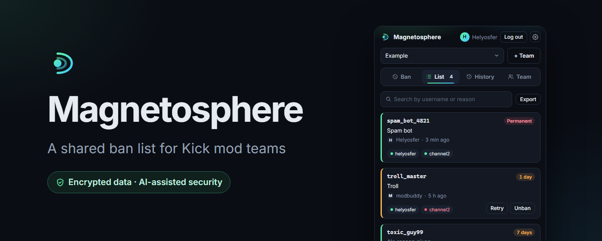
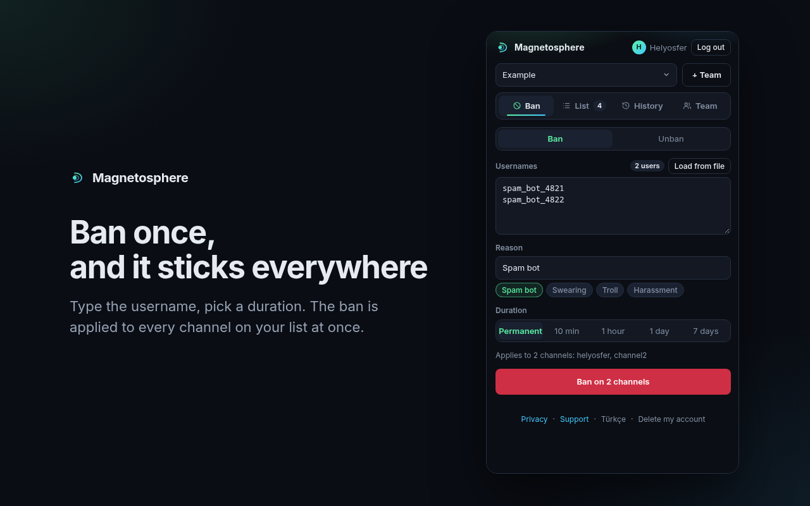
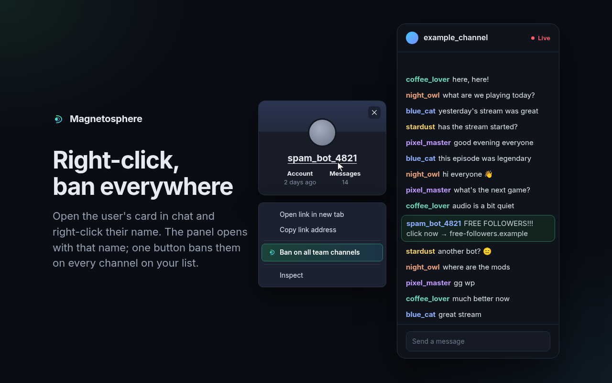
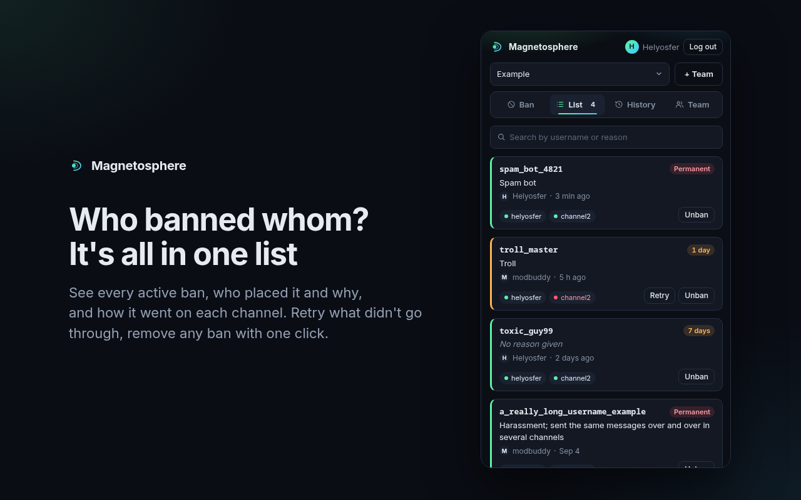
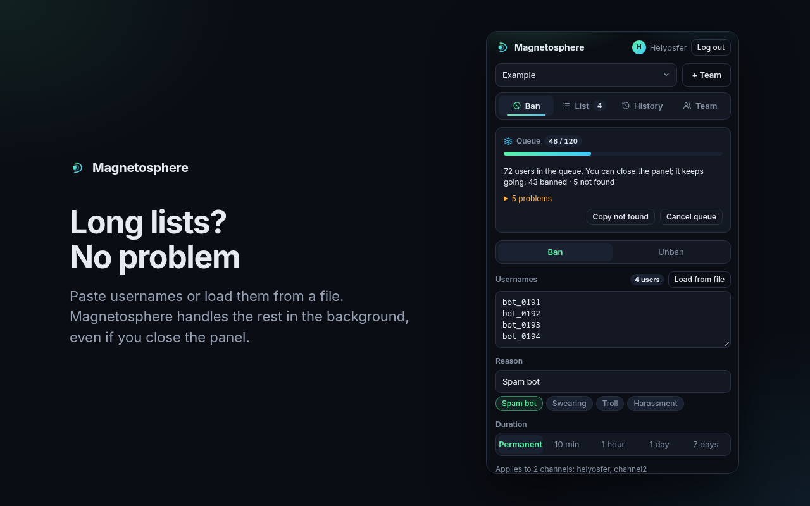
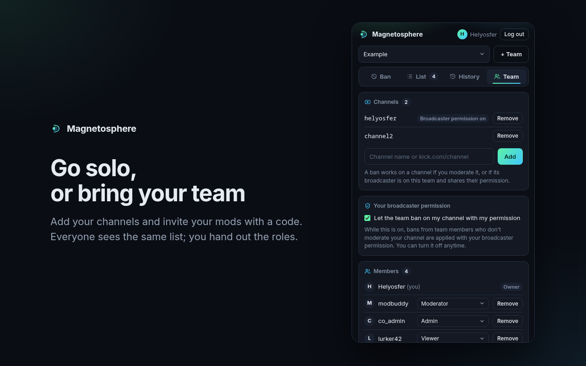
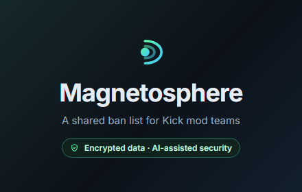

<div align="center">

<sub>[Türkçe](README.md) · [English](README.en.md) · [Español](README.es.md) · [Português (Brasil)](README.pt-BR.md) · [العربية](README.ar.md) · [Deutsch](README.de.md) · [Français](README.fr.md) · [Bahasa Indonesia](README.id.md) · [Русский](README.ru.md)</sub>



**Daftar ban bersama untuk moderator dan tim mod Kick.**<br>
Ban seorang pengguna di semua channel yang kamu moderasi dalam satu langkah.

[](https://chromewebstore.google.com/detail/magnetosphere/kjbbjooackbcfeeoolkfpmdbkomjiflh)
[](LICENSE)


[Tangkapan layar](#tangkapan-layar) ·
[Fitur](#fitur) ·
[Memulai](#memulai) ·
[Peran](#peran-dan-izin) ·
[Cara kerja](#cara-kerja) ·
[Server sendiri](#memasang-server-sendiri) ·
[Keamanan](#keamanan) ·
[Pengembangan](#pengembangan)

</div>

<br>

Kalau kamu memoderasi beberapa channel, kamu harus mem-ban troll atau bot spam satu per satu di setiap
channel. Magnetosphere meringkasnya jadi satu langkah: ketik nama pengguna sekali (atau muat ribuan nama dari
sebuah file), dan ban diterapkan ke semua channel di daftarmu. Siapa yang mem-ban siapa, kapan, dan
kenapa juga dicatat.

Kamu bisa memakainya **sendirian**: tambahkan channel yang kamu moderasi dan ban tanpa perlu mengundang siapa pun.
Kalau dipakai **bersama tim**, kamu juga mendapatkan:

- Semua orang melihat daftar ban yang sama.
- Ban dari satu orang diterapkan ke semua channel tim.
- Kalau seorang streamer di tim membagikan izinnya, ban dari anggota yang bukan moderator di channel itu juga berlaku di sana.

Namanya diambil dari perisai magnetik (magnetosfer) yang melindungi Bumi dari angin matahari.

> Magnetosphere adalah proyek independen; tidak berafiliasi dengan Kick dan tidak disahkan oleh Kick.

## Tangkapan layar

| | |
|:-:|:-:|
|  |  |
| **Ban:** ketik nama, pilih alasan dan durasi; ban langsung dikirim ke semua channel. | **Klik kanan:** buka kartu pengguna di chat, klik kanan namanya; panel terbuka dengan nama itu. |
|  |  |
| **Daftar:** ban aktif; siapa mem-ban siapa dan kenapa, serta di channel mana ban diterapkan. | **Antrean:** ribuan nama diproses di latar belakang; tetap berjalan walau panel ditutup. |
|  | |
| **Tim:** channel, berbagi izin streamer, anggota, dan peran mereka. | |

## Fitur

| | |
|---|---|
| **Ban di banyak channel sekaligus** | Ban permanen, atau timeout 10 menit, 1 jam, 1 hari, atau 7 hari; diterapkan ke semua channel sekaligus. |
| **Pemilihan channel** | Kalau tim punya beberapa channel, channel dipilih saat **Ban** dan **Cabut ban**: **Semua**, **Hanya milikku**, atau channel yang ditandai lewat **Pilih…**. Pilihan hanya berlaku untuk tindakan itu; setelah tindakan selesai, kembali ke **Semua**. Kalau ban hanya dicabut dari sebagian channel, catatannya tetap aktif di channel tempat ban masih berlaku; channel yang sudah dicabut tampak abu-abu di kartu dan **Coba lagi** tidak akan mem-ban ulang di sana. Karena pencabutan di channel yang bukan kamu moderasi akan error, hasil paling bersih didapat dengan memilih hanya channel yang kamu punya izinnya. Pada daftar panjang, channel dikunci saat masuk antrean: channel yang ditambahkan ke tim saat daftar sedang diproses tidak diterapkan ke nama yang tersisa. |
| **Ban massal, impor dan ekspor** | Tempel nama atau muat file `.txt`, `.csv`, `.json` (hingga 6.000 nama sekali muat). Pada file CSV hanya kolom pertama yang dibaca dan baris header dilewati. **Daftar > Ekspor** mengunduh semua ban permanen tim sebagai file `.txt` dengan satu nama pengguna per baris; file itu bisa dimuat apa adanya ke tim lain. |
| **Antrean latar belakang** | Daftar panjang diantrekan di server; ban tetap dikirim walau panel atau browser ditutup. Kemajuan, nama yang tidak ditemukan, dan pembatalan dikelola dari panel. |
| **Mematuhi batas permintaan Kick** | Kecepatan permintaan menyesuaikan sendiri. Kalau Kick memperlambat permintaan, tidak ada nama yang hilang; namanya kembali ke antrean. |
| **Daftar bersama dan riwayat** | Siapa yang mem-ban, kapan, dan kenapa, serta di channel mana ban diterapkan; bisa dicari berdasarkan nama pengguna atau alasan. **Daftar** menampilkan ban permanen dan timeout yang sedang berjalan, **Riwayat** menampilkan ban yang dicabut dan timeout yang sudah berakhir; pemilik dan admin bisa menghapus riwayat setelah konfirmasi. |
| **Coba lagi dan urungkan** | Mengulang ban di channel tempat ban tidak bisa diterapkan; mencabut ban dari semua channel dengan satu klik. |
| **Cabut ban lewat nama** | Ketik nama pengguna lewat **Ban > Cabut ban**; ban dicabut dari semua channel tim. Ban yang dipasang manual di Kick atau sebelum Magnetosphere, dan tidak ada di daftar, juga dicabut, dan pencabutannya dicatat di daftar. Daftar lebih dari 10 nama (bisa juga dimuat dari file) diantrekan seperti ban massal. |
| **Pintasan klik kanan** | Di kick.com, buka kartu pengguna di chat, klik kanan namanya, lalu pilih "Ban di semua channel tim". Panel terbuka dengan nama itu. |
| **Sendiri atau bersama tim** | Siapa pun yang masuk bisa menyusun daftar channelnya sendiri dengan satu klik; kalau mau, ajak orang lain ke tim lewat tautan atau kode undangan. Orang yang membuka tautan memasang ekstensi lalu bergabung dengan satu klik. |
| **Peran** | Pemilik, admin, moderator, dan penonton. Peran awal anggota yang bergabung lewat undangan bisa dipilih. |
| **Berbagi izin streamer** | Seorang streamer di tim bisa membuka izin ban di channelnya untuk dipakai tim; hanya dia sendiri yang memutuskan ini. |
| **Perlindungan dari salah ban** | Anggota tim yang punya izin ban dan streamer di tim tidak bisa di-ban. |
| **Pengelolaan akun dan tim** | Keluar dari tim, memindahkan kepemilikan, menghapus tim dan akun; semuanya dari panel. |
| **9 bahasa** | Turki, Inggris, Jerman, Spanyol, Prancis, Indonesia, Portugis, Rusia, dan Arab. Panel terbuka dengan bahasa browser; kalau bahasa browser bukan salah satunya, dipakai bahasa Inggris. Bisa diubah lewat **Pengaturan** yang dibuka dari ikon roda gigi di header; dalam bahasa Arab, panel tersusun dari kanan ke kiri. Pesan error server dan halaman undangan juga tampil dalam bahasa yang dipilih. |

## Memulai

<a href="https://chromewebstore.google.com/detail/magnetosphere/kjbbjooackbcfeeoolkfpmdbkomjiflh"></a>

1. **Pasang.** Tambahkan ekstensi dari [Chrome Web Store](https://chromewebstore.google.com/detail/magnetosphere/kjbbjooackbcfeeoolkfpmdbkomjiflh).
   Berjalan di browser berbasis Chromium seperti Chrome, Edge, dan Brave; Firefox tidak didukung.
2. **Masuk.** Klik ikon Magnetosphere dan tekan **Masuk dengan Kick**. Proses masuk berlangsung di halaman
   Kick sendiri; ekstensi tidak pernah melihat kata sandimu.
3. **Mulai.** Tekan **Mulai sendiri**; channelmu otomatis ditambahkan ke daftar. Kalau kamu diundang ke
   sebuah tim, tempel kode undangan sebagai gantinya.
4. **Tambahkan channel.** Di tab **Tim**, tambahkan channel yang kamu moderasi lewat nama atau tautan
   `kick.com/channel`.
5. **Ban.** Ketik nama pengguna di tab **Ban** atau pilih daftar dengan **Muat dari file**. Daftar lebih dari
   10 nama diantrekan dan diproses di latar belakang.
6. **Pantau.** Tab **Daftar** menampilkan hasil ban aktif per channel; ban yang dicabut dan timeout yang
   sudah berakhir pindah ke tab **Riwayat**. Dari sini kamu bisa mencabut ban atau
   mencoba lagi di channel tempat ban belum bisa diterapkan.
7. **Cabut ban lama.** Untuk ban yang tidak ada di daftar (dipasang manual di Kick atau sebelum Magnetosphere),
   pilih **Cabut ban** di tab **Ban** dan ketik nama penggunanya; ban dicabut dari semua channel tim.
   Daftar panjang juga diantrekan di sini.

Untuk membuat tim, tekan **Salin tautan undangan** di tab **Tim** dan kirim tautannya ke para mod-mu. Orang yang
membukanya memasang ekstensi, menekan **Gabung ke tim** di halaman itu, lalu melihat nama dan pemilik tim di panel
dan menyetujuinya. Kalau tautan dibuka di ponsel atau browser selain Chrome, halaman akan meminta untuk
membukanya di Chrome di komputer. Kamu juga bisa membagikan kodenya, bukan tautannya. Anggota yang bergabung memakai
daftar channel dan daftar ban yang sama.

Kode undangan ada di bagian tautan setelah tanda `#`; browser tidak mengirim bagian ini ke server, sehingga kode
tidak masuk ke log server atau Cloudflare. Halaman menyerahkan kode ke ekstensi lewat fitur `externally_connectable`
milik Chrome; fitur ini tidak meminta izin baru.

<br clear="right">

## Peran dan izin

| | Penonton | Moderator | Admin | Pemilik |
|---|:-:|:-:|:-:|:-:|
| Melihat dan mengekspor daftar bersama | ✓ | ✓ | ✓ | ✓ |
| Mem-ban, mencoba lagi, memuat daftar | | ✓ | ✓ | ✓ |
| Mencabut ban yang dipasang sendiri | | ✓ | ✓ | ✓ |
| Mencabut lewat nama ban yang tidak ada di daftar (dipasang manual di Kick) | | ✓ | ✓ | ✓ |
| Mencabut ban yang dipasang orang lain | | | ✓ | ✓ |
| Menambah dan menghapus channel | | | ✓ | ✓ |
| Menghapus riwayat | | | ✓ | ✓ |
| Melihat dan memperbarui kode undangan | | | ✓ | ✓ |
| Mengeluarkan anggota yang perannya lebih rendah | | | ✓ | ✓ |
| Memberi peran, peran awal anggota baru | | | | ✓ |
| Memindahkan kepemilikan, menghapus tim | | | | ✓ |

Anggota yang bergabung lewat undangan secara default menjadi moderator; pemilik bisa mengubahnya menjadi "mulai sebagai penonton".
Semua orang selain pemilik bisa keluar dari tim kapan saja.

Kalau pengguna yang namanya diketik di **Cabut ban** punya ban aktif di daftar yang dipasang anggota lain,
aturan daftar berlaku: ban itu hanya bisa dicabut oleh pemilik dan admin.

**Hapus riwayat** menghapus ban yang dicabut dan timeout yang sudah berakhir secara permanen untuk semua orang di tim;
ban di Kick tidak disentuh. Catatan ban yang gagal dicabut di sebuah channel tidak dihapus, karena orang itu
mungkin masih ter-ban di channel tersebut dan catatannya diperlukan untuk mencoba mencabut lagi.

### Berbagi izin streamer

Ban di setiap channel dicoba lebih dulu dengan **izin moderator milik pemberi ban sendiri**. Kalau streamer
channel itu ada di tim dan sudah membuka opsi berbagi di bawah **Tim > Izin streamer-mu**, ban diterapkan
dengan izin streamer saat izin moderator tidak cukup.

- Berbagi nonaktif secara default untuk semua orang; pembuat tim juga mengaktifkannya sendiri untuk channelnya. (Pada tim
  yang dibuat sebelum 0.15.1, berbagi milik pembuatnya aktif; matikan kalau mau.)
- Hanya streamer sendiri yang bisa mengaktifkan dan menonaktifkannya; bergabung ke tim lewat kode undangan saja tidak memberikan izin ini.
- Di channel yang tidak kamu moderasi dan streamernya tidak membagikan izin, ban tidak diterapkan; channel itu tampak merah di daftar.
- Untuk menambahkan channel ke tim, kamu harus menjadi moderator Kick di channel itu, channel itu milikmu, atau
  streamernya ada di tim (0.15.1). Kalau mau menambahkan channel seorang streamer, minta streamernya bergabung ke tim dulu.

## Cara kerja

```
   Ekstensi Chrome               Server                    Kick
┌──────────────────┐      ┌──────────────────┐      ┌──────────────────┐
│ Panel yang       │ ───▶ │ Tim, peran       │ ───▶ │ API resmi        │
│ dipakai          │      │ Daftar bersama   │      │ (OAuth 2.1 dan   │
│ moderator        │ ◀─── │ Antrean, worker  │ ◀─── │  moderasi)       │
└──────────────────┘      └──────────────────┘      └──────────────────┘
```

| Bagian | Fungsi |
|---|---|
| [`extension/`](extension) | Ekstensi Chrome (Manifest V3). Antarmuka yang dilihat pengguna; tidak mengirim permintaan Kick sendiri dan tidak pernah melihat kata sandi atau token Kick-mu. |
| [`server/`](server) | Server Python (3.10+). Menyimpan tim, peran, daftar bersama, antrean, dan sesi Kick; mengirim ban lewat [API resmi](https://docs.kick.com/apis/moderation) Kick. |
| [`store/`](store) | Teks dan gambar Chrome Web Store. |
| [`tools/`](tools) | Skrip yang membuat paket untuk store. |
| [`docs/`](docs) | Kebijakan privasi. |

Server wajib ada karena alur OAuth Kick meminta Client Secret; Secret tidak boleh ditaruh di dalam ekstensi.
Server hanya memakai pustaka standar Python; satu-satunya dependensinya adalah paket `cryptography` untuk
enkripsi token. Data disimpan dalam satu file SQLite.

Ekstensi dari store secara default memakai server `magnetosphere.helyosfer.me`; siapa pun yang masuk bisa
membuat tim di sana. Kalau mau, kamu bisa memasang server sendiri dengan langkah-langkah di bawah dan menyambungkan ekstensi ke sana.

## Memasang server sendiri

Untuk mencoba di komputermu sendiri, langkah 1–3 sudah cukup; untuk pemasangan permanen yang dipakai semua orang,
lanjut ke bagian [Membuka server ke internet](#membuka-server-ke-internet).

### 1. Aplikasi Kick

Buat aplikasi di [kick.com/settings/developer](https://kick.com/settings/developer)
(verifikasi dua langkah harus aktif di akunmu). Nama aplikasi tidak boleh mengandung spasi.

| Kolom | Nilai |
|---|---|
| Redirect URL | `http://localhost:8787/auth/callback` (uji coba lokal) atau `https://<domain-kamu>/auth/callback` |
| Scopes | Read user information, Read channel information, Execute moderation actions for moderators |

### 2. Server

```bash
cd server
pip install -r requirements.txt
cp .env.example .env
```

Isi file `.env`:

- `KICK_CLIENT_ID` dan `KICK_CLIENT_SECRET`: nilai yang diberikan Kick.
- `TOKEN_ENCRYPTION_KEY`: kunci yang dibuat dengan perintah di bawah.

```bash
python -c "from cryptography.fernet import Fernet; print(Fernet.generate_key().decode())"
```

Lalu jalankan servernya:

```bash
python app.py
```

Server mendengarkan di `http://localhost:8787`. Kalau ada pengaturan keamanan yang kurang, server menulis peringatan saat dijalankan.
Kamu bisa memastikan server berjalan di `http://localhost:8787/health`.

### 3. Ekstensi

1. Di Chrome, buka halaman `chrome://extensions` dan aktifkan **Mode developer**.
2. Dengan **Muat yang belum dipaketkan**, pilih folder `extension`.
3. Klik ikon Magnetosphere, ketik alamat servermu di kolom **Lanjutan: pakai server sendiri**
   (untuk uji coba lokal `http://localhost:8787`), lalu tekan **Masuk dengan Kick**.

Kalau tidak mau semua anggota timmu memasukkan alamat secara manual, ganti nilai `DEFAULT_SERVER` di
`extension/server-url.js` dengan alamatmu sendiri dan bagikan foldernya seperti itu. Agar tautan undangan sampai ke ekstensi,
tambahkan alamat yang sama ke daftar `externally_connectable.matches` di `manifest.json` dan ke daftar
`INVITE_ORIGINS` di `background.js`. Kalau tidak ditambahkan, tombol **Salin tautan undangan** tidak muncul di panel; kode
tetap bisa disalin dan dibagikan. Tombol ini muncul jika server berversi 0.12.0 atau lebih baru.

ID ekstensi yang dimuat manual dikunci oleh kunci di `manifest.json`
(`flmfmniipeobbaoahmbdkjnblbegalob`); hasilnya sama di setiap komputer. Server hanya menerima
ID dalam daftar `ALLOWED_EXTENSION_IDS`. ID ekstensi yang dipasang dari store berbeda
(`kjbbjooackbcfeeoolkfpmdbkomjiflh`); untuk menerima keduanya, tulis keduanya di daftar.

### Membuka server ke internet

Pada pemasangan untuk timmu, server harus berjalan terus dan berada di belakang HTTPS.

1. **Pengaturan.** Di `.env`, set `PUBLIC_URL=https://<domain-kamu>` dan ubah Redirect
   URL di aplikasi Kick menjadi `https://<domain-kamu>/auth/callback`. Biarkan `HOST=127.0.0.1`; server tidak
   dibuka langsung ke luar. Beri `DB_PATH` agar database berada di luar folder kode.
2. **Reverse proxy.** HTTPS disediakan oleh reverse proxy. Dengan [Caddy](https://caddyserver.com), sertifikat
   didapat otomatis:

   ```
   <domain-kamu> {
   	reverse_proxy 127.0.0.1:8787
   }
   ```

   Pembatas login membaca alamat klien asli dari nilai terakhir header `X-Forwarded-For`. Caddy menulis
   header ini dengan benar pada pengaturan default. nginx tidak menulisnya dan meneruskan header kiriman klien
   apa adanya; kalau memakai nginx, tambahkan baris `proxy_set_header X-Forwarded-For $remote_addr;`. Kalau header
   tidak datang sama sekali, semua klien dihitung sebagai satu alamat dan batas login jadi bersama untuk semua orang.

   Kalau server berada di belakang Cloudflare, reverse proxy melihat alamat Cloudflare, bukan alamat pengunjung, dan batas
   login jadi bersama untuk semua orang yang datang dari server Cloudflare yang sama. Alamat asli ada di header
   `CF-Connecting-IP`; header ini hanya boleh dipercaya pada permintaan yang datang dari Cloudflare:

   ```
   @cloudflare remote_ip <rentang di alamat https://www.cloudflare.com/ips/>
   handle @cloudflare {
   	reverse_proxy 127.0.0.1:8787 {
   		header_up X-Forwarded-For {http.request.header.CF-Connecting-IP}
   	}
   }
   handle {
   	reverse_proxy 127.0.0.1:8787
   }
   ```
3. **Layanan.** Jalankan server dengan user sistem tanpa hak istimewa, sebagai layanan systemd:

   ```ini
   [Service]
   User=magnetosphere
   WorkingDirectory=/opt/magnetosphere/app/server
   ExecStart=/opt/magnetosphere/venv/bin/python app.py
   Environment=PYTHONUNBUFFERED=1
   Restart=on-failure
   NoNewPrivileges=true
   ProtectSystem=strict
   ReadWritePaths=/opt/magnetosphere/data
   ```

4. **Siapa yang boleh membuat tim.** Secara default, siapa pun yang masuk bisa membuat tim. Kalau servermu dibuka hanya
   untuk timmu sendiri, batasi dengan `ALLOWED_TEAM_CREATORS` ke ID pengguna Kick-mu;
   yang lain bergabung lewat kode undangan.
5. **Backup.** Database bisa di-backup dengan aman saat sedang berjalan:

   ```bash
   sqlite3 /opt/magnetosphere/data/crossban.db ".backup '/opt/backups/crossban-$(date +%F).db'"
   ```

   Simpan salinan backup di luar server (mis. ke folder cloud dengan [rclone](https://rclone.org)).
   Jangan taruh file `.env` di samping backup ini; kunci enkripsi dan database harus disimpan terpisah.

Saat dijalankan, server memigrasikan database lama ke skema baru secara otomatis; cukup buat backup sebelum
memperbarui.

### Memperbarui server

Pada pemasangan di atas (kode di `/opt/magnetosphere/app`, database di `/opt/magnetosphere/data`):

```bash
# 1. Backup
sqlite3 /opt/magnetosphere/data/crossban.db ".backup '/opt/backups/crossban-$(date +%F)-guncelleme.db'"
# 2. Kode; ditarik sebagai pemilik folder (dengan user lain git menolak dengan "dubious ownership")
sudo -u "$(stat -c %U /opt/magnetosphere/app)" git -C /opt/magnetosphere/app pull
grep '^VERSION' /opt/magnetosphere/app/server/app.py   # jangan lanjut sebelum melihat versi baru
/opt/magnetosphere/venv/bin/pip install -r /opt/magnetosphere/app/server/requirements.txt
# 3. Restart dan periksa
sudo systemctl restart magnetosphere
curl -s https://<domain-kamu>/health          # {"ok": true, "version": "<versi baru>"}
journalctl -u magnetosphere -n 30 --no-pager
```

Kalau `/health` masih menampilkan versi lama, berarti `git pull` gagal atau layanan berjalan dari folder
lain; periksa nilai `WorkingDirectory` dengan `systemctl cat magnetosphere`.

Kalau halaman privasi kamu sajikan dari file statis di reverse proxy (mis. `/var/www/magnetosphere/privacy.html`),
`git pull` tidak memperbaruinya; setelah update, salin `docs/privacy.html` ke sana atau atur reverse
proxy agar langsung menunjuk ke folder `docs/` di repo.

Sesi tidak terpengaruh oleh pembaruan; tidak ada yang perlu masuk ulang. Kalau versi baru ekstensi memakai fitur
server baru, perbarui server dulu, lalu ekstensi; ekstensi lama tetap berjalan dengan server baru.
Untuk kembali ke versi sebelumnya, cari commit versi itu dengan `git log`, jalankan `git checkout <commit>`
lalu restart layanan. Sejak 0.6.0 skema database tidak berubah; versi 0.6.x dan 0.7.x bekerja dengan
database yang sama. Pulihkan backup hanya kalau data rusak, dan saat layanan dihentikan.

### Pengaturan

Dibaca dari file `server/.env`.

| Variabel | Default | Keterangan |
|---|---|---|
| `KICK_CLIENT_ID` | — | Client ID aplikasi Kick |
| `KICK_CLIENT_SECRET` | — | Client Secret aplikasi Kick |
| `TOKEN_ENCRYPTION_KEY` | kosong | Kunci yang mengenkripsi token Kick di database. Kalau kosong, token tersimpan sebagai teks biasa |
| `ALLOWED_EXTENSION_IDS` | kosong (semua) | ID ekstensi yang boleh login dan memanggil API, dipisah koma |
| `ALLOWED_TEAM_CREATORS` | kosong (semua) | ID pengguna Kick yang boleh membuat tim, dipisah koma. Bergabung lewat undangan selalu terbuka |
| `PUBLIC_URL` | `http://localhost:8787` | Alamat server yang diakses dari luar. Redirect URL di Kick harus `{PUBLIC_URL}/auth/callback` |
| `HOST` | `127.0.0.1` | Interface yang didengarkan |
| `PORT` | `8787` | Port yang didengarkan |
| `DB_PATH` | `server/crossban.db` | Lokasi database SQLite |
| `QUEUE_WORKERS` | `4` | Jumlah worker yang memproses antrean secara bersamaan |
| `KICK_REQUESTS_PER_SECOND` | `1` | Kecepatan awal permintaan ke API Kick; turun sendiri kalau Kick mengembalikan 429, naik kalau tidak ada masalah |
| `KICK_REQUESTS_PER_SECOND_MAX` | `5` | Batas atas kecepatan permintaan |

## Keamanan

### Apa saja yang dilindungi

- **Token Kick disimpan terenkripsi.** Saat `TOKEN_ENCRYPTION_KEY` diatur, access dan
  refresh token di database dienkripsi dengan Fernet (AES + HMAC); kalau file database bocor sendirian, token tidak bisa dibaca.
- **Sesi.** Kunci sesi disimpan di database hanya sebagai hash (SHA-256) dan menjadi
  tidak valid kalau tidak dipakai 30 hari. Keluar menutup semua sesi pengguna.
- **Hanya ekstensi ini.** Saat `ALLOWED_EXTENSION_IDS` diatur, ekstensi lain tidak bisa memulai alur login
  ataupun memanggil API dari browser (CORS hanya dibuka untuk ID yang diizinkan).
- **Alur login.** OAuth dilakukan dengan PKCE dan `state` sekali pakai; sesi hanya diserahkan ke alamat
  redirect khusus ekstensi milik Chrome.
- **Sesi hanya dikirim lewat koneksi terenkripsi.** Ekstensi tidak mengirim kunci sesi ke alamat `http://`
  selain `localhost`, `127.0.0.1`, dan `[::1]`: tidak memulai login, tidak memakai sesi
  kalau alamat tersimpan tidak terenkripsi, dan menampilkan peringatan.
- **Kolom teks diperiksa.** Nama tim, kode undangan, dan alasan ban ditolak kalau bukan teks;
  nilai seperti `null` atau list tidak diubah menjadi teks lalu disimpan.
- **Tim terisolasi satu sama lain.** Channel, anggota, dan daftar sebuah tim hanya dilihat oleh
  anggota tim itu.
- **Peran diperiksa di server.** Setiap tindakan melewati pemeriksaan peran di server; server tidak
  mengandalkan panel yang menyembunyikan tombol. Memperberat sebuah timeout tidak mengubah pemilik dan alasan ban;
  moderator tidak bisa mencabut ban orang lain lewat cara ini.
- **Kode undangan.** Acak 72 bit; hanya pemilik dan admin yang melihat dan memperbaruinya, dan kode lama langsung
  tidak berlaku. Di database hanya hash-nya dan (kalau kunci diatur) bentuk terenkripsinya yang disimpan. Anggota yang keluar dari tim
  tidak bisa kembali dengan kode yang sama dengan peran lebih tinggi dari peran terakhirnya; anggota yang dikeluarkan tidak bisa bergabung sampai kode diperbarui.
- **Izin streamer dipakai atas persetujuan.** Token seorang streamer hanya dipakai untuk ban yang dipasang orang lain kalau
  streamer itu sendiri yang mengaktifkan berbagi.
- **Penghapusan akun.** Saat pengguna menghapus akunnya, sesi, keanggotaan, dan tokennya dihapus, dan
  akses di Kick dicabut. Ban yang dia pasang di daftar tim lain tetap ada tanpa nama; ID Kick-nya juga
  dihapus dari catatan. Kalau pencabutan di Kick gagal, respons memberi tahu (`kick_revoked: false`).
- **Izin minimum.** Dari Kick hanya diminta informasi pengguna, informasi channel, dan izin ban. Ekstensi
  hanya memakai izin `identity`, `storage`, dan `contextMenus`; tidak menyisipkan content script ke situs mana pun.
- **Batas.** Body permintaan dibatasi 1 MB, daftar yang dimuat sekali dibatasi 6.000 nama, dan catatan antrean
  sebuah tim dibatasi 20.000. Dari satu alamat paling banyak 30 login bisa dimulai dalam 10 menit.
  Satu akun paling banyak mengirim 300 permintaan per menit, membuat 10 tim, dan menjadi anggota 50 tim;
  satu tim paling banyak punya 50 channel dan 200 anggota. Satu akun paling banyak punya dua operasi ke Kick pada saat yang sama;
  dengan begitu satu akun tidak bisa menghabiskan batas kecepatan Kick bersama dan membuat yang lain menunggu.
- **Penanganan permintaan yang tangguh.** Permintaan yang rusak atau terkirim setengah tidak menahan koneksi
  (timeout 30 detik); error tak terduga dikembalikan sebagai 500 tanpa membocorkan detail ke klien.
- **Antrean yang adil.** Antrean diproses bergiliran antar tim; daftar panjang satu tim tidak membuat yang lain menunggu.

### Memverifikasi enkripsi

Operator server bisa menunjukkan bahwa token disimpan terenkripsi tanpa memperlihatkan kunci atau satu pun token.
[`tools/sifreleme_dogrula.py`](tools/sifreleme_dogrula.py) memeriksa database langsung dan backup
dengan akses hanya-baca dan menulis laporan yang hanya berisi angka:

- apakah kunci diatur dan merupakan kunci Fernet yang valid,
- berapa token terenkripsi, berapa token teks biasa, dan berapa dari yang terenkripsi bisa didekripsi dengan kunci,
- apakah server menulis peringatan "kunci tidak diatur" pada startup terakhirnya,
- apakah setiap backup database berisi token teks biasa, dan apakah folder backup berisi salinan kunci.

```bash
sudo /opt/magnetosphere/venv/bin/python /opt/magnetosphere/app/tools/sifreleme_dogrula.py \
    --sunucu /opt/magnetosphere/app/server --yedek /opt/backups
```

Kalau ditemukan token teks biasa atau kunci tidak valid, kode keluarnya 1. Hash SHA-256 di awal laporan
dipakai untuk memeriksa bahwa skrip yang berjalan sama dengan versi di repo. Laporan adalah pernyataan operator
server; ini bukan bukti independen dari luar, tetapi apa yang diukur terbuka untuk semua orang di file ini.

### Tanggung jawab operator server

- `server/.env` (Client Secret, kunci enkripsi) dan `server/crossban.db` bersifat rahasia; `.gitignore`
  menjaga keduanya tetap di luar repo. Jangan taruh kunci enkripsi dan database dalam satu backup.
- Buka server ke internet hanya di belakang HTTPS. `HOST` secara default hanya mendengarkan mesin lokal.
- Kalau kunci enkripsi hilang, tidak ada data yang hilang; hanya saja semua orang harus masuk ulang dengan Kick.

### Batasan yang diketahui

- Enkripsi melindungi dari bocornya file database; orang yang menguasai seluruh server juga bisa membaca kuncinya.
- Orang yang bergabung dengan kode undangan secara default menjadi moderator dan bisa mem-ban di channel tim; bagikan
  kode hanya ke orang yang kamu percaya atau mulai anggota baru sebagai penonton.
- Batas permintaan berlaku per akun dan disimpan di memori; pasang batas tambahan di reverse proxy untuk permintaan tanpa sesi.
- Kalau pemindahan kepemilikan dan keluarnya anggota yang akan menerimanya terjadi tepat bersamaan, tim bisa tanpa pemilik.
  Kalau penghapusan akun dan bergabungnya anggota baru ke tim terjadi bersamaan, tim bisa terhapus tanpa peringatan.
  Keduanya membutuhkan rentang waktu yang sangat sempit; perbaikannya direncanakan.
- Kalau `TOKEN_ENCRYPTION_KEY` kosong, server hanya menulis peringatan dan menyimpan token sebagai teks biasa. Di server
  yang terbuka untuk umum, selalu atur kuncinya.

### Audit independen (Oktober 2026)

Server dan ekstensi diaudit secara independen pada 15 Oktober 2026. Selain tes di repo ini, digunakan
rangkaian tes terpisah:

- **Tes end-to-end di browser (Playwright).** Panel dibuka dengan server asli yang terhubung ke Kick palsu. Dicoba:
  HTML di nama tim, nama pengguna, dan alasan ban tidak dijalankan (XSS), sesi ditutup saat server mengembalikan 401,
  alamat server tanpa enkripsi ditolak, dan aksesibilitas (axe).
- **Tes server dari sudut pandang penyerang.**
  - Semua endpoint tim yang bukan keanggotaannya: semuanya mengembalikan 404.
  - Menyentuh catatan ban tim lain lewat jalur timnya sendiri.
  - Sesi palsu, kedaluwarsa, dan yang sudah keluar.
  - Pemakaian `state` untuk kedua kalinya dan percobaan open redirect.
  - ID ekstensi yang tidak diizinkan dan kode undangan lama yang sudah diperbarui.
  - Admin menjadikan dirinya pemilik.
  - Kebocoran detail internal pada respons error.
- **Pemeriksaan mutasi.** Pertahanan berikut dirusak sementara satu per satu; masing-masing tertangkap oleh setidaknya satu tes:
  - pemeriksaan keanggotaan tim
  - `state` yang hanya sekali pakai
  - pemeriksaan alamat redirect
  - masa berlaku sesi
  - izin pemilik
  - teks tidak ditulis sebagai HTML di panel
  - sesi dihapus saat menerima 401
- **Analisis statis.** 6 peringatan Bandit (f-string di SQL, `urlopen`) diperiksa baris per baris. Di semuanya
  input pengguna tidak sampai ke teks SQL atau ke skema maupun server alamat permintaan; nilai
  dikirim sebagai parameter.
- **Temuan yang diperbaiki di 0.5.1.** Ekstensi bisa mengirim kunci sesi ke server tanpa enkripsi (`http://`),
  dan kolom yang bukan teks diubah menjadi teks lalu disimpan.

Hasil: tidak ditemukan celah lain di area yang diuji. Batasan yang diketahui ada di atas.

### Laporan kerentanan

Kalau kamu menemukan kerentanan keamanan, jangan buka issue publik; tulis ke `destek@helyosfer.me`.
Untuk cakupan, waktu respons, dan proses pengungkapan, lihat [SECURITY.md](SECURITY.md).

Kebijakan privasi: [magnetosphere.helyosfer.me/privacy](https://magnetosphere.helyosfer.me/privacy)
(sumbernya [`docs/privacy.html`](docs/privacy.html)).

## Pengembangan

### Tes

```bash
cd server
python -m unittest test_app
```

Tes berjalan end-to-end terhadap API Kick palsu; tidak mengirim permintaan ke Kick asli. Cakupannya: login, hilangnya
izin, antrean dan worker bersamaan, antrean adil antar tim, peran, berbagi izin, pencabutan ban lewat nama,
penghapusan akun, pemisahan Daftar dan Riwayat, pesan error dalam lima bahasa, ban ulang setelah timeout berakhir, migrasi dari database lama,
dan aturan keamanan.

Kelengkapan terjemahan (teks yang sama di setiap bahasa, panjang deskripsi singkat store) diperiksa terpisah:

```bash
node tools/ceviri_kontrol.js
```

Di GitHub, pada setiap push dan PR, tes server (Python 3.12 dan 3.14), pemeriksaan terjemahan, dan pemindaian
kerentanan yang diketahui pada dependensi (`pip-audit`) berjalan otomatis (`.github/workflows/test.yml`).

### Chrome Web Store

```bash
python tools/paketle.py
```

Menghasilkan file `dist/magnetosphere-<versi>.zip`. Karena store tidak menerima kolom `key` di manifest,
skrip mengeluarkannya dari paket; kolom itu tetap ada di repo, sehingga ID ekstensi yang dimuat manual tidak berubah.

Teks halaman store ada di [`store/aciklama.md`](store/aciklama.md). Gambar:

| Bagian | File | Ukuran |
|---|---|---|
| Tangkapan layar | [`ekran-1-banla.png`](store/ekran-1-banla.png), [`ekran-2-liste.png`](store/ekran-2-liste.png), [`ekran-3-sira.png`](store/ekran-3-sira.png), [`ekran-4-ekip.png`](store/ekran-4-ekip.png), [`ekran-5-sagtik.png`](store/ekran-5-sagtik.png) | 1280×800 |
| Kotak promo kecil | [`tanitim-kucuk-440x280.png`](store/tanitim-kucuk-440x280.png) | 440×280 |
| Kotak promo besar | [`tanitim-buyuk-1400x560.png`](store/tanitim-buyuk-1400x560.png) | 1400×560 |
| Ikon | [`extension/icons/icon128.png`](extension/icons/icon128.png) | 128×128 |

## Peta jalan

Versi yang berjalan. Yang sudah diverifikasi di Kick asli: login, ban dengan izin streamer maupun moderator,
pencabutan ban, dan impor massal ribuan akun di dua channel.

- [x] Enkripsi token di database, masa berlaku sesi
- [x] Mengikat ekstensi ke ID tetap dan ikonnya
- [x] Server berjalan di internet di belakang HTTPS, sebagai layanan, dengan backup database
- [x] Penghapusan tim; antrean adil antar tim dan batas login untuk server terbuka
- [x] [Rilis di Chrome Web Store](https://chromewebstore.google.com/detail/magnetosphere/kjbbjooackbcfeeoolkfpmdbkomjiflh)
- [x] Pemakaian sendiri, peran dalam tim, persetujuan eksplisit untuk izin streamer, keluar dari tim, dan penghapusan akun
- [x] Batas per akun untuk penggunaan publik
- [x] Pencabutan ban lewat nama pengguna; termasuk ban yang dipasang manual di Kick
- [x] Pemisahan Daftar dan Riwayat: timeout yang berakhir dan ban yang dicabut pindah ke Riwayat
- [x] Antarmuka bahasa Inggris
- [x] Antarmuka bahasa Spanyol, Portugis (Brasil), dan Arab (tata letak kanan ke kiri untuk Arab)
- [x] Antarmuka bahasa Jerman, Prancis, Rusia, dan Indonesia; bahasa, privasi, dan penghapusan akun ada di Pengaturan di header
- [ ] Penangkapan otomatis yang mendengarkan chat dan memasukkan bot spam ke antrean tersangka

### Keterbatasan yang diketahui

- Nama pengguna dicari dengan aturan alamat channel Kick (huruf kecil, `-` sebagai pengganti `_`, maksimal 25 karakter).
- Channel selain channelmu sendiri ditambahkan manual; API resmi tidak menyediakan daftar "channel yang saya moderasi".
- API resmi tidak mencantumkan ban yang sudah ada di sebuah channel; ban yang dipasang sebelum Magnetosphere tidak tampak di daftar.
  Ban ini bisa dicabut dengan mengetik nama pengguna lewat **Cabut ban**. Kalau pengguna memang tidak ter-ban di sebuah
  channel, channel itu bisa tampil "gagal dicabut" di hasil.
- Kecepatan ditentukan oleh batas permintaan Kick: sekitar satu detik per akun pada tim dengan dua channel.

## Kontribusi

Untuk laporan bug dan saran, [buka issue](https://github.com/Helyosfer/magnetosphere/issues).
Sebelum mengirim perubahan, pastikan tes lulus; untuk perilaku baru, tambahkan tes ke
`server/test_app.py`.

## Lisensi

Copyright (C) 2026 Helyosfer

Magnetosphere adalah perangkat lunak bebas; kamu boleh menggunakan, mengubah, dan mendistribusikannya di bawah
ketentuan [GNU General Public License versi 3](LICENSE) (GPL-3.0). Kalau kamu mendistribusikan versi yang sudah diubah, kamu
juga harus membuka kode sumbernya dengan lisensi yang sama. Perangkat lunak ini disediakan tanpa jaminan apa pun.

Font [Inter](https://github.com/rsms/inter) yang dipakai di panel disertakan bersama ekstensi dan
dilisensikan di bawah [SIL Open Font License 1.1](extension/fonts/LICENSE.txt).
