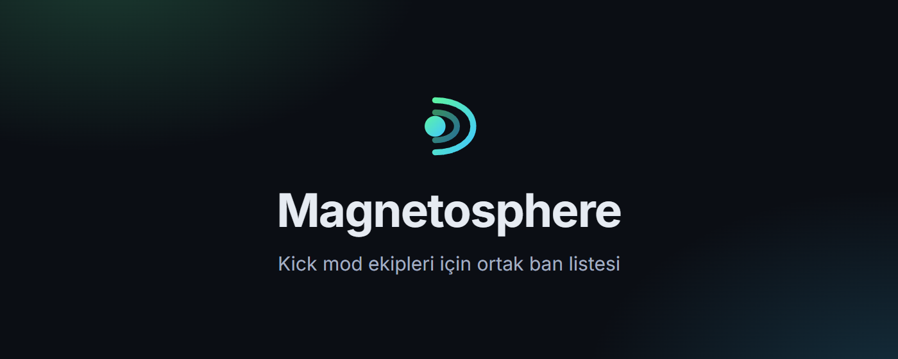
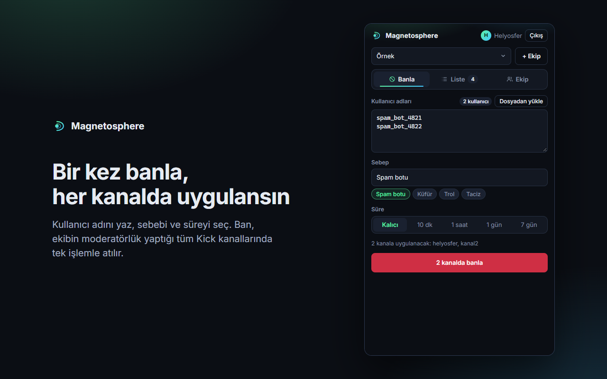
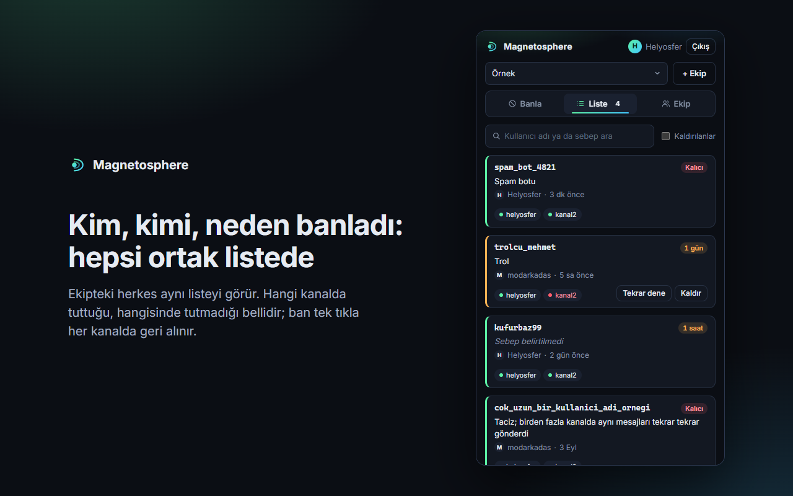
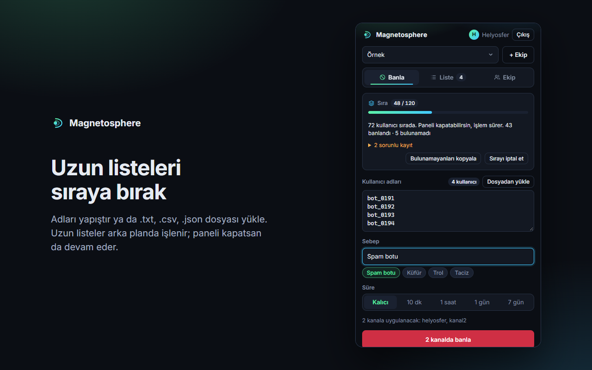
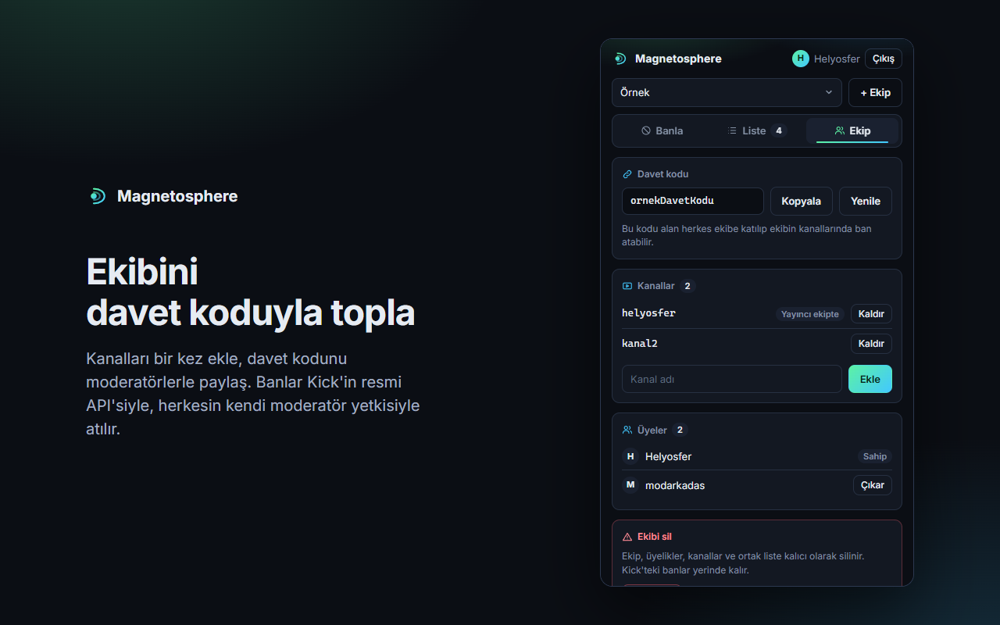
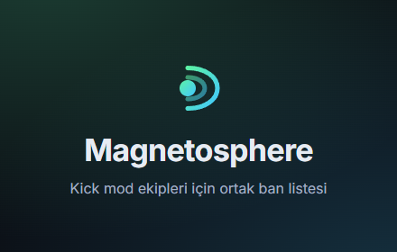

<div align="center">



**Kick moderatörleri ve mod ekipleri için ortak ban listesi.**<br>
Bir kullanıcıyı moderatörü olduğun tüm kanallarda tek işlemle banla.

[](https://chromewebstore.google.com/detail/magnetosphere/kjbbjooackbcfeeoolkfpmdbkomjiflh)
[](LICENSE)


[Ekran görüntüleri](#ekran-görüntüleri) ·
[Özellikler](#özellikler) ·
[Başlarken](#başlarken) ·
[Roller](#roller-ve-yetkiler) ·
[Nasıl çalışır](#nasıl-çalışır) ·
[Kendi sunucun](#kendi-sunucunu-kurmak) ·
[Güvenlik](#güvenlik) ·
[Geliştirme](#geliştirme)

</div>

<br>

Birden fazla kanalda moderatörlük yapanlar, bir trolü ya da spam botunu her kanalda tek tek banlamak
zorunda kalır. Magnetosphere bunu tek işleme indirir: kullanıcı adını bir kez girersin (ya da binlercesini
bir dosyadan yüklersin), listendeki tüm kanallarda banlanır ve kimin, kimi, ne zaman ve neden banladığı
kaydedilir.

**Tek başına** kullanabilirsin: kimseyi davet etmeden moderatörü olduğun kanalları ekler ve banlarsın.
**Ekip olarak** kullanınca üç şey eklenir: herkes aynı listeyi görür, bir kişinin banı bütün kanalları
korur ve ekipteki bir yayıncı yetkisini paylaşırsa, o kanalda moderatör olmayan üyelerin banları da
orada tutar.

Adını, Dünya'yı güneş rüzgârından koruyan manyetik kalkandan alır.

> Magnetosphere bağımsız bir projedir; Kick ile bağlantılı ya da Kick tarafından onaylanmış değildir.

## Ekran görüntüleri

| | |
|:-:|:-:|
|  |  |
| **Banla:** adları yaz, sebep ve süre seç; tüm kanallarda tek işlemle. | **Liste:** kim, kimi, neden banladı ve ban hangi kanalda tuttu. |
|  |  |
| **Sıra:** binlerce ad arka planda işlenir; panel kapansa da sürer. | **Ekip:** kanallar, yayıncı yetkisi paylaşımı ve rollerle üyeler. |

## Özellikler

| | |
|---|---|
| **Tek işlemle çoklu kanal banı** | Kalıcı ban ya da 7 güne kadar süreli uzaklaştırma; kanallara aynı anda uygulanır. |
| **Toplu ban ve içe aktarma** | Adları yapıştır ya da `.txt`, `.csv`, `.json` dosyası yükle (tek seferde 5.000'e kadar). CSV'de yalnızca ilk sütun alınır, başlık satırı atlanır. |
| **Arka plan sırası** | Uzun listeler sunucuda sıraya alınır; panel ya da tarayıcı kapansa da banlar atılmaya devam eder. İlerleme, bulunamayan adlar ve iptal panelden yönetilir. |
| **Kick'in istek sınırına uyum** | İstek hızı kendiliğinden ayarlanır; Kick yavaşlatırsa kayıtlar kaybolmaz, sıraya geri döner. |
| **Ortak liste** | Her ban için kim attı, ne zaman, neden ve hangi kanalda tuttu bilgisi; ad ya da sebebe göre arama. |
| **Tekrar dene ve geri al** | Tutmayan kanallara banı yeniden uygular; banı tek tıkla tüm kanallarda kaldırır. |
| **Sağ tık kısayolu** | kick.com'da bir kullanıcı adını seç, "Ekibin tüm kanallarında banla". |
| **Tek başına ya da ekiple** | Giriş yapan herkes tek tıkla kendi kanal listesini kurar; isterse davet koduyla başkalarını ekler. |
| **Roller** | Sahip, yönetici, moderatör ve izleyici; davetle katılanların hangi rolle başlayacağı seçilebilir. |
| **Yayıncı yetkisi paylaşımı** | Ekipteki bir yayıncı isterse kendi kanalında yetkisini ekibe açar; kararı yalnızca kendisi verir. |
| **Koruma** | Ban yetkisi olan ekip üyeleri ve ekipteki yayıncılar yanlışlıkla banlanamaz. |
| **Hesap ve ekip yönetimi** | Ekipten ayrılma, sahipliği devretme, ekibi silme ve hesabı panelden silme. |

## Başlarken

<a href="https://chromewebstore.google.com/detail/magnetosphere/kjbbjooackbcfeeoolkfpmdbkomjiflh"></a>

1. **Kur.** Uzantıyı [Chrome Web Store'dan](https://chromewebstore.google.com/detail/magnetosphere/kjbbjooackbcfeeoolkfpmdbkomjiflh)
   ekle. Chrome, Edge ve Brave gibi Chromium tabanlı tarayıcılarda çalışır; Firefox desteklenmez.
2. **Giriş yap.** Magnetosphere simgesine tıkla ve **Kick ile giriş yap**'a bas. Giriş Kick'in kendi
   sayfasında yapılır; uzantı şifreni görmez.
3. **Başla.** **Tek başıma başla**'ya bas; kendi kanalın listeye kendiliğinden eklenir. Bir ekibe davet
   edildiysen onun yerine davet kodunu yapıştır.
4. **Kanalları ekle.** **Ekip** sekmesinden moderatörü olduğun kanalları adıyla ya da `kick.com/kanal`
   bağlantısıyla ekle.
5. **Banla.** **Banla** sekmesine kullanıcı adlarını yaz ya da **Dosyadan yükle** ile liste seç. 10 addan
   uzun listeler sıraya alınır ve arka planda işlenir.
6. **Takip et.** **Liste** sekmesi her banın kanal kanal sonucunu gösterir; buradan ban kaldırılır ya da
   tutmayan kanallar için yeniden denenir.

İstersen ekip ol: **Ekip** sekmesindeki davet kodunu paylaş; katılanlar aynı kanal listesini ve ban
listesini kullanır.

<br clear="right">

## Roller ve yetkiler

| | İzleyici | Moderatör | Yönetici | Sahip |
|---|:-:|:-:|:-:|:-:|
| Ortak listeyi görme | ✓ | ✓ | ✓ | ✓ |
| Ban atma, tekrar deneme, liste yükleme | | ✓ | ✓ | ✓ |
| Kendi attığı banı kaldırma | | ✓ | ✓ | ✓ |
| Başkasının attığı banı kaldırma | | | ✓ | ✓ |
| Kanal ekleme ve kaldırma | | | ✓ | ✓ |
| Davet kodunu görme ve yenileme | | | ✓ | ✓ |
| Kendinden düşük yetkili üyeyi çıkarma | | | ✓ | ✓ |
| Rol verme, katılanların başlangıç rolü | | | | ✓ |
| Sahipliği devretme, ekibi silme | | | | ✓ |

Davetle katılanlar varsayılan olarak moderatör olur; sahip bunu "izleyici olarak başlar" yapabilir.
Sahip dışındaki herkes ekipten istediği an ayrılabilir.

### Yayıncı yetkisi paylaşımı

Bir ban her kanalda önce banı atan kişinin **kendi moderatör yetkisiyle** denenir. Kanalın yayıncısı
ekipteyse ve **Ekip > Yayıncı yetkin** altındaki paylaşımı açtıysa, moderatörün yetkisi yetmediğinde ban
yayıncının yetkisiyle uygulanır.

- Paylaşım, ekibi kuran kişi için açık, davetle katılanlar için kapalı başlar.
- Yalnızca yayıncının kendisi açıp kapatabilir; davet koduyla bir ekibe katılmak tek başına bu yetkiyi vermez.
- Moderatörü olmadığın ve yayıncısı yetkisini paylaşmayan bir kanalda banın tutmaz; listede o kanal kırmızı görünür.

## Nasıl çalışır

```
   Chrome uzantısı               Sunucu                    Kick
┌──────────────────┐      ┌──────────────────┐      ┌──────────────────┐
│ Moderatörün      │ ───▶ │ Ekipler, roller  │ ───▶ │ Resmi API        │
│ kullandığı       │      │ Ortak liste      │      │ (OAuth 2.1 ve    │
│ panel            │ ◀─── │ Sıra ve işçiler  │ ◀─── │  moderasyon)     │
└──────────────────┘      └──────────────────┘      └──────────────────┘
```

| Parça | Ne yapar |
|---|---|
| [`extension/`](extension) | Chrome uzantısı (Manifest V3). Kullanıcının gördüğü arayüz; kendi başına hiçbir Kick isteği atmaz ve Kick şifreni ya da token'ını görmez. |
| [`server/`](server) | Python sunucusu (3.10+). Ekipleri, rolleri, ortak listeyi, sırayı ve Kick oturumlarını tutar; banları Kick'in [resmi API'si](https://docs.kick.com/apis/moderation) üzerinden atar. |
| [`store/`](store) | Chrome Web Store metni ve görselleri. |
| [`tools/`](tools) | Mağaza paketini üreten betik. |
| [`docs/`](docs) | Gizlilik politikası. |

Kick'in OAuth akışı bir Client Secret istediği için sunucu şarttır; Secret uzantının içine konamaz.
Sunucu yalnızca Python standart kütüphanesini kullanır; tek bağımlılığı token şifrelemesi için
`cryptography` paketidir. Veriler tek bir SQLite dosyasında durur.

Mağazadaki uzantı varsayılan olarak `magnetosphere.helyosfer.me` sunucusunu kullanır; giriş yapan herkes
orada ekip kurabilir. İstersen aşağıdaki adımlarla kendi sunucunu kurup uzantıyı ona bağlayabilirsin.

## Kendi sunucunu kurmak

Önce kendi bilgisayarında denemek için 1–3. adımlar yeterlidir; herkesin kullanacağı kalıcı kurulum için
[Sunucuyu internete açmak](#sunucuyu-internete-açmak) bölümüne geç.

### 1. Kick uygulaması

[kick.com/settings/developer](https://kick.com/settings/developer) adresinden bir uygulama oluştur
(hesapta iki adımlı doğrulama açık olmalı). Uygulama adında boşluk kullanılamaz.

| Alan | Değer |
|---|---|
| Redirect URL | `http://localhost:8787/auth/callback` (yerel deneme) ya da `https://<alan-adın>/auth/callback` |
| Scopes | Read user information, Read channel information, Execute moderation actions for moderators |

### 2. Sunucu

```bash
cd server
pip install -r requirements.txt
cp .env.example .env
```

`.env` dosyasını doldur:

- `KICK_CLIENT_ID` ve `KICK_CLIENT_SECRET`: Kick'in verdiği değerler.
- `TOKEN_ENCRYPTION_KEY`: aşağıdaki komutla üretilen anahtar.

```bash
python -c "from cryptography.fernet import Fernet; print(Fernet.generate_key().decode())"
```

Sonra sunucuyu başlat:

```bash
python app.py
```

Sunucu `http://localhost:8787` adresinde dinler. Eksik bir güvenlik ayarı varsa açılışta uyarı yazar.
Çalıştığını `http://localhost:8787/health` adresinden görebilirsin.

### 3. Uzantı

1. Chrome'da `chrome://extensions` sayfasını aç ve **Geliştirici modu**'nu etkinleştir.
2. **Paketlenmemiş öğe yükle** ile `extension` klasörünü seç.
3. Magnetosphere simgesine tıkla, **Gelişmiş: kendi sunucunu kullan** alanına sunucunun adresini yaz
   (yerel deneme için `http://localhost:8787`) ve **Kick ile giriş yap**'a bas.

Ekibindeki herkesin adresi elle girmesini istemiyorsan `extension/panel.js` içindeki `DEFAULT_SERVER`
değerini kendi adresinle değiştirip klasörü öyle dağıt.

Elle yüklenen uzantının kimliği `manifest.json` içindeki anahtarla sabitlenmiştir
(`flmfmniipeobbaoahmbdkjnblbegalob`); her bilgisayarda aynı çıkar. Sunucu yalnızca
`ALLOWED_EXTENSION_IDS` listesindeki kimlikleri kabul eder. Mağazadan kurulan uzantının kimliği farklıdır
(`kjbbjooackbcfeeoolkfpmdbkomjiflh`); ikisini de kabul etmek için ikisini de listeye yaz.

### Sunucuyu internete açmak

Ekibin kullanacağı kurulumda sunucu sürekli çalışmalı ve HTTPS arkasında olmalıdır.

1. **Ayarlar.** `.env` içinde `PUBLIC_URL=https://<alan-adın>` yap ve Kick uygulamasındaki Redirect
   URL'i `https://<alan-adın>/auth/callback` olarak güncelle. `HOST=127.0.0.1` kalsın; sunucu dışarıya
   doğrudan açılmaz. Veritabanını kodun dışında tutmak için `DB_PATH` ver.
2. **Ters vekil.** HTTPS'i bir ters vekil sağlar. [Caddy](https://caddyserver.com) ile sertifika
   kendiliğinden alınır:

   ```
   <alan-adın> {
   	reverse_proxy 127.0.0.1:8787
   }
   ```

   Giriş sınırı gerçek istemci adresini `X-Forwarded-For` başlığının son değerinden okur; vekilin bu
   başlığı eklediğinden emin ol (Caddy ve nginx varsayılan ayarla ekler).
3. **Servis.** Sunucuyu yetkisiz bir sistem kullanıcısıyla, systemd servisi olarak çalıştır:

   ```ini
   [Service]
   User=magnetosphere
   WorkingDirectory=/opt/magnetosphere/app/server
   ExecStart=/opt/magnetosphere/venv/bin/python app.py
   Environment=PYTHONUNBUFFERED=1
   Restart=on-failure
   NoNewPrivileges=true
   ProtectSystem=strict
   ReadWritePaths=/opt/magnetosphere/data
   ```

4. **Kimler ekip açabilir.** Varsayılan olarak giriş yapan herkes ekip kurabilir. Sunucunu yalnızca
   kendi ekibin için açıyorsan `ALLOWED_TEAM_CREATORS` ile bunu kendi Kick kullanıcı kimliğinle sınırla;
   diğerleri davet koduyla katılır.
5. **Yedek.** Veritabanı çalışırken güvenle yedeklenebilir:

   ```bash
   sqlite3 /opt/magnetosphere/data/crossban.db ".backup '/opt/backups/crossban-$(date +%F).db'"
   ```

   Yedeğin bir kopyasını sunucu dışında tut (ör. [rclone](https://rclone.org) ile bir bulut klasörüne).
   `.env` dosyasını bu yedeğin yanına koyma; şifreleme anahtarı ile veritabanı ayrı durmalı.

Sunucu açılışta eski bir veritabanını kendiliğinden yeni şemaya geçirir; güncellemeden önce yedek almak
yeterlidir.

### Ayarlar

`server/.env` dosyasından okunur.

| Değişken | Varsayılan | Açıklama |
|---|---|---|
| `KICK_CLIENT_ID` | — | Kick uygulamasının Client ID'si |
| `KICK_CLIENT_SECRET` | — | Kick uygulamasının Client Secret'ı |
| `TOKEN_ENCRYPTION_KEY` | boş | Kick tokenlarını veritabanında şifreleyen anahtar. Boşsa tokenlar düz metin kalır |
| `ALLOWED_EXTENSION_IDS` | boş (hepsi) | Giriş yapmasına ve API'yi çağırmasına izin verilen uzantı kimlikleri, virgülle ayrılmış |
| `ALLOWED_TEAM_CREATORS` | boş (herkes) | Ekip oluşturabilecek Kick kullanıcı kimlikleri, virgülle ayrılmış. Davetle katılmak her durumda açıktır |
| `PUBLIC_URL` | `http://localhost:8787` | Sunucunun dışarıdan erişilen adresi. Kick'teki Redirect URL `{PUBLIC_URL}/auth/callback` olmalı |
| `HOST` | `127.0.0.1` | Dinlenecek arayüz |
| `PORT` | `8787` | Dinlenecek port |
| `DB_PATH` | `server/crossban.db` | SQLite veritabanının yolu |
| `QUEUE_WORKERS` | `4` | Sırayı aynı anda işleyen işçi sayısı |
| `KICK_REQUESTS_PER_SECOND` | `1` | Kick API'sine başlangıç istek hızı; Kick 429 dönerse kendiliğinden düşer, sorun yoksa yükselir |
| `KICK_REQUESTS_PER_SECOND_MAX` | `5` | İstek hızının üst sınırı |

## Güvenlik

### Neler korunuyor

- **Kick tokenları şifreli saklanır.** `TOKEN_ENCRYPTION_KEY` tanımlıyken veritabanındaki access ve
  refresh tokenlar Fernet (AES + HMAC) ile şifrelidir; veritabanı dosyası tek başına sızarsa tokenlar okunamaz.
- **Oturumlar.** Oturum anahtarı veritabanında yalnızca özet (SHA-256) olarak durur, 30 gün kullanılmazsa
  geçersiz olur. Çıkış yapmak kullanıcının tüm oturumlarını kapatır.
- **Yalnızca bu uzantı.** `ALLOWED_EXTENSION_IDS` tanımlıyken başka bir uzantı ne giriş akışını
  başlatabilir ne de tarayıcıdan API'yi çağırabilir (CORS yalnızca izinli kimliğe açılır).
- **Giriş akışı.** OAuth, PKCE ve tek kullanımlık `state` ile yapılır; oturum yalnızca Chrome'un uzantıya
  özel yönlendirme adresine teslim edilir.
- **Ekipler birbirinden yalıtılmıştır.** Bir ekibin kanallarını, üyelerini ve listesini yalnızca o
  ekibin üyeleri görür.
- **Roller sunucuda denetlenir.** Her işlem sunucuda rol kontrolünden geçer; panelin düğmeyi gizlemesine
  güvenilmez.
- **Davet kodu.** Rastgele 72 bitliktir; yalnızca sahip ve yöneticiler görür ve yeniler, eski kod anında
  geçersiz olur.
- **Yayıncı yetkisi rızayla kullanılır.** Bir yayıncının token'ı, başkasının attığı ban için ancak o
  yayıncı paylaşımı kendisi açtıysa kullanılır.
- **Hesap silme.** Kullanıcı hesabını sildiğinde oturumları, üyelikleri ve tokenları silinir, Kick'teki
  erişim geri alınır. Başka ekiplerin listesinde attığı banlar adsız olarak kalır.
- **Asgari izin.** Kick'ten yalnızca kullanıcı bilgisi, kanal bilgisi ve ban yetkisi istenir. Uzantı
  yalnızca `identity`, `storage` ve `contextMenus` izinlerini kullanır; hiçbir siteye içerik betiği eklemez.
- **Sınırlar.** İstek gövdesi 1 MB ile, tek seferde yüklenen liste 5.000 adla, bir ekibin sırada
  bekleyen kaydı 20.000 ile sınırlıdır. Aynı adresten 10 dakikada en fazla 30 giriş başlatılabilir.
  Bir hesap dakikada en fazla 300 istek atabilir, en fazla 10 ekip kurabilir ve 50 ekibe üye olabilir;
  bir ekipte en fazla 50 kanal ve 200 üye olur. Bir hesabın aynı anda Kick'e giden en fazla iki işlemi
  olabilir; böylece tek bir hesap ortak Kick hız sınırını doldurup diğerlerini bekletemez.
- **Sağlam istek işleme.** Bozuk ya da yarım gönderilen istekler bağlantıyı askıda tutmaz (30 saniye
  zaman aşımı); beklenmeyen hatalar istemciye ayrıntı sızdırmadan 500 olarak döner.
- **Adil sıra.** Sıra ekipler arasında dönüşümlü işlenir; bir ekibin uzun listesi diğerlerini bekletmez.

### Sunucuyu işleten kişinin sorumlulukları

- `server/.env` (Client Secret, şifreleme anahtarı) ve `server/crossban.db` gizlidir; `.gitignore`
  ikisini de depo dışında tutar. Şifreleme anahtarı ile veritabanını aynı yedeğe koyma.
- Sunucuyu internete yalnızca HTTPS arkasında aç. `HOST` varsayılan olarak yalnızca yerel makineyi dinler.
- Şifreleme anahtarı kaybolursa veri kaybı olmaz; yalnızca herkesin Kick ile yeniden giriş yapması gerekir.

### Bilinen sınırlar

- Şifreleme, veritabanı dosyasının sızmasına karşı korur; sunucunun tamamını ele geçiren biri anahtarı da okuyabilir.
- Davet koduyla katılan kişi varsayılan olarak moderatör olur ve ekibin kanallarında ban atabilir; kodu
  yalnızca güvendiğin kişilerle paylaş ya da katılanları izleyici olarak başlat.
- İstek sınırı hesap başınadır ve bellekte tutulur; oturumsuz isteklere karşı ters vekilde ayrıca sınır koy.

### Açık bildirimi

Bir güvenlik açığı bulursan lütfen herkese açık bir issue açma; `destek@helyosfer.me` adresine yaz.

Gizlilik politikası: [magnetosphere.helyosfer.me/privacy](https://magnetosphere.helyosfer.me/privacy)
(kaynağı [`docs/privacy.html`](docs/privacy.html)).

## Geliştirme

### Test

```bash
cd server
python -m unittest test_app
```

Testler sahte bir Kick API'sine karşı uçtan uca çalışır; gerçek Kick'e istek atmaz. Giriş, yetki
düşüşü, sıra ve eşzamanlı işçiler, ekipler arası adil sıra, roller, yetki paylaşımı, hesap silme, eski
veritabanından geçiş ve güvenlik kuralları kapsanır.

### Chrome Web Store

```bash
python tools/paketle.py
```

`dist/magnetosphere-<sürüm>.zip` dosyasını üretir. Mağaza manifest'teki `key` alanını kabul etmediği için
betik onu pakette çıkarır; depoda kalır, elle yüklenen uzantının kimliği değişmez.

Mağaza sayfasının metni [`store/aciklama.md`](store/aciklama.md) içindedir. Görseller:

| Alan | Dosya | Boyut |
|---|---|---|
| Ekran görüntüleri | [`ekran-1-banla.png`](store/ekran-1-banla.png), [`ekran-2-liste.png`](store/ekran-2-liste.png), [`ekran-3-sira.png`](store/ekran-3-sira.png), [`ekran-4-ekip.png`](store/ekran-4-ekip.png) | 1280×800 |
| Küçük tanıtım kutusu | [`tanitim-kucuk-440x280.png`](store/tanitim-kucuk-440x280.png) | 440×280 |
| Büyük tanıtım kutusu | [`tanitim-buyuk-1400x560.png`](store/tanitim-buyuk-1400x560.png) | 1400×560 |
| Simge | [`extension/icons/icon128.png`](extension/icons/icon128.png) | 128×128 |

## Yol haritası

Çalışan sürüm. Gerçek Kick üzerinde doğrulananlar: giriş, hem yayıncı hem moderatör yetkisiyle ban,
ban kaldırma ve iki kanalda binlerce hesaplık toplu içe aktarma.

- [x] Tokenların veritabanında şifrelenmesi, oturumlara süre
- [x] Uzantının sabit kimliğe bağlanması ve simgesi
- [x] Sunucunun internette HTTPS arkasında, servis olarak çalışması ve veritabanı yedeği
- [x] Ekip silme; açık sunucu için ekipler arası adil sıra ve giriş sınırı
- [x] [Chrome Web Store yayını](https://chromewebstore.google.com/detail/magnetosphere/kjbbjooackbcfeeoolkfpmdbkomjiflh)
- [x] Tek başına kullanım, ekip içi roller, yayıncı yetkisi için açık rıza, ekipten ayrılma ve hesap silme
- [x] Herkese açık kullanım için hesap başına sınırlar
- [ ] İngilizce arayüz
- [ ] Sohbeti dinleyip spam botlarını şüpheli kuyruğuna alan otomatik yakalama
- [ ] Süresi dolan süreli banların listede kendiliğinden kapanması

### Bilinen kısıtlar

- Kullanıcı adı, Kick'in kanal adresi kuralıyla aranır (küçük harf, `_` yerine `-`, en fazla 25 karakter).
- Kendi kanalın dışındaki kanallar elle eklenir; resmi API "moderatörü olduğum kanallar" listesini vermiyor.
- Süreli banlar süresi dolduktan sonra da listede aktif görünür.
- Hız, Kick'in istek sınırıyla belirlenir: iki kanallı bir ekipte hesap başına yaklaşık bir saniye.

## Katkı

Hata bildirimi ve öneriler için [issue aç](https://github.com/Helyosfer/magnetosphere/issues).
Değişiklik göndermeden önce testlerin geçtiğinden emin ol; yeni davranışlar için `server/test_app.py`
dosyasına test ekle.

## Lisans

Copyright (C) 2026 Helyosfer

Magnetosphere özgür yazılımdır; [GNU Genel Kamu Lisansı sürüm 3](LICENSE) (GPL-3.0) koşulları altında
kullanabilir, değiştirebilir ve dağıtabilirsin. Değiştirilmiş sürümleri dağıtırsan kaynak kodunu da aynı
lisansla açman gerekir. Yazılım hiçbir garanti verilmeden sunulur.

Panelde kullanılan [Inter](https://github.com/rsms/inter) yazı tipi uzantıyla birlikte gelir ve
[SIL Open Font License 1.1](extension/fonts/LICENSE.txt) ile lisanslıdır.
