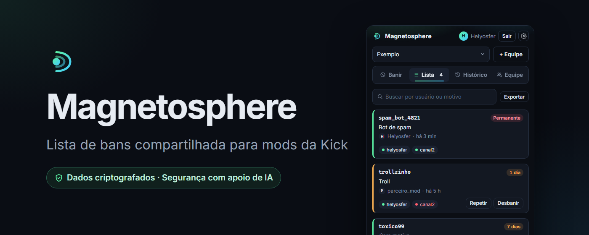
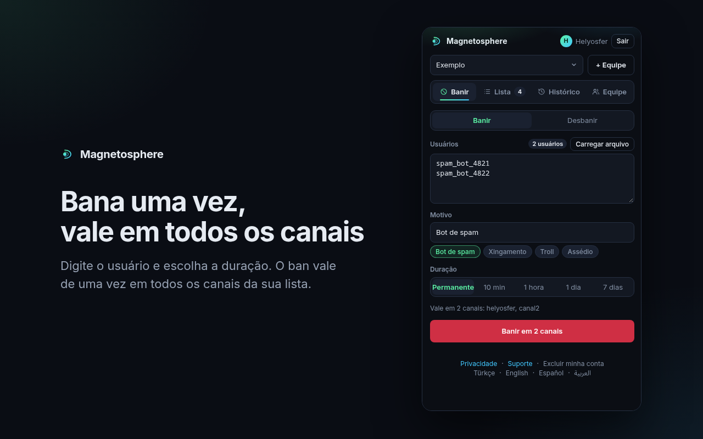
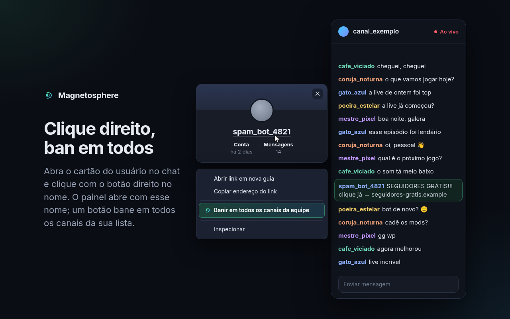
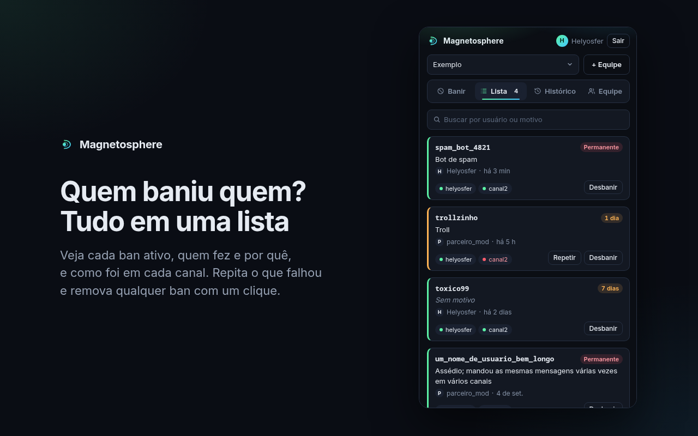
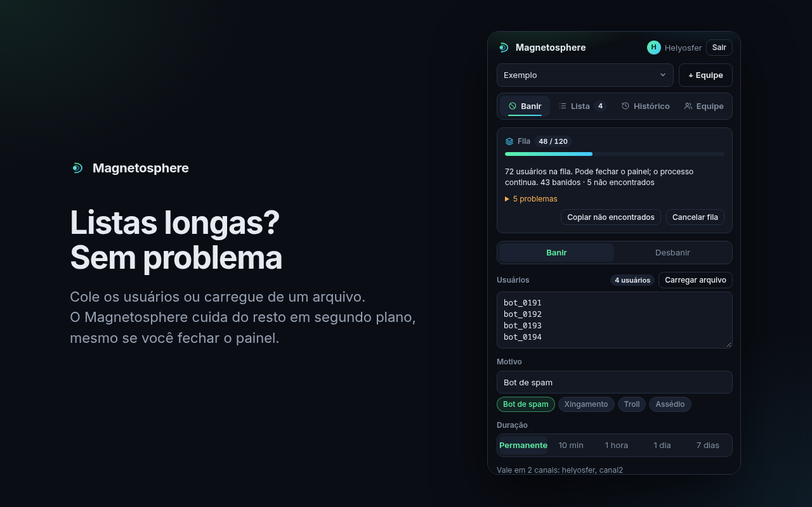
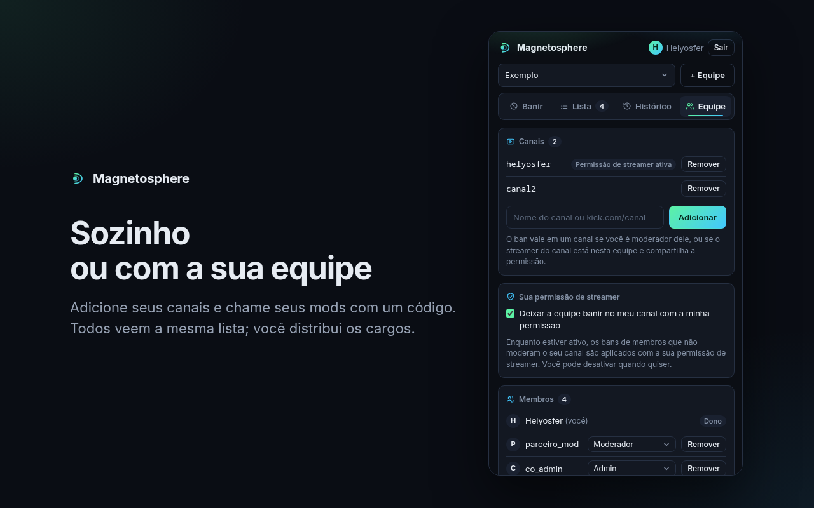
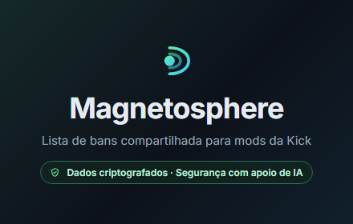

<div align="center">

<sub>[Türkçe](README.md) · [English](README.en.md) · [Español](README.es.md) · [Português (Brasil)](README.pt-BR.md) · [العربية](README.ar.md) · [Deutsch](README.de.md) · [Français](README.fr.md) · [Bahasa Indonesia](README.id.md) · [Русский](README.ru.md)</sub>



**Lista de bans compartilhada para moderadores e equipes de moderação da Kick.**<br>
Bana um usuário de uma só vez em todos os canais que você modera.

[](https://chromewebstore.google.com/detail/magnetosphere/kjbbjooackbcfeeoolkfpmdbkomjiflh)
[](LICENSE)


[Capturas de tela](#capturas-de-tela) ·
[Recursos](#recursos) ·
[Primeiros passos](#primeiros-passos) ·
[Cargos](#cargos-e-permissões) ·
[Como funciona](#como-funciona) ·
[Seu próprio servidor](#hospedar-seu-próprio-servidor) ·
[Segurança](#segurança) ·
[Desenvolvimento](#desenvolvimento)

</div>

<br>

Se você modera mais de um canal, precisa banir cada troll ou bot de spam canal por canal. O Magnetosphere
reduz isso a um único passo: você digita o nome de usuário uma vez (ou carrega milhares de nomes de um
arquivo) e o ban é aplicado em todos os canais da sua lista. Também fica registrado quem baniu quem, quando
e por quê.

Você pode usar **sozinho**: sem convidar ninguém, você adiciona os canais que modera e começa a banir.
**Em equipe**, você ganha também:

- Todos veem a mesma lista de bans.
- O ban dado por uma pessoa é aplicado em todos os canais da equipe.
- Se um streamer da equipe compartilhar a permissão dele, os bans de membros que não são moderadores daquele canal também valem lá.

O nome vem do escudo magnético (a magnetosfera) que protege a Terra do vento solar.

> O Magnetosphere é um projeto independente; não tem vínculo com a Kick nem é endossado por ela.

## Capturas de tela

| | |
|:-:|:-:|
|  |  |
| **Banir:** digite os nomes, escolha o motivo e a duração; o ban vai para todos os canais de uma vez. | **Clique direito:** abra o cartão do usuário no chat e clique com o botão direito no nome; o painel abre com esse nome. |
|  |  |
| **Lista:** bans ativos; quem baniu quem e por quê, e em quais canais o ban foi aplicado. | **Fila:** milhares de nomes são processados em segundo plano; continua mesmo com o painel fechado. |
|  | |
| **Equipe:** canais, compartilhamento da permissão de streamer, membros e cargos. | |

## Recursos

| | |
|---|---|
| **Ban em vários canais de uma vez** | Ban permanente ou timeout de 10 minutos, 1 hora, 1 dia ou 7 dias; aplicado em todos os canais ao mesmo tempo. |
| **Seleção de canais** | Quando a equipe tem vários canais, em **Banir** e **Desbanir** você escolhe os canais: **Todos**, **Só o meu** ou os marcados em **Escolher…**. A escolha vale só para aquela operação; depois dela, volta para **Todos**. Se você remove o ban de apenas alguns canais, o registro continua ativo nos canais em que o ban permanece; o canal removido aparece em cinza no cartão e **Repetir** não bane de novo nele. Remover o ban em um canal que você não modera dá erro, então escolher só os canais em que você tem permissão dá um resultado limpo. Em listas longas, os canais ficam fixados quando entram na fila: um canal adicionado à equipe enquanto a lista é processada não é aplicado aos nomes restantes. |
| **Ban em massa, importação e exportação** | Cole os nomes ou carregue um arquivo `.txt`, `.csv` ou `.json` (até 6.000 nomes de uma vez). Em arquivos CSV, só a primeira coluna é lida e a linha de cabeçalho é ignorada. **Lista > Exportar** baixa todos os bans permanentes da equipe como um arquivo `.txt` com um nome de usuário por linha; o arquivo pode ser carregado como está em outra equipe. |
| **Fila em segundo plano** | Listas longas entram numa fila no servidor; os bans continuam sendo dados mesmo que você feche o painel ou o navegador. O progresso, os nomes não encontrados e o cancelamento são gerenciados pelo painel. |
| **Respeito ao limite de requisições da Kick** | A taxa de requisições se ajusta sozinha. Se a Kick desacelerar as requisições, nenhum nome se perde: ele volta para a fila. |
| **Lista compartilhada e histórico** | Quem deu cada ban, quando e por quê, e em quais canais o ban foi aplicado; busca por nome de usuário ou motivo. **Lista** mostra os bans permanentes e os timeouts em andamento; **Histórico** mostra os bans removidos e os timeouts expirados; o dono e os admins podem apagar o histórico mediante confirmação. |
| **Repetir e desfazer** | Tenta o ban de novo nos canais em que ele não foi aplicado; remove o ban de todos os canais com um clique. |
| **Desbanir pelo nome** | Em **Banir > Desbanir**, digite o nome de usuário; o ban é removido de todos os canais da equipe. Bans que não estão na lista, dados manualmente na Kick ou antes do Magnetosphere, também são removidos, e a remoção fica registrada na lista. Listas com mais de 10 nomes (também podem ser carregadas de um arquivo) entram na fila como um ban em massa. |
| **Atalho no clique direito** | No kick.com, abra o cartão do usuário no chat, clique com o botão direito no nome dele e escolha "Banir em todos os canais da equipe". O painel abre com esse nome. |
| **Sozinho ou em equipe** | Qualquer pessoa que fizer login monta a própria lista de canais com um clique; se quiser, convida outras pessoas por link ou código de convite. Quem abre o link instala a extensão e entra com um clique. |
| **Cargos** | Dono, admin, moderador e espectador. Você escolhe com qual cargo quem entra por convite começa. |
| **Compartilhamento da permissão de streamer** | Se um streamer da equipe quiser, ele libera a permissão de ban do próprio canal para a equipe; só ele mesmo toma essa decisão. |
| **Proteção contra ban por engano** | Membros da equipe com permissão de ban e os streamers da equipe não podem ser banidos. |
| **Gerenciamento de conta e equipe** | Sair da equipe, transferir a posse, excluir a equipe e a conta; tudo pelo painel. |
| **9 idiomas** | Turco, inglês, alemão, espanhol, francês, indonésio, português, russo e árabe. O painel abre no idioma do navegador; se o idioma do navegador não for um desses, abre em inglês. Dá para mudar em **Configurações**, aberto pela engrenagem no cabeçalho; em árabe, o painel é exibido da direita para a esquerda. As mensagens de erro do servidor e a página de convite também aparecem no idioma escolhido. |

## Primeiros passos

<a href="https://chromewebstore.google.com/detail/magnetosphere/kjbbjooackbcfeeoolkfpmdbkomjiflh"></a>

1. **Instale.** Adicione a extensão pela [Chrome Web Store](https://chromewebstore.google.com/detail/magnetosphere/kjbbjooackbcfeeoolkfpmdbkomjiflh).
   Funciona em navegadores baseados em Chromium, como Chrome, Edge e Brave; o Firefox não é compatível.
2. **Faça login.** Clique no ícone do Magnetosphere e em **Entrar com a Kick**. O login é feito na própria
   página da Kick; a extensão não vê a sua senha.
3. **Comece.** Clique em **Começar sozinho**; o seu próprio canal é adicionado à lista automaticamente. Se
   você foi convidado para uma equipe, cole o código de convite no lugar.
4. **Adicione os canais.** Na aba **Equipe**, adicione os canais que você modera pelo nome ou pelo link
   `kick.com/canal`.
5. **Bana.** Na aba **Banir**, digite os nomes de usuário ou escolha uma lista com **Carregar arquivo**.
   Listas com mais de 10 nomes entram na fila e são processadas em segundo plano.
6. **Acompanhe.** A aba **Lista** mostra o resultado dos bans ativos canal por canal; bans removidos e
   timeouts expirados passam para a aba **Histórico**. Daqui você pode remover o ban ou tentar de novo
   nos canais em que ele não foi aplicado.
7. **Remova bans antigos.** Para um ban que não está na lista (dado manualmente na Kick ou antes do
   Magnetosphere), escolha **Desbanir** na aba **Banir** e digite o nome de usuário; o ban sai de todos os
   canais da equipe. Listas longas também entram na fila aqui.

Para montar uma equipe, clique em **Copiar link de convite** na aba **Equipe** e envie o link aos seus
mods. Quem abrir instala a extensão, clica em **Entrar na equipe** na página e, no painel, vê o nome e o dono
da equipe e confirma. Se o link for aberto no celular ou em um navegador que não seja o Chrome, a página
orienta a abri-lo no Chrome do computador. Em vez do link, você também pode compartilhar o código. Quem
entra usa a mesma lista de canais e a mesma lista de bans.

O código de convite fica na parte do link depois do `#`; o navegador não envia essa parte ao servidor, então
o código não vai parar nos logs do servidor nem do Cloudflare. A página entrega o código à extensão pelo
recurso `externally_connectable` do Chrome, que não pede nenhuma permissão nova.

<br clear="right">

## Cargos e permissões

| | Espectador | Moderador | Admin | Dono |
|---|:-:|:-:|:-:|:-:|
| Ver e exportar a lista compartilhada | ✓ | ✓ | ✓ | ✓ |
| Dar bans, repetir, carregar listas | | ✓ | ✓ | ✓ |
| Remover o ban que você mesmo deu | | ✓ | ✓ | ✓ |
| Remover pelo nome um ban que não está na lista (dado manualmente na Kick) | | ✓ | ✓ | ✓ |
| Remover o ban dado por outra pessoa | | | ✓ | ✓ |
| Adicionar e remover canais | | | ✓ | ✓ |
| Apagar o histórico | | | ✓ | ✓ |
| Ver e renovar o código de convite | | | ✓ | ✓ |
| Remover membros de cargo inferior ao seu | | | ✓ | ✓ |
| Atribuir cargos, definir o cargo inicial de quem entra | | | | ✓ |
| Transferir a posse, excluir a equipe | | | | ✓ |

Quem entra por convite começa como moderador por padrão; o dono pode mudar isso para "Começa como espectador".
Todos, exceto o dono, podem sair da equipe a qualquer momento.

Se o usuário cujo nome você digitar em **Desbanir** tiver na lista um ban ativo dado por outro membro, vale
a regra da lista: só o dono e os admins podem remover esse ban.

**Apagar histórico** apaga de forma permanente, para todos da equipe, os bans removidos e os timeouts
expirados; não mexe nos bans da Kick. O registro de um ban que não pôde ser removido em algum canal não é
apagado, porque a pessoa ainda pode estar banida nesse canal e o registro é necessário para tentar a
remoção de novo.

### Compartilhamento da permissão de streamer

Em cada canal, um ban é tentado primeiro **com a própria permissão de moderador** de quem deu o ban. Se o
streamer do canal está na equipe e ativou o compartilhamento em **Equipe > Sua permissão de streamer**, o ban
é aplicado com a permissão do streamer quando a permissão do moderador não basta.

- O compartilhamento começa desativado para todos; quem criou a equipe também ativa por conta própria, para o
  seu canal. (Em equipes criadas antes da 0.15.1, o compartilhamento de quem criou está ativo; desative se
  quiser.)
- Só o próprio streamer pode ativar e desativar; entrar em uma equipe com o código de convite não concede
  essa permissão por si só.
- Em um canal que você não modera e cujo streamer não compartilha a permissão, o ban não é aplicado; esse
  canal aparece em vermelho na lista.
- Para adicionar um canal à equipe, você precisa ser moderador da Kick nesse canal, o canal precisa ser seu ou
  o streamer dele precisa estar na equipe (0.15.1). Se quiser adicionar o canal de um streamer, ele deve
  entrar na equipe primeiro.

## Como funciona

```
   Extensão do Chrome            Servidor                  Kick
┌──────────────────┐      ┌──────────────────┐      ┌──────────────────┐
│ Painel que o     │ ───▶ │ Equipes, cargos  │ ───▶ │ API oficial      │
│ moderador usa    │      │ Lista comum      │      │ (OAuth 2.1 e     │
│ no navegador     │ ◀─── │ Fila e workers   │ ◀─── │  moderação)      │
└──────────────────┘      └──────────────────┘      └──────────────────┘
```

| Parte | O que faz |
|---|---|
| [`extension/`](extension) | Extensão do Chrome (Manifest V3). A interface que o usuário vê; não faz nenhuma requisição à Kick por conta própria e não vê a sua senha nem o seu token da Kick. |
| [`server/`](server) | Servidor em Python (3.10+). Guarda as equipes, os cargos, a lista compartilhada, a fila e as sessões da Kick; aplica os bans pela [API oficial](https://docs.kick.com/apis/moderation) da Kick. |
| [`store/`](store) | Texto e imagens da Chrome Web Store. |
| [`tools/`](tools) | Script que gera o pacote da loja. |
| [`docs/`](docs) | Política de privacidade. |

O servidor é indispensável porque o fluxo OAuth da Kick exige um Client Secret, e o Secret não pode ficar
dentro da extensão. O servidor usa apenas a biblioteca padrão do Python; a única dependência é o pacote
`cryptography`, para a criptografia dos tokens. Os dados ficam em um único arquivo SQLite.

Por padrão, a extensão da loja usa o servidor `magnetosphere.helyosfer.me`; qualquer pessoa que fizer login
pode criar uma equipe lá. Se preferir, você pode montar o seu próprio servidor com os passos abaixo e
conectar a extensão a ele.

## Hospedar seu próprio servidor

Para testar primeiro no seu computador, os passos 1 a 3 bastam; para uma instalação permanente que todos
vão usar, vá para a seção [Expor o servidor na internet](#expor-o-servidor-na-internet).

### 1. Aplicativo da Kick

Crie um aplicativo em [kick.com/settings/developer](https://kick.com/settings/developer) (a conta precisa
ter a verificação em duas etapas ativada). O nome do aplicativo não pode ter espaços.

| Campo | Valor |
|---|---|
| Redirect URL | `http://localhost:8787/auth/callback` (teste local) ou `https://<seu-dominio>/auth/callback` |
| Scopes | Read user information, Read channel information, Execute moderation actions for moderators |

### 2. Servidor

```bash
cd server
pip install -r requirements.txt
cp .env.example .env
```

Preencha o arquivo `.env`:

- `KICK_CLIENT_ID` e `KICK_CLIENT_SECRET`: os valores fornecidos pela Kick.
- `TOKEN_ENCRYPTION_KEY`: a chave gerada pelo comando abaixo.

```bash
python -c "from cryptography.fernet import Fernet; print(Fernet.generate_key().decode())"
```

Depois, inicie o servidor:

```bash
python app.py
```

O servidor escuta em `http://localhost:8787`. Se faltar alguma configuração de segurança, ele avisa na
inicialização. Para ver se está funcionando, acesse `http://localhost:8787/health`.

### 3. Extensão

1. No Chrome, abra `chrome://extensions` e ative o **Modo do desenvolvedor**.
2. Com **Carregar sem compactação**, selecione a pasta `extension`.
3. Clique no ícone do Magnetosphere, digite o endereço do servidor no campo **Avançado: usar seu próprio
   servidor** (para teste local, `http://localhost:8787`) e clique em **Entrar com a Kick**.

Se você não quiser que cada pessoa da equipe digite o endereço manualmente, troque o valor de
`DEFAULT_SERVER` em `extension/server-url.js` pelo seu endereço e distribua a pasta assim. Para que os links
de convite cheguem à extensão, adicione o mesmo endereço também à lista `externally_connectable.matches` do
`manifest.json` e à lista `INVITE_ORIGINS` do `background.js`. Se você não adicionar, o botão **Copiar link
de convite** não aparece no painel; o código ainda pode ser copiado e compartilhado. O botão aparece quando
o servidor é a versão 0.12.0 ou mais nova.

O ID de uma extensão carregada manualmente é fixado pela chave do `manifest.json`
(`flmfmniipeobbaoahmbdkjnblbegalob`); é o mesmo em qualquer computador. O servidor só aceita os IDs que
estão em `ALLOWED_EXTENSION_IDS`. O ID da extensão instalada pela loja é diferente
(`kjbbjooackbcfeeoolkfpmdbkomjiflh`); para aceitar os dois, coloque os dois na lista.

### Expor o servidor na internet

Em uma instalação que a equipe vai usar, o servidor precisa ficar sempre ligado e atrás de HTTPS.

1. **Configurações.** No `.env`, defina `PUBLIC_URL=https://<seu-dominio>` e atualize a Redirect URL do
   aplicativo da Kick para `https://<seu-dominio>/auth/callback`. Mantenha `HOST=127.0.0.1`; o servidor
   não é exposto diretamente para fora. Informe `DB_PATH` para manter o banco de dados fora da pasta do código.
2. **Proxy reverso.** O HTTPS fica por conta de um proxy reverso. Com o [Caddy](https://caddyserver.com), o
   certificado é obtido automaticamente:

   ```
   <seu-dominio> {
   	reverse_proxy 127.0.0.1:8787
   }
   ```

   O limite de login lê o endereço real do cliente do último valor do cabeçalho `X-Forwarded-For`. O Caddy
   escreve esse cabeçalho corretamente com a configuração padrão. O nginx não escreve e repassa o cabeçalho
   enviado pelo cliente como está; se você usa nginx, adicione a linha
   `proxy_set_header X-Forwarded-For $remote_addr;`. Se o cabeçalho não chegar, todos os clientes são
   contados como um único endereço e o limite de login passa a ser compartilhado por todos.

   Se o servidor está atrás do Cloudflare, o proxy reverso vê o endereço do Cloudflare e não o do visitante,
   e o limite de login passa a ser compartilhado por todos que vêm do mesmo servidor do Cloudflare. O endereço
   real está no cabeçalho `CF-Connecting-IP`; esse cabeçalho só deve ser considerado confiável em
   requisições que vêm do Cloudflare:

   ```
   @cloudflare remote_ip <intervalos de https://www.cloudflare.com/ips/>
   handle @cloudflare {
   	reverse_proxy 127.0.0.1:8787 {
   		header_up X-Forwarded-For {http.request.header.CF-Connecting-IP}
   	}
   }
   handle {
   	reverse_proxy 127.0.0.1:8787
   }
   ```
3. **Serviço.** Execute o servidor com um usuário de sistema sem privilégios, como um serviço do systemd:

   ```ini
   [Service]
   User=magnetosphere
   WorkingDirectory=/opt/magnetosphere/app/server
   ExecStart=/opt/magnetosphere/venv/bin/python app.py
   Environment=PYTHONUNBUFFERED=1
   Restart=on-failure
   NoNewPrivileges=true
   ProtectSystem=strict
   ReadWritePaths=/opt/magnetosphere/data
   ```

4. **Quem pode criar equipes.** Por padrão, qualquer pessoa que faz login pode criar uma equipe. Se você
   abre o servidor só para a sua própria equipe, limite isso ao seu ID de usuário da Kick com
   `ALLOWED_TEAM_CREATORS`; as demais pessoas entram com o código de convite.
5. **Backup.** O banco de dados pode ser copiado com segurança enquanto está em uso:

   ```bash
   sqlite3 /opt/magnetosphere/data/crossban.db ".backup '/opt/backups/crossban-$(date +%F).db'"
   ```

   Guarde uma cópia do backup fora do servidor (por exemplo, em uma pasta na nuvem com o
   [rclone](https://rclone.org)). Não coloque o arquivo `.env` junto com esse backup; a chave de criptografia
   e o banco de dados devem ficar separados.

Na inicialização, o servidor migra sozinho um banco de dados antigo para o esquema novo; basta fazer um
backup antes de atualizar.

### Atualizar o servidor

Na instalação acima (código em `/opt/magnetosphere/app`, banco de dados em `/opt/magnetosphere/data`):

```bash
# 1. Backup
sqlite3 /opt/magnetosphere/data/crossban.db ".backup '/opt/backups/crossban-$(date +%F)-atualizacao.db'"
# 2. Código; baixe como dono da pasta (com outro usuário, o git recusa com "dubious ownership")
sudo -u "$(stat -c %U /opt/magnetosphere/app)" git -C /opt/magnetosphere/app pull
grep '^VERSION' /opt/magnetosphere/app/server/app.py   # não continue sem ver a versão nova
/opt/magnetosphere/venv/bin/pip install -r /opt/magnetosphere/app/server/requirements.txt
# 3. Reinicie e confira
sudo systemctl restart magnetosphere
curl -s https://<seu-dominio>/health          # {"ok": true, "version": "<versão nova>"}
journalctl -u magnetosphere -n 30 --no-pager
```

Se o `/health` ainda mostrar a versão antiga, ou o `git pull` deu erro, ou o serviço está rodando de outra
pasta; confira o valor de `WorkingDirectory` com `systemctl cat magnetosphere`.

Se você serve a página de privacidade como um arquivo estático no proxy reverso (por exemplo,
`/var/www/magnetosphere/privacy.html`), o `git pull` não a atualiza; depois de atualizar, copie o arquivo
`docs/privacy.html` para lá ou configure o proxy reverso para apontar direto para a pasta `docs/` do
repositório.

As sessões não são afetadas pela atualização; ninguém precisa fazer login de novo. Se a nova versão da
extensão usa um recurso novo do servidor, atualize primeiro o servidor e depois a extensão; a extensão
antiga continua funcionando com o servidor novo. Para voltar a uma versão anterior, encontre o commit dessa
versão com `git log`, rode `git checkout <commit>` e reinicie o serviço. Desde a 0.6.0, o esquema do banco de
dados não mudou; as versões 0.6.x e 0.7.x funcionam com o mesmo banco. Restaure o backup somente se os dados
estiverem corrompidos, com o serviço parado.

### Configurações

Lidas do arquivo `server/.env`.

| Variável | Padrão | Descrição |
|---|---|---|
| `KICK_CLIENT_ID` | — | Client ID do aplicativo da Kick |
| `KICK_CLIENT_SECRET` | — | Client Secret do aplicativo da Kick |
| `TOKEN_ENCRYPTION_KEY` | vazio | Chave que criptografa os tokens da Kick no banco de dados. Se estiver vazia, os tokens ficam em texto puro |
| `ALLOWED_EXTENSION_IDS` | vazio (todos) | IDs de extensão com permissão para fazer login e chamar a API, separados por vírgula |
| `ALLOWED_TEAM_CREATORS` | vazio (todos) | IDs de usuário da Kick que podem criar equipes, separados por vírgula. Entrar por convite é sempre permitido |
| `PUBLIC_URL` | `http://localhost:8787` | Endereço do servidor acessado de fora. A Redirect URL na Kick deve ser `{PUBLIC_URL}/auth/callback` |
| `HOST` | `127.0.0.1` | Interface em que o servidor escuta |
| `PORT` | `8787` | Porta em que o servidor escuta |
| `DB_PATH` | `server/crossban.db` | Caminho do banco de dados SQLite |
| `QUEUE_WORKERS` | `4` | Número de workers que processam a fila ao mesmo tempo |
| `KICK_REQUESTS_PER_SECOND` | `1` | Taxa inicial de requisições para a API da Kick; cai sozinha se a Kick responder 429 e sobe se não houver problema |
| `KICK_REQUESTS_PER_SECOND_MAX` | `5` | Limite máximo da taxa de requisições |

## Segurança

### O que é protegido

- **Os tokens da Kick são guardados criptografados.** Com `TOKEN_ENCRYPTION_KEY` definida, os tokens de
  acesso e de atualização (access e refresh) no banco de dados são criptografados com Fernet (AES + HMAC);
  se só o arquivo do banco de dados vazar, os tokens não podem ser lidos.
- **Sessões.** A chave de sessão fica no banco de dados apenas como hash (SHA-256) e expira se não for usada
  por 30 dias. Sair da conta encerra todas as sessões do usuário.
- **Somente esta extensão.** Com `ALLOWED_EXTENSION_IDS` definida, nenhuma outra extensão consegue iniciar o
  fluxo de login nem chamar a API pelo navegador (o CORS só é aberto para o ID permitido).
- **Fluxo de login.** O OAuth usa PKCE e um `state` de uso único; a sessão só é entregue ao endereço de
  redirecionamento exclusivo da extensão no Chrome.
- **A sessão só trafega por conexão criptografada.** A extensão não envia a chave de sessão para endereços
  `http://` que não sejam `localhost`, `127.0.0.1` e `[::1]`: não inicia o login, não usa a sessão se o
  endereço salvo não for criptografado e mostra um aviso.
- **Os campos de texto são verificados.** Se o nome da equipe, o código de convite ou o motivo do ban não
  forem texto, a requisição é recusada; valores como `null` ou listas não são convertidos em texto nem
  salvos.
- **As equipes são isoladas entre si.** Os canais, os membros e a lista de uma equipe só são vistos pelos
  membros dessa equipe.
- **Os cargos são verificados no servidor.** Toda operação passa pela verificação de cargo no servidor; o
  servidor não confia no fato de o painel esconder um botão. Agravar um timeout não muda o dono nem o motivo
  do ban; um moderador não consegue remover o ban de outra pessoa por esse caminho.
- **Código de convite.** Tem 72 bits aleatórios; só o dono e os admins o veem e o renovam, e o código antigo
  deixa de valer na hora. No banco de dados ficam apenas o hash dele e (se houver chave definida) a versão
  criptografada. Um membro que sai da equipe não consegue voltar com o mesmo código com um cargo mais alto
  que o último que tinha; um membro removido não consegue entrar até o código ser renovado.
- **A permissão de streamer só é usada com consentimento.** O token de um streamer só é usado para o ban
  dado por outra pessoa se o próprio streamer ativou o compartilhamento.
- **Exclusão de conta.** Quando o usuário exclui a conta, as sessões, as participações e os tokens são
  apagados e o acesso na Kick é revogado. Os bans que ele deu nas listas de outras equipes permanecem sem
  nome; o ID da Kick também é apagado dos registros. Se a revogação na Kick falhar, a resposta informa
  (`kick_revoked: false`).
- **Permissões mínimas.** À Kick só são pedidos informações do usuário, informações do canal e permissão de
  ban. A extensão usa apenas as permissões `identity`, `storage` e `contextMenus`; não injeta scripts de
  conteúdo em nenhum site.
- **Limites.** O corpo da requisição é limitado a 1 MB, a lista carregada de uma vez a 6.000 nomes e os
  registros de uma equipe aguardando na fila a 20.000. Do mesmo endereço, podem ser iniciados no máximo 30
  logins em 10 minutos. Uma conta pode fazer no máximo 300 requisições por minuto, criar no máximo 10 equipes
  e participar de 50; uma equipe tem no máximo 50 canais e 200 membros. Uma conta pode ter no máximo duas
  operações indo para a Kick ao mesmo tempo; assim, uma única conta não consegue esgotar o limite de taxa
  compartilhado da Kick e deixar as outras esperando.
- **Tratamento robusto de requisições.** Requisições malformadas ou enviadas pela metade não deixam a
  conexão pendurada (timeout de 30 segundos); erros inesperados voltam como 500 sem vazar detalhes ao
  cliente.
- **Fila justa.** A fila é processada de forma alternada entre as equipes; a lista longa de uma equipe não
  faz as outras esperarem.

### Verificar a criptografia

Quem opera o servidor pode demonstrar que os tokens são guardados criptografados sem mostrar a chave nem
nenhum token. O [`tools/sifreleme_dogrula.py`](tools/sifreleme_dogrula.py) examina o banco de dados em
produção e os backups somente para leitura e escreve um relatório feito só de números:

- se a chave está definida e é uma chave Fernet válida,
- quantos tokens estão criptografados, quantos estão em texto puro e quantos dos criptografados podem ser
  decifrados com a chave,
- se, na última inicialização, o servidor imprimiu o aviso de "chave não definida",
- se cada backup do banco de dados contém tokens em texto puro e se há uma cópia da chave nas pastas de backup.

```bash
sudo /opt/magnetosphere/venv/bin/python /opt/magnetosphere/app/tools/sifreleme_dogrula.py \
    --sunucu /opt/magnetosphere/app/server --yedek /opt/backups
```

Se algum token em texto puro for encontrado ou a chave for inválida, o código de saída é 1. O resumo SHA-256
no início do relatório serve para conferir se o script em execução é igual à versão do repositório. O
relatório é uma declaração de quem opera o servidor; não é uma prova independente de fora, mas o que foi
medido está aberto a todos neste arquivo.

### Responsabilidades de quem opera o servidor

- O `server/.env` (Client Secret, chave de criptografia) e o `server/crossban.db` são confidenciais; o
  `.gitignore` mantém os dois fora do repositório. Não coloque a chave de criptografia e o banco de dados no
  mesmo backup.
- Só exponha o servidor na internet atrás de HTTPS. Por padrão, o `HOST` escuta apenas a máquina local.
- Se a chave de criptografia for perdida, não há perda de dados; só é preciso que todos façam login de novo
  com a Kick.

### Limites conhecidos

- A criptografia protege contra o vazamento do arquivo do banco de dados; quem tomar o servidor inteiro
  também consegue ler a chave.
- Quem entra com o código de convite começa como moderador por padrão e pode dar bans nos canais da equipe;
  compartilhe o código só com quem você confia ou faça os novos membros começarem como espectadores.
- O limite de requisições é por conta e fica na memória; defina também um limite no proxy reverso contra
  requisições sem sessão.
- Se a transferência de posse e a saída do membro que a receberia acontecerem exatamente ao mesmo tempo, a
  equipe pode ficar sem dono. Se a exclusão de conta e a entrada de um novo membro na equipe acontecerem ao
  mesmo tempo, a equipe pode ser excluída sem aviso. Os dois casos exigem uma janela de tempo muito
  estreita; a correção está planejada.
- Se `TOKEN_ENCRYPTION_KEY` estiver vazia, o servidor só imprime um aviso e guarda os tokens em texto puro.
  Em um servidor aberto ao público, sempre defina a chave.

### Auditoria independente (outubro de 2026)

O servidor e a extensão foram auditados de forma independente em 15 de outubro de 2026. Além dos testes
deste repositório, foi usada uma suíte de testes separada:

- **Testes de ponta a ponta no navegador (Playwright).** O painel foi aberto com o servidor real ligado a
  uma Kick falsa. Foram testados: que HTML no nome da equipe, no nome de usuário e no motivo do ban não é
  executado (XSS), que a sessão é encerrada quando o servidor responde 401, que um endereço de servidor sem
  criptografia é recusado e a acessibilidade (axe).
- **Testes do servidor com olhar de atacante.**
  - Todos os endpoints de uma equipe da qual não se é membro: todos retornaram 404.
  - Tentativa de mexer no registro de ban de outra equipe pelo caminho da própria equipe.
  - Sessões falsas, expiradas e encerradas.
  - Segundo uso do `state` e tentativas de redirecionamento aberto.
  - ID de extensão não permitido e código de convite antigo já renovado.
  - Admin tentando se tornar dono.
  - Vazamento de detalhes internos nas respostas de erro.
- **Verificação por mutação.** As defesas abaixo foram quebradas temporariamente, uma a uma; pelo menos um
  teste pegou cada uma:
  - verificação de participação na equipe
  - `state` de uso único
  - verificação do endereço de redirecionamento
  - expiração da sessão
  - permissão do dono
  - o painel não escrever o texto como HTML
  - a sessão ser apagada ao receber 401
- **Análise estática.** Os 6 alertas do Bandit (f-string em SQL, `urlopen`) foram examinados linha por
  linha. Em nenhum deles a entrada do usuário chega ao texto do SQL nem ao esquema ou ao servidor do
  endereço da requisição; os valores vão como parâmetros.
- **Encontrado e corrigido na 0.5.1.** A extensão poder enviar a chave de sessão a um servidor sem
  criptografia (`http://`) e campos que não eram texto serem convertidos em texto e salvos.

Resultado: nenhuma outra falha foi encontrada nas áreas testadas. Os limites conhecidos estão acima.

### Reportar vulnerabilidades

Se você encontrar uma vulnerabilidade de segurança, não abra uma issue pública; escreva para
`destek@helyosfer.me`. Para o escopo, os prazos de resposta e o processo de divulgação, veja o arquivo
[SECURITY.md](SECURITY.md).

Política de privacidade: [magnetosphere.helyosfer.me/privacy](https://magnetosphere.helyosfer.me/privacy)
(o código-fonte está em [`docs/privacy.html`](docs/privacy.html)).

## Desenvolvimento

### Testes

```bash
cd server
python -m unittest test_app
```

Os testes rodam de ponta a ponta contra uma API da Kick falsa; não fazem requisições à Kick de verdade.
Cobrem login, perda de permissão, fila e workers simultâneos, fila justa entre equipes, cargos,
compartilhamento de permissão, remoção de ban pelo nome, exclusão de conta, a separação entre Lista e
Histórico, mensagens de erro em cinco idiomas, novo ban depois de um timeout expirado, migração de um banco de
dados antigo e regras de segurança.

A completude das traduções (os mesmos textos em todos os idiomas, o tamanho da descrição curta da loja) é
verificada à parte:

```bash
node tools/ceviri_kontrol.js
```

No GitHub, a cada push e PR rodam automaticamente os testes do servidor (Python 3.12 e 3.14), a verificação
das traduções e a busca por vulnerabilidades conhecidas nas dependências (`pip-audit`)
(`.github/workflows/test.yml`).

### Chrome Web Store

```bash
python tools/paketle.py
```

Gera o arquivo `dist/magnetosphere-<versão>.zip`. Como a loja não aceita o campo `key` do manifest, o script
o remove do pacote; ele continua no repositório, e o ID da extensão carregada manualmente não muda.

O texto da página da loja está em [`store/aciklama.md`](store/aciklama.md). As imagens:

| Campo | Arquivo | Tamanho |
|---|---|---|
| Capturas de tela | [`screenshot-1-ban.png`](store/pt/screenshot-1-ban.png), [`screenshot-2-list.png`](store/pt/screenshot-2-list.png), [`screenshot-3-queue.png`](store/pt/screenshot-3-queue.png), [`screenshot-4-team.png`](store/pt/screenshot-4-team.png), [`screenshot-5-right-click.png`](store/pt/screenshot-5-right-click.png) | 1280×800 |
| Tile promocional pequeno | [`promo-small-440x280.png`](store/pt/promo-small-440x280.png) | 440×280 |
| Tile promocional grande | [`promo-marquee-1400x560.png`](store/pt/promo-marquee-1400x560.png) | 1400×560 |
| Ícone | [`extension/icons/icon128.png`](extension/icons/icon128.png) | 128×128 |

## Roteiro

Versão em funcionamento. Validado na Kick de verdade: login, ban com permissão de streamer e de moderador,
remoção de ban e importação em massa de milhares de contas em dois canais.

- [x] Criptografia dos tokens no banco de dados, expiração das sessões
- [x] Extensão ligada a um ID fixo e o ícone dela
- [x] Servidor na internet atrás de HTTPS, rodando como serviço, com backup do banco de dados
- [x] Exclusão de equipe; fila justa entre equipes e limite de login para servidor aberto
- [x] [Publicação na Chrome Web Store](https://chromewebstore.google.com/detail/magnetosphere/kjbbjooackbcfeeoolkfpmdbkomjiflh)
- [x] Uso sozinho, cargos dentro da equipe, consentimento explícito para a permissão de streamer, saída da equipe e exclusão de conta
- [x] Limites por conta para uso público
- [x] Remoção de ban pelo nome de usuário; inclusive bans dados manualmente na Kick
- [x] Separação entre Lista e Histórico: timeouts expirados e bans removidos passam para o Histórico
- [x] Interface em inglês
- [x] Interface em espanhol, português (Brasil) e árabe (layout da direita para a esquerda em árabe)
- [x] Interface em alemão, francês, russo e indonésio; idioma, privacidade e exclusão de conta em Configurações, no cabeçalho
- [ ] Detecção automática que escuta o chat e coloca bots de spam suspeitos em uma fila de suspeitos

### Limitações conhecidas

- O nome de usuário é buscado pela regra de endereço de canal da Kick (minúsculas, `-` no lugar de `_`, no máximo 25 caracteres).
- Os canais além do seu são adicionados manualmente; a API oficial não fornece a lista de "canais que eu modero".
- A API oficial não lista os bans existentes em um canal; os bans dados antes do Magnetosphere não aparecem na lista.
  Esses bans podem ser removidos digitando o nome de usuário em **Desbanir**. Se o usuário já não estiver
  banido em um canal, esse canal pode aparecer no resultado como "não foi possível remover".
- A velocidade é determinada pelo limite de requisições da Kick: cerca de um segundo por conta em uma equipe de dois canais.

## Contribuir

Para reportar erros e dar sugestões, [abra uma issue](https://github.com/Helyosfer/magnetosphere/issues).
Antes de enviar uma alteração, confirme que os testes passam; para comportamentos novos, adicione um teste
em `server/test_app.py`.

## Licença

Copyright (C) 2026 Helyosfer

O Magnetosphere é software livre; você pode usá-lo, modificá-lo e distribuí-lo sob os termos da
[Licença Pública Geral GNU versão 3](LICENSE) (GPL-3.0). Se distribuir versões modificadas, você também
precisa abrir o código-fonte sob a mesma licença. O software é fornecido sem nenhuma garantia.

A fonte [Inter](https://github.com/rsms/inter), usada no painel, acompanha a extensão e é licenciada sob a
[SIL Open Font License 1.1](extension/fonts/LICENSE.txt).
