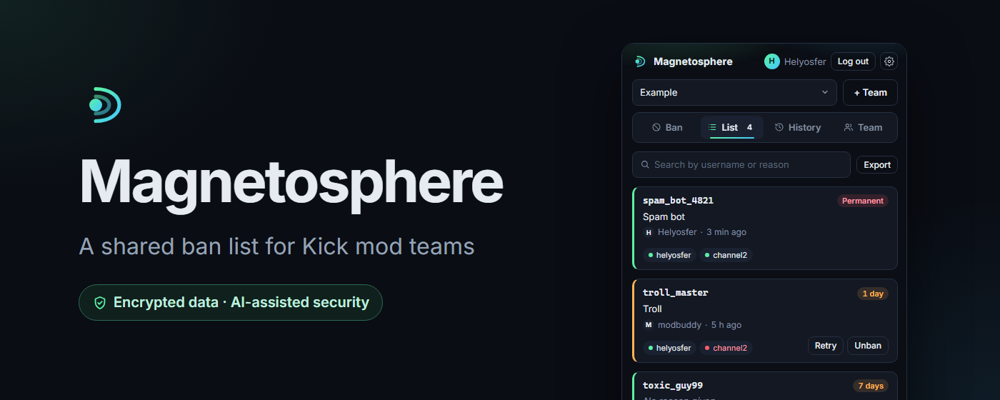
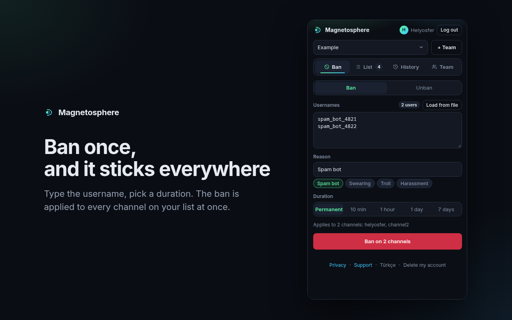
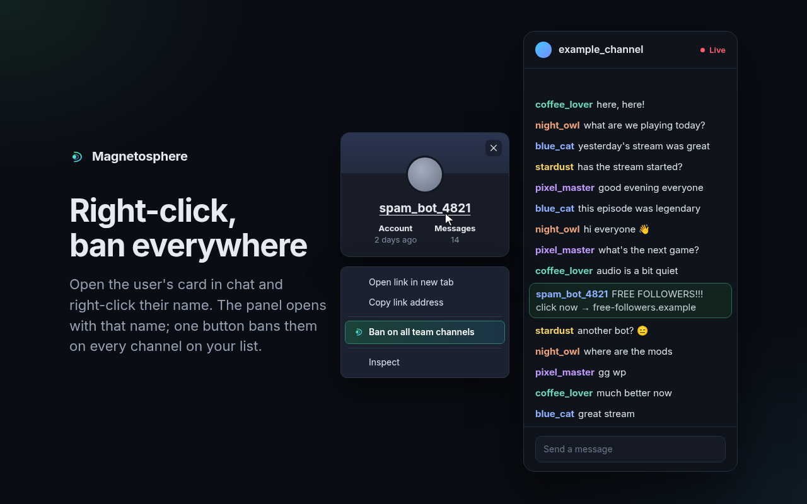
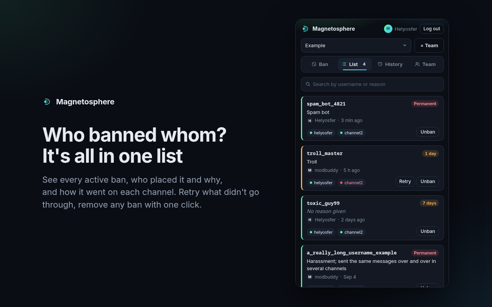
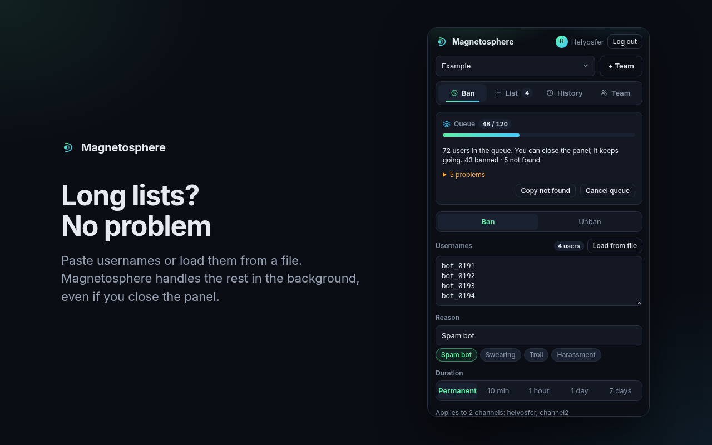
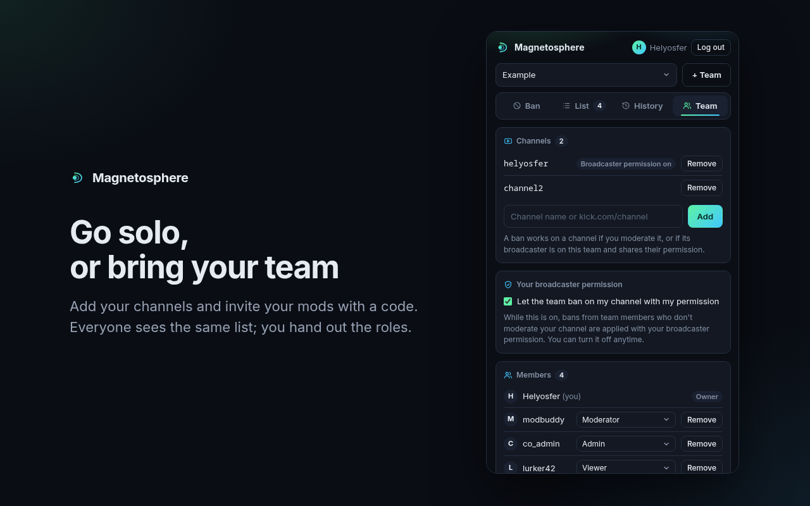
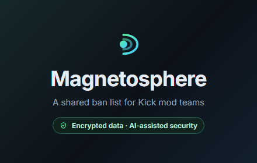

<div align="center">

<sub>[Türkçe](README.md) · [English](README.en.md) · [Español](README.es.md) · [Português (Brasil)](README.pt-BR.md) · [العربية](README.ar.md) · [Deutsch](README.de.md) · [Français](README.fr.md) · [Bahasa Indonesia](README.id.md) · [Русский](README.ru.md)</sub>



**Общий бан-лист для модераторов Kick и команд модераторов.**<br>
Забаньте пользователя сразу на всех каналах, где вы модератор.

[](https://chromewebstore.google.com/detail/magnetosphere/kjbbjooackbcfeeoolkfpmdbkomjiflh)
[](LICENSE)


[Скриншоты](#скриншоты) ·
[Возможности](#возможности) ·
[Начало работы](#начало-работы) ·
[Роли](#роли-и-права) ·
[Как это работает](#как-это-работает) ·
[Свой сервер](#установка-собственного-сервера) ·
[Безопасность](#безопасность) ·
[Разработка](#разработка)

</div>

<br>

Если вы модерируете несколько каналов, тролля или спам-бота приходится банить на каждом канале по отдельности.
Magnetosphere сводит это к одному действию: вы один раз вводите имя пользователя (или загружаете из файла
тысячи имён), и бан применяется ко всем каналам из вашего списка. Кто, кого, когда и за что забанил, тоже
записывается.

Пользоваться можно **в одиночку**: без приглашений вы добавляете каналы, где вы модератор, и баните. **В составе
команды** добавляется следующее:

- Все видят один и тот же бан-лист.
- Бан, выданный одним участником, применяется на всех каналах команды.
- Если стример из команды делегирует свои права, баны участников, которые не модераторы на его канале, действуют и там.

Название происходит от магнитного щита (магнитосферы), который защищает Землю от солнечного ветра.

> Magnetosphere — независимый проект; он не связан с Kick и не одобрен Kick.

## Скриншоты

| | |
|:-:|:-:|
|  |  |
| **Бан:** введите имена, выберите причину и срок; бан уходит сразу на все каналы. | **Правый клик:** откройте карточку пользователя в чате и кликните по имени правой кнопкой; панель откроется с этим именем. |
|  |  |
| **Список:** активные баны; кто кого и за что забанил, на каких каналах бан применён. | **Очередь:** тысячи имён обрабатываются в фоне; обработка продолжается и после закрытия панели. |
|  | |
| **Команда:** каналы, делегирование прав стримера, участники и их роли. | |

## Возможности

| | |
|---|---|
| **Бан на нескольких каналах за один раз** | Постоянный бан или таймаут на 10 минут, 1 час, 1 день либо 7 дней; применяется ко всем каналам одновременно. |
| **Выбор каналов** | Если в команде несколько каналов, при действиях **Забанить** и **Разбанить** можно выбрать каналы: **Все**, **Только мой** или отмеченные через **Выбрать…**. Выбор действует только для этой операции; после неё возвращается **Все**. Если бан снят лишь с части каналов, запись остаётся активной на тех каналах, где бан сохраняется; снятый канал на карточке отображается серым, а **Повторить** не банит там заново. Если вы не модератор канала, снятие бана там завершится ошибкой, поэтому для чистого результата выбирайте только те каналы, где у вас есть права. В длинных списках каналы фиксируются в момент постановки в очередь: канал, добавленный в команду во время обработки списка, к оставшимся именам не применяется. |
| **Массовый бан, импорт и экспорт** | Вставьте имена или загрузите файл `.txt`, `.csv`, `.json` (до 6000 имён за раз). В файлах CSV читается только первый столбец, строка заголовка пропускается. **Список > Экспорт** скачивает все постоянные баны команды в виде файла `.txt` с одним именем пользователя в строке; этот файл можно загрузить в другую команду как есть. |
| **Фоновая очередь** | Длинные списки ставятся в очередь на сервере; баны продолжают выдаваться, даже если панель или браузер закрыты. Ход выполнения, ненайденные имена и отмена управляются из панели. |
| **Соблюдение лимитов запросов Kick** | Скорость запросов подстраивается автоматически. Если Kick замедляет запросы, ни одно имя не теряется: оно возвращается в очередь. |
| **Общий список и история** | Кто, когда и за что выдал каждый бан, на каких каналах он применён; поиск по имени пользователя или причине. **Список** показывает постоянные баны и действующие таймауты, **История** — снятые баны и истёкшие таймауты; владелец и админы могут удалить историю с подтверждением. |
| **Повторить и отменить** | Повторяет бан на каналах, где он не применился; снимает бан со всех каналов одним кликом. |
| **Снятие бана по имени** | Введите имя в **Бан > Разбанить**; бан снимается со всех каналов команды. Баны, выданные вручную в Kick или до Magnetosphere и отсутствующие в списке, тоже снимаются, а факт снятия записывается в список. Списки длиннее 10 имён (их тоже можно загрузить из файла) ставятся в очередь, как и массовый бан. |
| **Быстрый доступ по правому клику** | На kick.com откройте карточку пользователя в чате, кликните правой кнопкой по имени на карточке и выберите «Забанить на всех каналах команды». Панель откроется с этим именем. |
| **В одиночку или с командой** | Каждый вошедший одним кликом создаёт свой список каналов; при желании можно позвать других по ссылке-приглашению или коду. Тот, кто откроет ссылку, ставит расширение и вступает одним кликом. |
| **Роли** | Владелец, админ, модератор и зритель. Можно выбрать, с какой роли начинают те, кто вступает по приглашению. |
| **Делегирование прав стримера** | Стример из команды может по своему желанию открыть команде свои права на бан на собственном канале; это решение принимает только он сам. |
| **Защита от ошибочных банов** | Участников команды с правом бана и стримеров из команды забанить нельзя. |
| **Управление аккаунтом и командой** | Выход из команды, передача владения, удаление команды и аккаунта; всё из панели. |
| **9 языков** | Турецкий, английский, немецкий, испанский, французский, индонезийский, португальский, русский и арабский. Панель открывается на языке браузера; если язык браузера не входит в этот список, используется английский. Язык меняется в **Настройки**, которые открываются шестерёнкой в заголовке; в арабском панель выстраивается справа налево. Сообщения об ошибках сервера и страница приглашения тоже приходят на выбранном языке. |

## Начало работы

<a href="https://chromewebstore.google.com/detail/magnetosphere/kjbbjooackbcfeeoolkfpmdbkomjiflh"></a>

1. **Установите.** Добавьте расширение [из Chrome Web Store](https://chromewebstore.google.com/detail/magnetosphere/kjbbjooackbcfeeoolkfpmdbkomjiflh).
   Работает в браузерах на основе Chromium, таких как Chrome, Edge и Brave; Firefox не поддерживается.
2. **Войдите.** Нажмите на значок Magnetosphere и выберите **Войти через Kick**. Вход выполняется на
   собственной странице Kick; расширение не видит ваш пароль.
3. **Начните.** Нажмите **Начать одному**; ваш канал автоматически добавится в список. Если вас пригласили в
   команду, вместо этого вставьте код приглашения.
4. **Добавьте каналы.** На вкладке **Команда** добавьте каналы, где вы модератор, по имени или по ссылке
   `kick.com/канал`.
5. **Баньте.** На вкладке **Бан** введите имена пользователей или выберите список через **Загрузить из файла**.
   Списки длиннее 10 имён ставятся в очередь и обрабатываются в фоне.
6. **Следите.** Вкладка **Список** показывает результат по активным банам для каждого канала; снятые баны и
   истёкшие таймауты переходят на вкладку **История**. Отсюда можно снять бан или повторить его
   на каналах, где он не применился.
7. **Снимайте старые баны.** Для бана, которого нет в списке (выданного вручную в Kick или до Magnetosphere),
   на вкладке **Бан** выберите **Разбанить** и введите имя пользователя; бан снимется со всех каналов команды.
   Длинные списки и здесь ставятся в очередь.

Чтобы создать команду, на вкладке **Команда** нажмите **Копировать ссылку-приглашение** и отправьте ссылку
своим модераторам. Открывший её ставит расширение, нажимает на странице **Вступить в команду**, видит в
панели название команды и её владельца и подтверждает вступление. Если ссылку открыть на телефоне или в
браузере, отличном от Chrome, страница предложит открыть её в Chrome на компьютере. Вместо ссылки можно
поделиться кодом. Вступившие пользуются тем же списком каналов и тем же бан-листом.

Код приглашения находится в части ссылки после символа `#`; браузер не отправляет эту часть на сервер, поэтому
код не попадает в журналы сервера или Cloudflare. Страница передаёт код расширению через Chrome
`externally_connectable`; для этого не требуется нового разрешения.

<br clear="right">

## Роли и права

| | Зритель | Модератор | Админ | Владелец |
|---|:-:|:-:|:-:|:-:|
| Просмотр и экспорт общего списка | ✓ | ✓ | ✓ | ✓ |
| Выдача банов, повтор, загрузка списков | | ✓ | ✓ | ✓ |
| Снятие собственных банов | | ✓ | ✓ | ✓ |
| Снятие по имени бана, которого нет в списке (выданного вручную в Kick) | | ✓ | ✓ | ✓ |
| Снятие бана, выданного другим | | | ✓ | ✓ |
| Добавление и удаление каналов | | | ✓ | ✓ |
| Удаление истории | | | ✓ | ✓ |
| Просмотр и обновление кода приглашения | | | ✓ | ✓ |
| Исключение участника с более низкой ролью | | | ✓ | ✓ |
| Выдача ролей, начальная роль вступающих | | | | ✓ |
| Передача владения, удаление команды | | | | ✓ |

По умолчанию вступившие по приглашению становятся модераторами; владелец может сменить это на «начинают зрителями».
Выйти из команды в любой момент может любой, кроме владельца.

Если у пользователя, имя которого введено в **Разбанить**, в списке есть активный бан, выданный другим участником,
действует правило списка: снять такой бан могут только владелец и админы.

**Очистить историю** безвозвратно удаляет снятые баны и истёкшие таймауты для всех участников команды; баны в
Kick она не затрагивает. Запись о бане, который не удалось снять на каком-то канале, не удаляется: человек
на этом канале всё ещё может быть забанен, и запись нужна, чтобы повторить снятие.

### Делегирование прав стримера

Каждый бан на каждом канале сначала пробуется **с собственными правами модератора** того, кто банит. Если
стример этого канала состоит в команде и включил делегирование в **Команда > Твои права стримера**, то, когда прав
модератора недостаточно, бан применяется с правами стримера.

- По умолчанию делегирование выключено для всех; тот, кто создал команду, тоже сам включает его для своего канала.
  (В командах, созданных до 0.15.1, делегирование создателя включено; при желании выключите его.)
- Включать и выключать его может только сам стример; вступление в команду по коду приглашения само по себе
  этих прав не даёт.
- На канале, где вы не модератор и стример не делегирует права, бан не применяется; в списке этот канал отображается красным.
- Чтобы добавить канал в команду, вы должны быть модератором Kick на этом канале, канал должен быть вашим или
  его стример должен состоять в команде (0.15.1). Чтобы добавить канал стримера, сначала пусть стример вступит в команду.

## Как это работает

```
   Расширение Chrome             Сервер                    Kick
┌──────────────────┐      ┌──────────────────┐      ┌──────────────────┐
│ Панель,          │ ───▶ │ Команды, роли    │ ───▶ │ Официальный API  │
│ которой          │      │ Общий список     │      │ (OAuth 2.1 и     │
│ пользуется       │ ◀─── │ Очередь и воркеры│ ◀─── │  модерация)      │
│ модератор        │      │                  │      │                  │
└──────────────────┘      └──────────────────┘      └──────────────────┘
```

| Компонент | Что делает |
|---|---|
| [`extension/`](extension) | Расширение Chrome (Manifest V3). Интерфейс, который видит пользователь; само не отправляет никаких запросов в Kick и не видит ни ваш пароль Kick, ни токен. |
| [`server/`](server) | Сервер на Python (3.10+). Хранит команды, роли, общий список, очередь и сессии Kick; выдаёт баны через [официальный API](https://docs.kick.com/apis/moderation) Kick. |
| [`store/`](store) | Текст и изображения для Chrome Web Store. |
| [`tools/`](tools) | Скрипт, собирающий пакет для магазина. |
| [`docs/`](docs) | Политика конфиденциальности. |

Сервер обязателен, потому что для потока OAuth Kick нужен Client Secret, а его нельзя положить внутрь расширения.
Сервер использует только стандартную библиотеку Python; единственная зависимость — пакет `cryptography`
для шифрования токенов. Данные хранятся в одном файле SQLite.

Расширение из магазина по умолчанию использует сервер `magnetosphere.helyosfer.me`; любой вошедший
может создать там команду. При желании вы можете развернуть собственный сервер по шагам ниже и подключить к нему расширение.

## Установка собственного сервера

Чтобы сначала попробовать на своём компьютере, достаточно шагов 1–3; для постоянной установки, которой будут
пользоваться все, переходите к разделу [Публикация сервера в интернете](#публикация-сервера-в-интернете).

### 1. Приложение Kick

Создайте приложение на [kick.com/settings/developer](https://kick.com/settings/developer)
(в аккаунте должна быть включена двухэтапная проверка). В названии приложения нельзя использовать пробелы.

| Поле | Значение |
|---|---|
| Redirect URL | `http://localhost:8787/auth/callback` (локальная проверка) или `https://<alan-adın>/auth/callback` |
| Scopes | Read user information, Read channel information, Execute moderation actions for moderators |

### 2. Сервер

```bash
cd server
pip install -r requirements.txt
cp .env.example .env
```

Заполните файл `.env`:

- `KICK_CLIENT_ID` и `KICK_CLIENT_SECRET`: значения, которые выдал Kick.
- `TOKEN_ENCRYPTION_KEY`: ключ, сгенерированный командой ниже.

```bash
python -c "from cryptography.fernet import Fernet; print(Fernet.generate_key().decode())"
```

Затем запустите сервер:

```bash
python app.py
```

Сервер слушает адрес `http://localhost:8787`. Если не хватает какой-либо настройки безопасности, при запуске он выводит предупреждение.
Убедиться, что он работает, можно по адресу `http://localhost:8787/health`.

### 3. Расширение

1. В Chrome откройте страницу `chrome://extensions` и включите **Режим разработчика**.
2. Через **Загрузить распакованное расширение** выберите папку `extension`.
3. Нажмите на значок Magnetosphere, в поле **Дополнительно: свой сервер** введите адрес сервера
   (для локальной проверки `http://localhost:8787`) и выберите **Войти через Kick**.

Если вы не хотите, чтобы каждый участник команды вводил адрес вручную, замените значение `DEFAULT_SERVER`
в `extension/server-url.js` на свой адрес и раздавайте папку в таком виде. Чтобы ссылки-приглашения доходили
до расширения, добавьте тот же адрес в список `externally_connectable.matches` в `manifest.json` и в список
`INVITE_ORIGINS` в `background.js`. Если не добавить, кнопка **Копировать ссылку-приглашение** в панели не появится;
код по-прежнему можно скопировать и передать. Кнопка появляется при сервере версии 0.12.0 или новее.

Идентификатор вручную загруженного расширения закреплён ключом в `manifest.json`
(`flmfmniipeobbaoahmbdkjnblbegalob`); на любом компьютере он будет одинаковым. Сервер принимает только
идентификаторы из списка `ALLOWED_EXTENSION_IDS`. У расширения, установленного из магазина, идентификатор другой
(`kjbbjooackbcfeeoolkfpmdbkomjiflh`); чтобы принимать оба, впишите оба в список.

### Публикация сервера в интернете

Для установки, которой будет пользоваться команда, сервер должен работать постоянно и находиться за HTTPS.

1. **Настройки.** В `.env` задайте `PUBLIC_URL=https://<alan-adın>` и измените Redirect
   URL в приложении Kick на `https://<alan-adın>/auth/callback`. Оставьте `HOST=127.0.0.1`: сервер не
   открывается наружу напрямую. Чтобы хранить базу данных вне каталога с кодом, задайте `DB_PATH`.
2. **Обратный прокси.** HTTPS обеспечивает обратный прокси. С [Caddy](https://caddyserver.com) сертификат
   получается автоматически:

   ```
   <alan-adın> {
   	reverse_proxy 127.0.0.1:8787
   }
   ```

   Ограничитель попыток входа определяет настоящий адрес клиента по последнему значению заголовка
   `X-Forwarded-For`. Caddy с настройками по умолчанию записывает этот заголовок правильно. nginx не
   записывает его и передаёт заголовок клиента как есть; если вы используете nginx, добавьте строку
   `proxy_set_header X-Forwarded-For $remote_addr;`. Если заголовок вообще не приходит, все клиенты
   считаются одним адресом, и ограничение на вход становится общим для всех.

   Если сервер находится за Cloudflare, обратный прокси видит не посетителя, а адрес Cloudflare, и
   ограничение на вход становится общим для всех, кто приходит с одного и того же сервера Cloudflare. Настоящий адрес
   находится в заголовке `CF-Connecting-IP`; доверять этому заголовку следует только в запросах, пришедших от Cloudflare:

   ```
   @cloudflare remote_ip <https://www.cloudflare.com/ips/ adresindeki aralıklar>
   handle @cloudflare {
   	reverse_proxy 127.0.0.1:8787 {
   		header_up X-Forwarded-For {http.request.header.CF-Connecting-IP}
   	}
   }
   handle {
   	reverse_proxy 127.0.0.1:8787
   }
   ```
3. **Служба.** Запускайте сервер как службу systemd от имени непривилегированного системного пользователя:

   ```ini
   [Service]
   User=magnetosphere
   WorkingDirectory=/opt/magnetosphere/app/server
   ExecStart=/opt/magnetosphere/venv/bin/python app.py
   Environment=PYTHONUNBUFFERED=1
   Restart=on-failure
   NoNewPrivileges=true
   ProtectSystem=strict
   ReadWritePaths=/opt/magnetosphere/data
   ```

4. **Кто может создавать команды.** По умолчанию команду может создать любой вошедший. Если вы открываете
   сервер только для своей команды, ограничьте это своим идентификатором пользователя Kick через `ALLOWED_TEAM_CREATORS`;
   остальные вступают по коду приглашения.
5. **Резервная копия.** Базу данных можно безопасно копировать во время работы:

   ```bash
   sqlite3 /opt/magnetosphere/data/crossban.db ".backup '/opt/backups/crossban-$(date +%F).db'"
   ```

   Храните копию резервной копии вне сервера (например, в облачной папке через [rclone](https://rclone.org)).
   Не кладите файл `.env` рядом с этой копией: ключ шифрования и база данных должны храниться раздельно.

При запуске сервер сам переводит старую базу данных на новую схему; перед обновлением достаточно сделать
резервную копию.

### Обновление сервера

Для установки выше (код в `/opt/magnetosphere/app`, база данных в `/opt/magnetosphere/data`):

```bash
# 1. Резервная копия
sqlite3 /opt/magnetosphere/data/crossban.db ".backup '/opt/backups/crossban-$(date +%F)-guncelleme.db'"
# 2. Код; забирается от имени владельца папки (от другого пользователя git скажет "dubious ownership" и откажет)
sudo -u "$(stat -c %U /opt/magnetosphere/app)" git -C /opt/magnetosphere/app pull
grep '^VERSION' /opt/magnetosphere/app/server/app.py   # не продолжайте, пока не увидите новую версию
/opt/magnetosphere/venv/bin/pip install -r /opt/magnetosphere/app/server/requirements.txt
# 3. Перезапуск и проверка
sudo systemctl restart magnetosphere
curl -s https://<alan-adın>/health          # {"ok": true, "version": "<новая версия>"}
journalctl -u magnetosphere -n 30 --no-pager
```

Если `/health` всё ещё показывает старую версию, либо `git pull` завершился ошибкой, либо служба работает
из другой папки; посмотрите значение `WorkingDirectory` через `systemctl cat magnetosphere`.

Если вы отдаёте страницу конфиденциальности через обратный прокси из статического файла (например,
`/var/www/magnetosphere/privacy.html`), `git pull` её не обновит; после обновления скопируйте туда
`docs/privacy.html` или настройте обратный прокси так, чтобы он отдавал папку `docs/` прямо из репозитория.

Сессии при обновлении не затрагиваются; никому не нужно входить заново. Если новая версия расширения использует новую
функцию сервера, сначала обновите сервер, потом расширение; старое расширение продолжает работать с новым сервером.
Чтобы вернуться к предыдущей версии, найдите коммит этой версии через `git log`, выполните `git checkout <commit>`
и перезапустите службу. Начиная с 0.6.0 схема базы данных не менялась; версии 0.6.x и 0.7.x работают с одной и той же
базой. Резервную копию восстанавливайте только при повреждении данных и только при остановленной службе.

### Настройки

Читаются из файла `server/.env`.

| Переменная | По умолчанию | Описание |
|---|---|---|
| `KICK_CLIENT_ID` | — | Client ID приложения Kick |
| `KICK_CLIENT_SECRET` | — | Client Secret приложения Kick |
| `TOKEN_ENCRYPTION_KEY` | пусто | Ключ, которым токены Kick шифруются в базе данных. Если пусто, токены остаются открытым текстом |
| `ALLOWED_EXTENSION_IDS` | пусто (все) | Идентификаторы расширений, которым разрешено входить и обращаться к API, через запятую |
| `ALLOWED_TEAM_CREATORS` | пусто (все) | Идентификаторы пользователей Kick, которые могут создавать команды, через запятую. Вступление по приглашению открыто в любом случае |
| `PUBLIC_URL` | `http://localhost:8787` | Адрес сервера, по которому к нему обращаются снаружи. Redirect URL в Kick должен быть `{PUBLIC_URL}/auth/callback` |
| `HOST` | `127.0.0.1` | Интерфейс, на котором сервер слушает |
| `PORT` | `8787` | Порт, на котором сервер слушает |
| `DB_PATH` | `server/crossban.db` | Путь к базе данных SQLite |
| `QUEUE_WORKERS` | `4` | Число воркеров, одновременно обрабатывающих очередь |
| `KICK_REQUESTS_PER_SECOND` | `1` | Начальная скорость запросов к API Kick; при ответе Kick 429 автоматически снижается, при отсутствии проблем растёт |
| `KICK_REQUESTS_PER_SECOND_MAX` | `5` | Верхний предел скорости запросов |

## Безопасность

### Что защищено

- **Токены Kick хранятся в зашифрованном виде.** Если задан `TOKEN_ENCRYPTION_KEY`, токены access и
  refresh в базе данных зашифрованы Fernet (AES + HMAC); если файл базы данных утечёт сам по себе, токены прочитать нельзя.
- **Сессии.** Ключ сессии хранится в базе данных только в виде хеша (SHA-256) и становится
  недействительным, если не использовался 30 дней. Выход закрывает все сессии пользователя.
- **Только это расширение.** Если задан `ALLOWED_EXTENSION_IDS`, другое расширение не может ни
  начать процесс входа, ни обращаться к API из браузера (CORS открывается только для разрешённого идентификатора).
- **Процесс входа.** OAuth выполняется с PKCE и одноразовым `state`; сессия передаётся только на
  адрес перенаправления Chrome, предназначенный для расширения.
- **Сессия передаётся только по шифрованному соединению.** Расширение не отправляет ключ сессии на адреса
  `http://`, кроме `localhost`, `127.0.0.1` и `[::1]`: оно не начинает вход, не использует сессию, если сохранённый
  адрес нешифрованный, и показывает предупреждение.
- **Текстовые поля проверяются.** Если название команды, код приглашения или причина бана не являются текстом, запрос отклоняется;
  значения вроде `null` или списка не превращаются в текст и не сохраняются.
- **Команды изолированы друг от друга.** Каналы, участников и список команды видят только
  участники этой команды.
- **Роли проверяются на сервере.** Каждое действие проходит проверку роли на сервере; скрытию кнопки в панели
  не доверяют. Ужесточение таймаута не меняет владельца и причину бана; модератор
  не может таким путём снять чужой бан.
- **Код приглашения.** Случайный, 72 бита; видят и обновляют его только владелец и админы, старый код
  сразу становится недействительным. В базе данных хранится только его хеш и (если ключ задан) зашифрованная форма. Участник, вышедший из команды,
  не может вернуться по тому же коду с ролью выше последней; исключённый участник не может вступить, пока код не обновлён.
- **Права стримера используются с согласия.** Токен стримера используется для бана, выданного другим, только
  если сам стример включил делегирование.
- **Удаление аккаунта.** Когда пользователь удаляет аккаунт, его сессии, членство и токены удаляются, доступ
  в Kick отзывается. Баны, которые он выдал в списках других команд, остаются без имени; идентификатор Kick также
  удаляется из записей. Если отзыв в Kick не удался, ответ сообщает об этом (`kick_revoked: false`).
- **Минимальные разрешения.** У Kick запрашиваются только данные пользователя, данные канала и право бана. Расширение
  использует только разрешения `identity`, `storage` и `contextMenus`; контентные скрипты ни на какие сайты не внедряются.
- **Лимиты.** Тело запроса ограничено 1 МБ, список, загружаемый за раз, — 6000 именами, число записей команды, ожидающих
  в очереди, — 20 000. С одного адреса за 10 минут можно начать не более 30 входов.
  Аккаунт может отправлять не более 300 запросов в минуту, создать не более 10 команд и состоять в 50 командах;
  в команде не более 50 каналов и 200 участников. У одного аккаунта одновременно может быть не более двух операций в Kick;
  так один аккаунт не может исчерпать общий лимит Kick и заставить остальных ждать.
- **Устойчивая обработка запросов.** Повреждённые или недосланные запросы не держат соединение (таймаут
  30 секунд); непредвиденные ошибки возвращаются клиенту как 500 без утечки подробностей.
- **Справедливая очередь.** Очередь обрабатывается между командами по кругу; длинный список одной команды не заставляет ждать остальных.

### Проверка шифрования

Тот, кто эксплуатирует сервер, может показать, что токены хранятся в зашифрованном виде, не раскрывая ни ключ, ни
какой-либо токен. [`tools/sifreleme_dogrula.py`](tools/sifreleme_dogrula.py) читает рабочую базу данных и резервные копии
только на чтение и выводит отчёт, состоящий лишь из чисел:

- задан ли ключ и является ли он допустимым ключом Fernet,
- сколько токенов зашифровано, сколько хранится открытым текстом, сколько из зашифрованных расшифровывается ключом,
- выводил ли сервер при последнем запуске предупреждение «ключ не задан»,
- есть ли в каждой резервной копии базы данных токены открытым текстом, лежит ли в папках с резервными копиями копия ключа.

```bash
sudo /opt/magnetosphere/venv/bin/python /opt/magnetosphere/app/tools/sifreleme_dogrula.py \
    --sunucu /opt/magnetosphere/app/server --yedek /opt/backups
```

Если найден токен открытым текстом или ключ недействителен, код выхода равен 1. Хеш SHA-256 в начале отчёта нужен,
чтобы проверить, что выполняемый скрипт совпадает с версией в репозитории. Отчёт — заявление того, кто эксплуатирует сервер;
это не независимое внешнее доказательство, но то, что именно измеряется, открыто для всех в этом файле.

### Обязанности владельца сервера

- `server/.env` (Client Secret, ключ шифрования) и `server/crossban.db` конфиденциальны; `.gitignore`
  исключает оба из репозитория. Не кладите ключ шифрования и базу данных в одну резервную копию.
- Открывайте сервер в интернет только за HTTPS. По умолчанию `HOST` слушает только локальную машину.
- Если ключ шифрования потерян, данные не теряются; всем лишь нужно заново войти через Kick.

### Известные ограничения

- Шифрование защищает от утечки файла базы данных; тот, кто получил контроль над всем сервером, может прочитать и ключ.
- Вступивший по коду приглашения по умолчанию становится модератором и может банить на каналах команды; делитесь кодом
  только с теми, кому доверяете, либо делайте вступающих зрителями.
- Ограничение запросов действует на уровне аккаунта и хранится в памяти; для запросов без сессии задайте отдельный лимит на обратном прокси.
- Если передача владения и выход принимающего участника из команды происходят точно одновременно, команда может остаться без владельца.
  Если удаление аккаунта и вступление нового участника в команду происходят одновременно, команда может быть удалена без предупреждения.
  Оба случая требуют очень узкого временного окна; исправление запланировано.
- Если `TOKEN_ENCRYPTION_KEY` пуст, сервер лишь выводит предупреждение и хранит токены открытым текстом. На публичном
  сервере обязательно задайте ключ.

### Независимый аудит (октябрь 2026)

Сервер и расширение были независимо проверены 15 октября 2026 года. Помимо тестов из этого репозитория использовался
отдельный набор тестов:

- **Сквозные тесты в браузере (Playwright).** Панель была открыта с настоящим сервером, подключённым к поддельному Kick. Проверялось,
  что HTML в названии команды, имени пользователя и причине бана не выполняется (XSS), что сессия закрывается, когда сервер возвращает 401, что
  нешифрованный адрес сервера отклоняется, а также доступность (axe).
- **Тесты сервера глазами атакующего.**
  - Все конечные точки команды, в которой вы не состоите: все вернули 404.
  - Попытка затронуть запись о бане другой команды через путь собственной команды.
  - Поддельные, просроченные и закрытые выходом сессии.
  - Повторное использование `state` и попытки открытого перенаправления.
  - Не входящий в список идентификатор расширения и обновлённый старый код приглашения.
  - Попытка админа сделать себя владельцем.
  - Утечка внутренних подробностей в ответах об ошибках.
- **Мутационная проверка.** Следующие защиты по очереди временно ломались; каждую поймал как минимум один тест:
  - проверка членства в команде
  - одноразовость `state`
  - проверка адреса перенаправления
  - срок действия сессии
  - права владельца
  - отсутствие вывода текста как HTML в панели
  - удаление сессии при получении 401
- **Статический анализ.** 6 предупреждений Bandit (f-строка в SQL, `urlopen`) разобраны построчно. Ни в одном случае
  пользовательский ввод не попадает ни в текст SQL, ни в схему или хост адреса запроса; значения передаются
  параметрами.
- **Найдено и исправлено в 0.5.1.** Возможность отправки ключа сессии расширением на нешифрованный (`http://`) сервер
  и преобразование нетекстовых полей в текст с последующим сохранением.

Итог: в проверенных областях других уязвимостей не найдено. Известные ограничения указаны выше.

### Сообщение об уязвимостях

Если вы нашли уязвимость, пожалуйста, не создавайте публичный issue; напишите на `destek@helyosfer.me`.
Об области действия, сроках ответа и процессе раскрытия см. [SECURITY.md](SECURITY.md).

Политика конфиденциальности: [magnetosphere.helyosfer.me/privacy](https://magnetosphere.helyosfer.me/privacy)
(исходник — [`docs/privacy.html`](docs/privacy.html)).

## Разработка

### Тесты

```bash
cd server
python -m unittest test_app
```

Тесты выполняются сквозным образом против поддельного API Kick; настоящий Kick не затрагивается. Покрываются вход, потеря
прав, очередь и параллельные воркеры, справедливая очередь между командами, роли, делегирование прав, снятие бана по имени,
удаление аккаунта, разделение Списка и Истории, сообщения об ошибках на пяти языках, повторный бан после истёкшего таймаута, переход
со старой базы данных и правила безопасности.

Полнота переводов (одинаковые тексты на каждом языке, длина краткого описания магазина) проверяется отдельно:

```bash
node tools/ceviri_kontrol.js
```

В GitHub при каждом push и PR автоматически выполняются тесты сервера (Python 3.12 и 3.14), проверка переводов и
поиск известных уязвимостей в зависимостях (`pip-audit`) (`.github/workflows/test.yml`).

### Chrome Web Store

```bash
python tools/paketle.py
```

Создаёт файл `dist/magnetosphere-<версия>.zip`. Поскольку магазин не принимает поле `key` в манифесте, скрипт
убирает его из пакета; оно остаётся в репозитории, и идентификатор вручную загруженного расширения не меняется.

Текст страницы магазина находится в [`store/aciklama.md`](store/aciklama.md). Изображения:

| Поле | Файл | Размер |
|---|---|---|
| Скриншоты | [`ekran-1-banla.png`](store/ekran-1-banla.png), [`ekran-2-liste.png`](store/ekran-2-liste.png), [`ekran-3-sira.png`](store/ekran-3-sira.png), [`ekran-4-ekip.png`](store/ekran-4-ekip.png), [`ekran-5-sagtik.png`](store/ekran-5-sagtik.png) | 1280×800 |
| Малый рекламный блок | [`tanitim-kucuk-440x280.png`](store/tanitim-kucuk-440x280.png) | 440×280 |
| Большой рекламный блок | [`tanitim-buyuk-1400x560.png`](store/tanitim-buyuk-1400x560.png) | 1400×560 |
| Значок | [`extension/icons/icon128.png`](extension/icons/icon128.png) | 128×128 |

## Дорожная карта

Рабочая версия. Проверено на настоящем Kick: вход, бан и с правами стримера, и с правами модератора,
снятие бана и массовый импорт тысяч аккаунтов на двух каналах.

- [x] Шифрование токенов в базе данных, срок действия сессий
- [x] Привязка расширения к постоянному идентификатору и его значок
- [x] Работа сервера в интернете за HTTPS в виде службы и резервное копирование базы данных
- [x] Удаление команды; справедливая очередь между командами и ограничение входа для открытого сервера
- [x] [Публикация в Chrome Web Store](https://chromewebstore.google.com/detail/magnetosphere/kjbbjooackbcfeeoolkfpmdbkomjiflh)
- [x] Использование в одиночку, роли внутри команды, явное согласие для прав стримера, выход из команды и удаление аккаунта
- [x] Лимиты на аккаунт для публичного использования
- [x] Снятие бана по имени пользователя, включая баны, выданные вручную в Kick
- [x] Разделение Списка и Истории: истёкшие таймауты и снятые баны переходят в Историю
- [x] Интерфейс на английском
- [x] Интерфейс на испанском, португальском (Бразилия) и арабском (в арабском раскладка справа налево)
- [x] Интерфейс на немецком, французском, русском и индонезийском; язык, конфиденциальность и удаление аккаунта в Настройки в заголовке
- [ ] Автоматическое выявление: прослушивание чата и помещение спам-ботов в очередь подозрительных

### Текущие ограничения

- Имя пользователя ищется по правилу Kick для адреса канала (строчные буквы, `-` вместо `_`, не более 25 символов).
- Каналы, кроме вашего собственного, добавляются вручную; официальный API не отдаёт список «каналов, где я модератор».
- Официальный API не выдаёт список существующих банов на канале; баны, выданные до Magnetosphere, в списке не видны.
  Такие баны можно снять через **Разбанить**, введя имя пользователя. Если пользователь на канале и так не забанен,
  в результате этот канал может отображаться как «не удалось снять».
- Скорость определяется лимитом запросов Kick: примерно одна секунда на аккаунт для команды из двух каналов.

## Участие в проекте

Об ошибках и предложениях сообщайте через [issue](https://github.com/Helyosfer/magnetosphere/issues).
Перед отправкой изменений убедитесь, что тесты проходят; для нового поведения добавляйте тест в
`server/test_app.py`.

## Лицензия

Copyright (C) 2026 Helyosfer

Magnetosphere — свободное программное обеспечение; вы можете использовать, изменять и распространять его на условиях
[Стандартной общественной лицензии GNU версии 3](LICENSE) (GPL-3.0). Если вы распространяете изменённые версии, вы обязаны
открыть исходный код под той же лицензией. ПО предоставляется без каких-либо гарантий.

Шрифт [Inter](https://github.com/rsms/inter), используемый в панели, поставляется вместе с расширением и
лицензирован по [SIL Open Font License 1.1](extension/fonts/LICENSE.txt).
